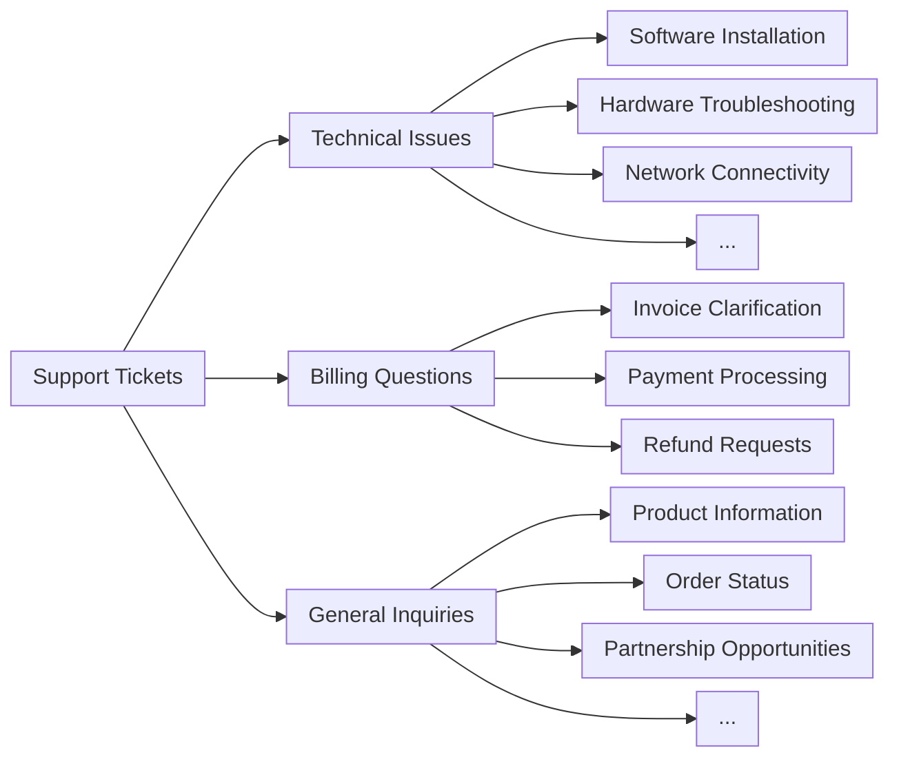

## 前提条件

* 一个 Claude API 密钥，并已安装 Anthropic SDK
* 能够访问并熟悉您现有的支持工单系统
* 一组用于测试的历史支持工单样本

## 确定是否使用 Claude 进行工单路由

以下是一些关键指标，表明您应该使用 Claude 等 “large language model”（大型语言模型），即 LLM，而不是传统的 “machine learning”（机器学习），即 ML 方法来完成分类任务：

<AccordionGroup>
  <Accordion title="您可用的已标注训练数据有限">
    传统的机器学习流程需要大量已标注的数据集。Claude 的预训练模型只需几十个已标注示例即可有效地对工单进行分类，从而显著减少数据准备的时间和成本。
  </Accordion>

  <Accordion title="您的分类类别可能会随时间变化或演进">
    一旦建立了传统的机器学习方法，对其进行更改将是一项费力且数据密集的工作。另一方面，随着您的产品或客户需求的演进，Claude 可以轻松适应类别定义的变化或新增类别，而无需对训练数据进行大量重新标注。
  </Accordion>

  <Accordion title="您需要处理复杂的非结构化文本输入">
    传统的机器学习模型通常难以处理非结构化数据，并且需要大量的特征工程。Claude 先进的语言理解能力使其能够基于内容和上下文进行准确分类，而不是依赖严格的本体结构。
  </Accordion>

  <Accordion title="您的分类规则基于语义理解">
    传统 ML 方法通常依赖词袋模型或简单的模式匹配。当类别由条件而非示例定义时，Claude 擅长应用底层规则。
  </Accordion>

  <Accordion title="您需要为分类决策提供可解释的推理">
    许多传统的机器学习模型几乎无法让人了解其决策过程。Claude 可以为其分类决策提供人类可读的解释，从而建立对自动化系统的信任，并在需要时便于调整。
  </Accordion>

  <Accordion title="您希望更有效地处理边缘情况和模糊工单">
    传统的机器学习系统通常难以处理异常值和模糊输入，经常将其错误分类或默认归入一个兜底类别。Claude 的自然语言处理能力使其能够更好地理解支持工单中的上下文和细微差别，从而有可能减少需要人工干预的错误路由或未分类工单的数量。
  </Accordion>

  <Accordion title="您需要多语言支持，而无需维护多个独立模型">
    传统的机器学习方法通常需要为每种支持的语言建立单独的模型或进行大量的翻译处理。Claude 的多语言能力使其能够对各种语言的工单进行分类，而无需单独的模型或大量的翻译处理，从而简化对全球客户群的支持。
  </Accordion>
</AccordionGroup>

***

## 构建并部署您的 LLM 支持工作流

### 了解您当前的支持方式

在实现自动化之前，了解您现有的工单系统至关重要。首先调查您的支持团队目前是如何处理工单路由的。

请考虑以下问题：

* 使用什么标准来确定适用哪种 SLA/服务方案？
* 工单路由是否用于确定工单应转给哪一级支持或哪位产品专家？
* 是否已有任何自动化规则或工作流？它们在什么情况下会失效？
* 边缘情况或模糊工单是如何处理的？
* 团队如何确定工单的优先级？

您对人工如何处理特定情况了解得越多，就越能更好地与 Claude 协作完成这项任务。

### 定义用户意图类别

一份定义明确的用户意图类别列表对于使用 Claude 准确分类支持工单至关重要。Claude 在您的系统中有效路由工单的能力，与您系统中类别定义的清晰程度直接成正比。

以下是一些用户意图类别和子类别的示例。

<AccordionGroup>
  <Accordion title="技术问题">
    * 硬件问题
    * 软件缺陷
    * 兼容性问题
    * 性能问题
  </Accordion>

  <Accordion title="账户管理">
    * 密码重置
    * 账户访问问题
    * 账单咨询
    * 订阅变更
  </Accordion>

  <Accordion title="产品信息">
    * 功能咨询
    * 产品兼容性问题
    * 价格信息
    * 供货情况咨询
  </Accordion>

  <Accordion title="用户指导">
    * 操作方法问题
    * 功能使用协助
    * 最佳实践建议
    * 故障排除指导
  </Accordion>

  <Accordion title="反馈">
    * 缺陷报告
    * 功能请求
    * 一般反馈或建议
    * 投诉
  </Accordion>

  <Accordion title="订单相关">
    * 订单状态查询
    * 物流信息
    * 退货与换货
    * 订单修改
  </Accordion>

  <Accordion title="服务请求">
    * 安装协助
    * 升级请求
    * 维护排期
    * 服务取消
  </Accordion>

  <Accordion title="安全问题">
    * 数据隐私咨询
    * 可疑活动报告
    * 安全功能协助
  </Accordion>

  <Accordion title="合规与法律">
    * 监管合规问题
    * 服务条款咨询
    * 法律文件请求
  </Accordion>

  <Accordion title="紧急支持">
    * 关键系统故障
    * 紧急安全问题
    * 时间敏感问题
  </Accordion>

  <Accordion title="培训与教育">
    * 产品培训请求
    * 文档咨询
    * 网络研讨会或工作坊信息
  </Accordion>

  <Accordion title="集成与 API">
    * 集成协助
    * API 使用问题
    * 第三方兼容性咨询
  </Accordion>
</AccordionGroup>

除了意图之外，工单路由和优先级还可能受到其他因素的影响，例如紧急程度、客户类型、SLA 或语言。在构建自动化路由系统时，请务必考虑其他路由标准。

### 建立成功标准

与您的支持团队合作，[定义明确的成功标准](https://platform.claude.com/docs/zh-CN/test-and-evaluate/develop-tests)，包括可衡量的基准、阈值和目标。

以下是使用 LLM 进行支持工单路由时的一些标准指标和基准：

<AccordionGroup>
  <Accordion title="分类一致性">
    此指标评估 Claude 随时间推移对相似工单进行分类的一致程度。这对于保持路由可靠性至关重要。可以通过定期使用一组标准化输入测试模型来衡量，目标是达到 95% 或更高的一致率。
  </Accordion>

  <Accordion title="适应速度">
    此指标衡量 Claude 适应新类别或不断变化的工单模式的速度。可以通过引入新的工单类型并测量模型在这些新类别上达到令人满意的准确率（例如超过 90%）所需的时间来进行测试。目标是在 50–100 个样本工单内完成适应。
  </Accordion>

  <Accordion title="多语言处理">
    此指标评估 Claude 准确路由多种语言工单的能力。衡量不同语言之间的路由准确率，目标是非主要语言的准确率下降不超过 5–10%。
  </Accordion>

  <Accordion title="边缘情况处理">
    此指标评估 Claude 在不寻常或复杂工单上的表现。创建一个边缘情况测试集并衡量路由准确率，目标是在这些具有挑战性的输入上至少达到 80% 的准确率。
  </Accordion>

  <Accordion title="偏见缓解">
    此指标衡量 Claude 在不同客户群体之间路由的公平性。定期审核路由决策是否存在潜在偏差，目标是在所有客户群体之间保持一致的路由准确率（差异在 2–3% 以内）。
  </Accordion>

  <Accordion title="提示效率">
    在尽量减少令牌数量至关重要的情况下，此标准评估 Claude 在上下文极少时的表现。在提供不同数量上下文的情况下衡量路由准确率，目标是仅凭工单标题和简短描述即可达到至少 90% 的准确率。
  </Accordion>

  <Accordion title="可解释性评分">
    该指标评估 Claude 对其路由决策所作解释的质量和相关性。人工评分者可以按一定量表（例如 1–5 分）对解释进行评分，目标是达到 4 分或更高的平均分。
  </Accordion>
</AccordionGroup>

以下是一些无论是否使用 LLM 都可能有用的常见成功标准：

<AccordionGroup>
  <Accordion title="路由准确率">
    路由准确率衡量工单在第一次尝试时被正确分配给相应团队或个人的频率。通常以正确路由的工单占工单总数的百分比来衡量。行业基准通常以 90–95% 的准确率为目标，但这可能因支持结构的复杂程度而异。
  </Accordion>

  <Accordion title="分配时间">
    该指标跟踪工单提交后被分配的速度。更快的分配时间通常会带来更快的解决速度和更高的客户满意度。一流的系统通常能实现平均 5 分钟以内的分配时间，许多系统的目标是近乎即时的路由（这在 LLM 实现中是可能的）。
  </Accordion>

  <Accordion title="重新路由率">
    重新路由率表示工单在初次路由后需要重新分配的频率。较低的比率表明初次路由更加准确。目标是将重新路由率控制在 10% 以下，表现最佳的系统可以达到 5% 或更低。
  </Accordion>

  <Accordion title="首次联系解决率">
    此指标衡量在与客户首次互动期间解决的工单百分比。较高的比率表明路由高效且支持团队准备充分。行业基准通常在 70% 到 75% 之间，表现最佳者可达到 80% 或更高。
  </Accordion>

  <Accordion title="平均处理时间">
    平均处理时间衡量从开始到结束解决一个工单所需的时间。高效的路由可以显著缩短这一时间。基准因行业和复杂程度差异很大，但许多组织的目标是将非关键问题的平均处理时间控制在 24 小时以内。
  </Accordion>

  <Accordion title="客户满意度评分">
    这些评分通常通过互动后调查来衡量，反映客户对支持流程的总体满意度。有效的路由有助于提高满意度。目标是达到 90% 或更高的 CSAT 评分，表现最佳者的满意度通常至少达到 95%。
  </Accordion>

  <Accordion title="升级率">
    此指标衡量工单需要升级到更高级别支持的频率。较低的升级率通常表明初次路由更加准确。力争将升级率控制在 20% 以下，一流的系统可以达到 10% 或更低。
  </Accordion>

  <Accordion title="客服人员生产力">
    此指标考察在实施路由解决方案后客服人员能够有效处理多少工单。改进后的路由应能提高生产力。可以通过跟踪每位客服人员每天或每小时解决的工单数来衡量，目标是在实施新路由系统后提高 10–20%。
  </Accordion>

  <Accordion title="自助服务分流率">
    此指标衡量在进入路由系统之前通过自助服务选项解决的潜在工单百分比。较高的比率表明路由前的分流有效。目标是达到 20–30% 的分流率，表现最佳者可达到 40% 或更高。
  </Accordion>

  <Accordion title="单工单成本">
    此指标计算解决每张支持工单的平均成本。高效的路由应有助于随时间推移降低这一成本。虽然基准差异很大，但许多组织的目标是在实施改进的路由系统后将每张工单成本降低 10–15%。
  </Accordion>
</AccordionGroup>

### 选择合适的 Claude 模型

模型的选择取决于成本、准确性和响应时间之间的权衡。

Claude Haiku 5.5（`claude-haiku-5-5`）适合工单路由：它是当前速度最快、最具成本效益的模型，在 `low` effort 下能够处理分类等简单、大批量的请求。如果您的分类问题需要深厚的专业领域知识、大量的意图类别或复杂的推理，您可以选择[更大的 Sonnet 模型](https://platform.claude.com/docs/zh-CN/models/overview)。

### 构建强大的提示

工单路由是一种分类任务。Claude 会分析支持工单的内容，并根据问题类型、紧急程度、所需专业知识或其他相关因素将其归入预定义的类别。

编写一个工单分类提示。初始提示应包含用户请求的内容，并同时返回推理过程和意图。

<Tip>
  试试 [Claude Cookbook 中的 metaprompt（元提示）配方](https://colab.research.google.com/github/anthropics/claude-cookbooks/blob/main/misc/metaprompt.ipynb)，让 Claude 为您编写初稿。
</Tip>

以下是一个工单路由分类提示示例：

<CodeGroup exclude="shell">
  <CodeGroupItem language="cURL">
    在代码中构建提示。
  </CodeGroupItem>

  <CodeGroupItem language="CLI">
    在代码中构建提示。
  </CodeGroupItem>

  ```python Python
  def classify_support_request(ticket_contents):
      # 定义分类任务的提示
      classification_prompt = f"""You will be acting as a customer support ticket classification system. Your task is to analyze customer support requests and output the appropriate classification intent for each request, along with your reasoning.

          Here is the customer support request you need to classify:

          <request>{ticket_contents}</request>

          Please carefully analyze the above request to determine the customer's core intent and needs. Consider what the customer is asking for has concerns about.

          First, write out your reasoning and analysis of how to classify this request inside <reasoning> tags.

          Then, output the appropriate classification label for the request inside a <intent> tag. The valid intents are:
          <intents>
          <intent>Support, Feedback, Complaint</intent>
          <intent>Order Tracking</intent>
          <intent>Refund/Exchange</intent>
          </intents>

          A request may have ONLY ONE applicable intent. Only include the intent that is most applicable to the request.

          As an example, consider the following request:
          <request>Hello! I had high-speed fiber internet installed on Saturday and my installer, Kevin, was absolutely fantastic! Where can I send my positive review? Thanks for your help!</request>

          Here is an example of how your output should be formatted (for the above example request):
          <reasoning>The user seeks information in order to leave positive feedback.</reasoning>
          <intent>Support, Feedback, Complaint</intent>

          Here are a few more examples:
          <examples>
          <example 2>
          Example 2 Input:
          <request>I wanted to write and personally thank you for the compassion you showed towards my family during my father's funeral this past weekend. Your staff was so considerate and helpful throughout this whole process; it really took a load off our shoulders. The visitation brochures were beautiful. We'll never forget the kindness you showed us and we are so appreciative of how smoothly the proceedings went. Thank you, again, Amarantha Hill on behalf of the Hill Family.</request>

          Example 2 Output:
          <reasoning>User leaves a positive review of their experience.</reasoning>
          <intent>Support, Feedback, Complaint</intent>
          </example 2>
          <example 3>

          […]

          </example 8>
          <example 9>
          Example 9 Input:
          <request>Your website keeps sending ad-popups that block the entire screen. It took me twenty minutes just to finally find the phone number to call and complain. How can I possibly access my account information with all of these popups? Can you access my account for me, since your website is broken? I need to know what the address is on file.</request>

          Example 9 Output:
          <reasoning>The user requests help accessing their web account information.</reasoning>
          <intent>Support, Feedback, Complaint</intent>
          </example 9>

          Remember to always include your classification reasoning before your actual intent output. The reasoning should be enclosed in <reasoning> tags and the intent in <intent> tags. Return only the reasoning and the intent.
          """
  ```

  ```typescript TypeScript
  function classifySupportRequest(ticketContents: string) {
    // 定义分类任务的提示
    const classificationPrompt = `You will be acting as a customer support ticket classification system. Your task is to analyze customer support requests and output the appropriate classification intent for each request, along with your reasoning.

      Here is the customer support request you need to classify:

      <request>${ticketContents}</request>

      Please carefully analyze the above request to determine the customer's core intent and needs. Consider what the customer is asking for has concerns about.

      First, write out your reasoning and analysis of how to classify this request inside <reasoning> tags.

      Then, output the appropriate classification label for the request inside a <intent> tag. The valid intents are:
      <intents>
      <intent>Support, Feedback, Complaint</intent>
      <intent>Order Tracking</intent>
      <intent>Refund/Exchange</intent>
      </intents>

      A request may have ONLY ONE applicable intent. Only include the intent that is most applicable to the request.

      As an example, consider the following request:
      <request>Hello! I had high-speed fiber internet installed on Saturday and my installer, Kevin, was absolutely fantastic! Where can I send my positive review? Thanks for your help!</request>

      Here is an example of how your output should be formatted (for the above example request):
      <reasoning>The user seeks information in order to leave positive feedback.</reasoning>
      <intent>Support, Feedback, Complaint</intent>

      Here are a few more examples:
      <examples>
      <example 2>
      Example 2 Input:
      <request>I wanted to write and personally thank you for the compassion you showed towards my family during my father's funeral this past weekend. Your staff was so considerate and helpful throughout this whole process; it really took a load off our shoulders. The visitation brochures were beautiful. We'll never forget the kindness you showed us and we are so appreciative of how smoothly the proceedings went. Thank you, again, Amarantha Hill on behalf of the Hill Family.</request>

      Example 2 Output:
      <reasoning>User leaves a positive review of their experience.</reasoning>
      <intent>Support, Feedback, Complaint</intent>
      </example 2>
      <example 3>

      […]

      </example 8>
      <example 9>
      Example 9 Input:
      <request>Your website keeps sending ad-popups that block the entire screen. It took me twenty minutes just to finally find the phone number to call and complain. How can I possibly access my account information with all of these popups? Can you access my account for me, since your website is broken? I need to know what the address is on file.</request>

      Example 9 Output:
      <reasoning>The user requests help accessing their web account information.</reasoning>
      <intent>Support, Feedback, Complaint</intent>
      </example 9>

      Remember to always include your classification reasoning before your actual intent output. The reasoning should be enclosed in <reasoning> tags and the intent in <intent> tags. Return only the reasoning and the intent.
      `;
  }
  ```

  ```csharp C#
  void ClassifySupportRequest(string ticketContents)
  {
      // 定义分类任务的提示
      var classificationPrompt = $"""
          You will be acting as a customer support ticket classification system. Your task is to analyze customer support requests and output the appropriate classification intent for each request, along with your reasoning.

          Here is the customer support request you need to classify:

          <request>{ticketContents}</request>

          Please carefully analyze the above request to determine the customer's core intent and needs. Consider what the customer is asking for has concerns about.

          First, write out your reasoning and analysis of how to classify this request inside <reasoning> tags.

          Then, output the appropriate classification label for the request inside a <intent> tag. The valid intents are:
          <intents>
          <intent>Support, Feedback, Complaint</intent>
          <intent>Order Tracking</intent>
          <intent>Refund/Exchange</intent>
          </intents>

          A request may have ONLY ONE applicable intent. Only include the intent that is most applicable to the request.

          As an example, consider the following request:
          <request>Hello! I had high-speed fiber internet installed on Saturday and my installer, Kevin, was absolutely fantastic! Where can I send my positive review? Thanks for your help!</request>

          Here is an example of how your output should be formatted (for the above example request):
          <reasoning>The user seeks information in order to leave positive feedback.</reasoning>
          <intent>Support, Feedback, Complaint</intent>

          Here are a few more examples:
          <examples>
          <example 2>
          Example 2 Input:
          <request>I wanted to write and personally thank you for the compassion you showed towards my family during my father's funeral this past weekend. Your staff was so considerate and helpful throughout this whole process; it really took a load off our shoulders. The visitation brochures were beautiful. We'll never forget the kindness you showed us and we are so appreciative of how smoothly the proceedings went. Thank you, again, Amarantha Hill on behalf of the Hill Family.</request>

          Example 2 Output:
          <reasoning>User leaves a positive review of their experience.</reasoning>
          <intent>Support, Feedback, Complaint</intent>
          </example 2>
          <example 3>

          […]

          </example 8>
          <example 9>
          Example 9 Input:
          <request>Your website keeps sending ad-popups that block the entire screen. It took me twenty minutes just to finally find the phone number to call and complain. How can I possibly access my account information with all of these popups? Can you access my account for me, since your website is broken? I need to know what the address is on file.</request>

          Example 9 Output:
          <reasoning>The user requests help accessing their web account information.</reasoning>
          <intent>Support, Feedback, Complaint</intent>
          </example 9>

          Remember to always include your classification reasoning before your actual intent output. The reasoning should be enclosed in <reasoning> tags and the intent in <intent> tags. Return only the reasoning and the intent.
          """;
  }
  ```

  ```go Go
  func classifySupportRequest(ticketContents string) {
  	// 定义分类任务的提示
  	classificationPrompt := `You will be acting as a customer support ticket classification system. Your task is to analyze customer support requests and output the appropriate classification intent for each request, along with your reasoning.

  		Here is the customer support request you need to classify:

  		<request>` + ticketContents + `</request>

  		Please carefully analyze the above request to determine the customer's core intent and needs. Consider what the customer is asking for has concerns about.

  		First, write out your reasoning and analysis of how to classify this request inside <reasoning> tags.

  		Then, output the appropriate classification label for the request inside a <intent> tag. The valid intents are:
  		<intents>
  		<intent>Support, Feedback, Complaint</intent>
  		<intent>Order Tracking</intent>
  		<intent>Refund/Exchange</intent>
  		</intents>

  		A request may have ONLY ONE applicable intent. Only include the intent that is most applicable to the request.

  		As an example, consider the following request:
  		<request>Hello! I had high-speed fiber internet installed on Saturday and my installer, Kevin, was absolutely fantastic! Where can I send my positive review? Thanks for your help!</request>

  		Here is an example of how your output should be formatted (for the above example request):
  		<reasoning>The user seeks information in order to leave positive feedback.</reasoning>
  		<intent>Support, Feedback, Complaint</intent>

  		Here are a few more examples:
  		<examples>
  		<example 2>
  		Example 2 Input:
  		<request>I wanted to write and personally thank you for the compassion you showed towards my family during my father's funeral this past weekend. Your staff was so considerate and helpful throughout this whole process; it really took a load off our shoulders. The visitation brochures were beautiful. We'll never forget the kindness you showed us and we are so appreciative of how smoothly the proceedings went. Thank you, again, Amarantha Hill on behalf of the Hill Family.</request>

  		Example 2 Output:
  		<reasoning>User leaves a positive review of their experience.</reasoning>
  		<intent>Support, Feedback, Complaint</intent>
  		</example 2>
  		<example 3>

  		[…]

  		</example 8>
  		<example 9>
  		Example 9 Input:
  		<request>Your website keeps sending ad-popups that block the entire screen. It took me twenty minutes just to finally find the phone number to call and complain. How can I possibly access my account information with all of these popups? Can you access my account for me, since your website is broken? I need to know what the address is on file.</request>

  		Example 9 Output:
  		<reasoning>The user requests help accessing their web account information.</reasoning>
  		<intent>Support, Feedback, Complaint</intent>
  		</example 9>

  		Remember to always include your classification reasoning before your actual intent output. The reasoning should be enclosed in <reasoning> tags and the intent in <intent> tags. Return only the reasoning and the intent.
  		`
  // ...
  }
  ```

  ```java Java
  void classifySupportRequest(String ticketContents) {
      // 定义分类任务的提示
      String classificationPrompt = """
          You will be acting as a customer support ticket classification system. Your task is to analyze customer support requests and output the appropriate classification intent for each request, along with your reasoning.

          Here is the customer support request you need to classify:

          <request>%s</request>

          Please carefully analyze the above request to determine the customer's core intent and needs. Consider what the customer is asking for has concerns about.

          First, write out your reasoning and analysis of how to classify this request inside <reasoning> tags.

          Then, output the appropriate classification label for the request inside a <intent> tag. The valid intents are:
          <intents>
          <intent>Support, Feedback, Complaint</intent>
          <intent>Order Tracking</intent>
          <intent>Refund/Exchange</intent>
          </intents>

          A request may have ONLY ONE applicable intent. Only include the intent that is most applicable to the request.

          As an example, consider the following request:
          <request>Hello! I had high-speed fiber internet installed on Saturday and my installer, Kevin, was absolutely fantastic! Where can I send my positive review? Thanks for your help!</request>

          Here is an example of how your output should be formatted (for the above example request):
          <reasoning>The user seeks information in order to leave positive feedback.</reasoning>
          <intent>Support, Feedback, Complaint</intent>

          Here are a few more examples:
          <examples>
          <example 2>
          Example 2 Input:
          <request>I wanted to write and personally thank you for the compassion you showed towards my family during my father's funeral this past weekend. Your staff was so considerate and helpful throughout this whole process; it really took a load off our shoulders. The visitation brochures were beautiful. We'll never forget the kindness you showed us and we are so appreciative of how smoothly the proceedings went. Thank you, again, Amarantha Hill on behalf of the Hill Family.</request>

          Example 2 Output:
          <reasoning>User leaves a positive review of their experience.</reasoning>
          <intent>Support, Feedback, Complaint</intent>
          </example 2>
          <example 3>

          […]

          </example 8>
          <example 9>
          Example 9 Input:
          <request>Your website keeps sending ad-popups that block the entire screen. It took me twenty minutes just to finally find the phone number to call and complain. How can I possibly access my account information with all of these popups? Can you access my account for me, since your website is broken? I need to know what the address is on file.</request>

          Example 9 Output:
          <reasoning>The user requests help accessing their web account information.</reasoning>
          <intent>Support, Feedback, Complaint</intent>
          </example 9>

          Remember to always include your classification reasoning before your actual intent output. The reasoning should be enclosed in <reasoning> tags and the intent in <intent> tags. Return only the reasoning and the intent.
          """.formatted(ticketContents);
  }
  ```

  ```php PHP
  function classifySupportRequest(string $ticketContents): void
  {
      // 定义分类任务的提示
      $classificationPrompt = <<<PROMPT
          You will be acting as a customer support ticket classification system. Your task is to analyze customer support requests and output the appropriate classification intent for each request, along with your reasoning.

          Here is the customer support request you need to classify:

          <request>{$ticketContents}</request>

          Please carefully analyze the above request to determine the customer's core intent and needs. Consider what the customer is asking for has concerns about.

          First, write out your reasoning and analysis of how to classify this request inside <reasoning> tags.

          Then, output the appropriate classification label for the request inside a <intent> tag. The valid intents are:
          <intents>
          <intent>Support, Feedback, Complaint</intent>
          <intent>Order Tracking</intent>
          <intent>Refund/Exchange</intent>
          </intents>

          A request may have ONLY ONE applicable intent. Only include the intent that is most applicable to the request.

          As an example, consider the following request:
          <request>Hello! I had high-speed fiber internet installed on Saturday and my installer, Kevin, was absolutely fantastic! Where can I send my positive review? Thanks for your help!</request>

          Here is an example of how your output should be formatted (for the above example request):
          <reasoning>The user seeks information in order to leave positive feedback.</reasoning>
          <intent>Support, Feedback, Complaint</intent>

          Here are a few more examples:
          <examples>
          <example 2>
          Example 2 Input:
          <request>I wanted to write and personally thank you for the compassion you showed towards my family during my father's funeral this past weekend. Your staff was so considerate and helpful throughout this whole process; it really took a load off our shoulders. The visitation brochures were beautiful. We'll never forget the kindness you showed us and we are so appreciative of how smoothly the proceedings went. Thank you, again, Amarantha Hill on behalf of the Hill Family.</request>

          Example 2 Output:
          <reasoning>User leaves a positive review of their experience.</reasoning>
          <intent>Support, Feedback, Complaint</intent>
          </example 2>
          <example 3>

          […]

          </example 8>
          <example 9>
          Example 9 Input:
          <request>Your website keeps sending ad-popups that block the entire screen. It took me twenty minutes just to finally find the phone number to call and complain. How can I possibly access my account information with all of these popups? Can you access my account for me, since your website is broken? I need to know what the address is on file.</request>

          Example 9 Output:
          <reasoning>The user requests help accessing their web account information.</reasoning>
          <intent>Support, Feedback, Complaint</intent>
          </example 9>

          Remember to always include your classification reasoning before your actual intent output. The reasoning should be enclosed in <reasoning> tags and the intent in <intent> tags. Return only the reasoning and the intent.
          PROMPT;
  }
  ```

  ```ruby Ruby
  def classify_support_request(ticket_contents)
    # 定义分类任务的提示
    classification_prompt = <<~PROMPT
      You will be acting as a customer support ticket classification system. Your task is to analyze customer support requests and output the appropriate classification intent for each request, along with your reasoning.

      Here is the customer support request you need to classify:

      <request>#{ticket_contents}</request>

      Please carefully analyze the above request to determine the customer's core intent and needs. Consider what the customer is asking for has concerns about.

      First, write out your reasoning and analysis of how to classify this request inside <reasoning> tags.

      Then, output the appropriate classification label for the request inside a <intent> tag. The valid intents are:
      <intents>
      <intent>Support, Feedback, Complaint</intent>
      <intent>Order Tracking</intent>
      <intent>Refund/Exchange</intent>
      </intents>

      A request may have ONLY ONE applicable intent. Only include the intent that is most applicable to the request.

      As an example, consider the following request:
      <request>Hello! I had high-speed fiber internet installed on Saturday and my installer, Kevin, was absolutely fantastic! Where can I send my positive review? Thanks for your help!</request>

      Here is an example of how your output should be formatted (for the above example request):
      <reasoning>The user seeks information in order to leave positive feedback.</reasoning>
      <intent>Support, Feedback, Complaint</intent>

      Here are a few more examples:
      <examples>
      <example 2>
      Example 2 Input:
      <request>I wanted to write and personally thank you for the compassion you showed towards my family during my father's funeral this past weekend. Your staff was so considerate and helpful throughout this whole process; it really took a load off our shoulders. The visitation brochures were beautiful. We'll never forget the kindness you showed us and we are so appreciative of how smoothly the proceedings went. Thank you, again, Amarantha Hill on behalf of the Hill Family.</request>

      Example 2 Output:
      <reasoning>User leaves a positive review of their experience.</reasoning>
      <intent>Support, Feedback, Complaint</intent>
      </example 2>
      <example 3>

      […]

      </example 8>
      <example 9>
      Example 9 Input:
      <request>Your website keeps sending ad-popups that block the entire screen. It took me twenty minutes just to finally find the phone number to call and complain. How can I possibly access my account information with all of these popups? Can you access my account for me, since your website is broken? I need to know what the address is on file.</request>

      Example 9 Output:
      <reasoning>The user requests help accessing their web account information.</reasoning>
      <intent>Support, Feedback, Complaint</intent>
      </example 9>

      Remember to always include your classification reasoning before your actual intent output. The reasoning should be enclosed in <reasoning> tags and the intent in <intent> tags. Return only the reasoning and the intent.
    PROMPT
  end
  ```
</CodeGroup>

<Note>
  此提示是为在此以 `low` effort 运行的 Claude Haiku 5.5 编写的。在 Claude Fable 5.2、Claude Fable 5.1、Claude Fable 5、Claude Opus 5.5、Claude Opus 5 和 Claude Sonnet 5.5 上，请改为要求模型输出意图以及对请求的一句话摘要。请参阅[将推理保留在思考块中](https://platform.claude.com/docs/zh-CN/build-with-claude/refusals-and-fallback#keep-reasoning-in-thinking-blocks)。
</Note>

以下是此提示的关键组成部分：

* 提示模板将 `ticket_contents` (typescript, csharp, go, java: `ticketContents`; php: `$ticketContents`) 插入到 `<request>` 标签中。
* 提示为 Claude 赋予了一个明确定义的角色，即一个仔细分析工单内容以确定客户核心意图和需求的分类系统。
* 提示指导 Claude 使用正确的输出格式，在本例中是在 `<reasoning>` 标签内提供其推理和分析，然后在 `<intent>` 标签内给出相应的分类标签。
* 提示指定了有效的意图类别：`Support, Feedback, Complaint`、`Order Tracking` 和 `Refund/Exchange`。
* 提示包含了一些示例（即 “few-shot prompting”，少样本提示）来说明输出应如何格式化，从而提高准确性和一致性。

让 Claude 将其响应拆分为单独的 XML 标签部分，可以让您使用正则表达式从输出中分别提取推理和意图。这使您能够在工单路由工作流中创建有针对性的后续步骤，例如仅使用意图来决定将工单路由给哪个人。

### 部署您的提示

如果不在测试生产环境中部署提示并[运行评估](https://platform.claude.com/docs/zh-CN/test-and-evaluate/develop-tests)，就很难知道提示的效果如何。

构建部署结构。首先定义用于封装 Claude 调用的函数签名。扩展您之前开始编写的函数，该函数以 `ticket_contents` (typescript, csharp, go, java: `ticketContents`; php: `$ticketContents`) 作为输入，使其现在返回推理和意图作为输出。如果您已有使用传统 ML 的自动化系统，则应改为遵循该系统的签名。

<CodeGroup exclude="shell">
  <CodeGroupItem language="cURL">
    此工作流需要的逻辑超出了单个 shell 命令所能实现的范围。请使用 Anthropic SDK 运行它。
  </CodeGroupItem>

  <CodeGroupItem language="CLI">
    此工作流需要的逻辑超出了单个 shell 命令所能实现的范围。请使用 Anthropic SDK 运行它。
  </CodeGroupItem>

  ```python Python
  import re

  # 创建 Claude API 客户端实例
  client = anthropic.Anthropic()

  # 设置默认模型
  DEFAULT_MODEL = "claude-haiku-5-5"


  def classify_support_request(ticket_contents):
      # 定义分类任务的提示
      classification_prompt = f"""You will be acting as a customer support ticket classification system.
          […]
          ... The reasoning should be enclosed in <reasoning> tags and the intent in <intent> tags. Return only the reasoning and the intent.
          """
      # 将提示发送到 API，对支持请求进行分类。
      message = client.messages.create(
          model=DEFAULT_MODEL,
          max_tokens=2048,
          output_config={"effort": "low"},
          messages=[{"role": "user", "content": classification_prompt}],
          stream=False,
      )
      reasoning_and_intent = next(
          (block.text for block in message.content if block.type == "text"), ""
      )

      # 使用 Python 的正则表达式库提取 `reasoning`。
      reasoning_match = re.search(
          r"<reasoning>(.*?)</reasoning>", reasoning_and_intent, re.DOTALL
      )
      reasoning = reasoning_match.group(1).strip() if reasoning_match else ""

      # 同样，也提取 `intent`。
      intent_match = re.search(r"<intent>(.*?)</intent>", reasoning_and_intent, re.DOTALL)
      intent = intent_match.group(1).strip() if intent_match else ""

      return reasoning, intent
  ```

  ```typescript TypeScript
  // 创建 Claude API 客户端实例
  const client = new Anthropic();

  // 设置默认模型
  const DEFAULT_MODEL = "claude-haiku-5-5";

  async function classifySupportRequest(
    ticketContents: string
  ): Promise<{ reasoning: string; intent: string }> {
    // 定义分类任务的提示
    const classificationPrompt = `You will be acting as a customer support ticket classification system.
      […]
      ... The reasoning should be enclosed in <reasoning> tags and the intent in <intent> tags. Return only the reasoning and the intent.
      `;
    // 将提示发送到 API 以对支持请求进行分类。
    const message = await client.messages.create({
      model: DEFAULT_MODEL,
      max_tokens: 2048,
      output_config: { effort: "low" },
      messages: [{ role: "user", content: classificationPrompt }]
    });
    const textBlock = message.content.find((block) => block.type === "text");
    const reasoningAndIntent = textBlock?.text ?? "";

    // 使用正则表达式提取 `reasoning`。
    const reasoningMatch = /<reasoning>(.*?)<\/reasoning>/s.exec(reasoningAndIntent);
    const reasoning = reasoningMatch?.[1].trim() ?? "";

    // 同样，也提取 `intent`。
    const intentMatch = /<intent>(.*?)<\/intent>/s.exec(reasoningAndIntent);
    const intent = intentMatch?.[1].trim() ?? "";

    return { reasoning, intent };
  }
  ```

  ```csharp C#
  using System.Text.RegularExpressions;
  // ...

  // 创建 Claude API 客户端实例
  AnthropicClient client = new();

  // 设置默认模型
  const Model DefaultModel = Model.ClaudeHaiku5_5;

  async Task<(string Reasoning, string Intent)> ClassifySupportRequest(string ticketContents)
  {
      // 定义分类任务的提示
      var classificationPrompt = """
          You will be acting as a customer support ticket classification system.
          […]
          ... The reasoning should be enclosed in <reasoning> tags and the intent in <intent> tags. Return only the reasoning and the intent.
          """;
      // 将提示发送到 API 以对支持请求进行分类。
      var message = await client.Messages.Create(new MessageCreateParams
      {
          Model = DefaultModel,
          MaxTokens = 2048,
          OutputConfig = new OutputConfig { Effort = Effort.Low },
          Messages = [new UserMessageParam { Content = classificationPrompt }],
      });
      var reasoningAndIntent = "";
      foreach (var block in message.Content)
      {
          if (block.TryPickText(out var textBlock))
          {
              reasoningAndIntent = textBlock.Text;
              break;
          }
      }

      // 使用正则表达式提取 `reasoning`。
      var reasoningMatch = Regex.Match(reasoningAndIntent, "<reasoning>(.*?)</reasoning>", RegexOptions.Singleline);
      var reasoning = reasoningMatch.Success ? reasoningMatch.Groups[1].Value.Trim() : "";

      // 同样，也提取 `intent`。
      var intentMatch = Regex.Match(reasoningAndIntent, "<intent>(.*?)</intent>", RegexOptions.Singleline);
      var intent = intentMatch.Success ? intentMatch.Groups[1].Value.Trim() : "";

      return (reasoning, intent);
  }
  ```

  ```go Go
  import (
  	"context"
  	"regexp"
  	"strings"
  // ...
  )

  // 创建 Claude API 客户端实例
  var client = anthropic.NewClient()

  // 设置默认模型
  const defaultModel = anthropic.ModelClaudeHaiku5_5

  func classifySupportRequest(ctx context.Context, ticketContents string) (reasoning, intent string, err error) {
  	// 定义分类任务的提示
  	classificationPrompt := `You will be acting as a customer support ticket classification system.
  		[…]
  		... The reasoning should be enclosed in <reasoning> tags and the intent in <intent> tags. Return only the reasoning and the intent.
  		`
  	// 将提示发送到 API 以对支持请求进行分类。
  	message, err := client.Messages.New(ctx, anthropic.MessageNewParams{
  		Model:        defaultModel,
  		MaxTokens:    2048,
  		OutputConfig: anthropic.OutputConfigParam{Effort: anthropic.OutputConfigEffortLow},
  		Messages: []anthropic.MessageParam{
  			anthropic.NewUserMessage(anthropic.NewTextBlock(classificationPrompt)),
  		},
  	})
  	if err != nil {
  		return "", "", err
  	}
  	var reasoningAndIntent string
  	for _, block := range message.Content {
  		if textBlock, ok := block.AsAny().(anthropic.TextBlock); ok {
  			reasoningAndIntent = textBlock.Text
  			break
  		}
  	}

  	// 使用正则表达式提取 `reasoning`。
  	reasoningMatch := regexp.MustCompile(`(?s)<reasoning>(.*?)</reasoning>`).FindStringSubmatch(reasoningAndIntent)
  	if reasoningMatch != nil {
  		reasoning = strings.TrimSpace(reasoningMatch[1])
  	}

  	// 同样，也提取 `intent`。
  	intentMatch := regexp.MustCompile(`(?s)<intent>(.*?)</intent>`).FindStringSubmatch(reasoningAndIntent)
  	if intentMatch != nil {
  		intent = strings.TrimSpace(intentMatch[1])
  	}

  	return reasoning, intent, nil
  }
  ```

  ```java Java
  import java.util.regex.Matcher;
  import java.util.regex.Pattern;

  // 创建 Claude API 客户端实例
  final AnthropicClient client = AnthropicOkHttpClient.fromEnv();

  // 设置默认模型
  static final Model DEFAULT_MODEL = Model.CLAUDE_HAIKU_5_5;

  record Classification(String reasoning, String intent) {}

  Classification classifySupportRequest(String ticketContents) {
      // 定义分类任务的提示
      String classificationPrompt = """
          You will be acting as a customer support ticket classification system.
          […]
          ... The reasoning should be enclosed in <reasoning> tags and the intent in <intent> tags. Return only the reasoning and the intent.
          """;
      // 将提示发送到 API 以对支持请求进行分类。
      Message message = client.messages().create(MessageCreateParams.builder()
          .model(DEFAULT_MODEL)
          .maxTokens(2048L)
          .outputConfig(OutputConfig.builder()
              .effort(OutputConfig.Effort.LOW)
              .build())
          .addUserMessage(classificationPrompt)
          .build());
      String reasoningAndIntent = message.content().stream()
          .flatMap(block -> block.text().stream())
          .map(textBlock -> textBlock.text())
          .findFirst()
          .orElse("");

      // 使用正则表达式提取 `reasoning`。
      Matcher reasoningMatch = Pattern.compile("<reasoning>(.*?)</reasoning>", Pattern.DOTALL)
          .matcher(reasoningAndIntent);
      String reasoning = reasoningMatch.find() ? reasoningMatch.group(1).strip() : "";

      // 同样，也提取 `intent`。
      Matcher intentMatch = Pattern.compile("<intent>(.*?)</intent>", Pattern.DOTALL)
          .matcher(reasoningAndIntent);
      String intent = intentMatch.find() ? intentMatch.group(1).strip() : "";

      return new Classification(reasoning, intent);
  }
  ```

  ```php PHP
  // 创建 Claude API 客户端实例
  $client = new Client();

  // 设置默认模型
  const DEFAULT_MODEL = Model::CLAUDE_HAIKU_5_5;

  /**
   * @return array{string, string} the reasoning and the intent
   */
  function classifySupportRequest(Client $client, string $ticketContents): array
  {
      // 定义分类任务的提示
      $classificationPrompt = <<<PROMPT
          You will be acting as a customer support ticket classification system.
          […]
          ... The reasoning should be enclosed in <reasoning> tags and the intent in <intent> tags. Return only the reasoning and the intent.
          PROMPT;
      // 将提示发送到 API，对支持请求进行分类。
      $message = $client->messages->create(
          model: DEFAULT_MODEL,
          maxTokens: 2048,
          outputConfig: ['effort' => 'low'],
          messages: [['role' => 'user', 'content' => $classificationPrompt]],
      );
      $reasoningAndIntent = '';
      foreach ($message->content as $block) {
          if ($block instanceof \Anthropic\Messages\TextBlock) {
              $reasoningAndIntent = $block->text;
              break;
          }
      }

      // 使用正则表达式提取 `reasoning`。
      $reasoning = preg_match('/<reasoning>(.*?)<\/reasoning>/s', $reasoningAndIntent, $reasoningMatch)
          ? trim($reasoningMatch[1])
          : '';

      // 同样，也提取 `intent`。
      $intent = preg_match('/<intent>(.*?)<\/intent>/s', $reasoningAndIntent, $intentMatch)
          ? trim($intentMatch[1])
          : '';

      return [$reasoning, $intent];
  }
  ```

  ```ruby Ruby
  # 创建 Claude API 客户端实例
  client = Anthropic::Client.new

  # 设置默认模型
  DEFAULT_MODEL = Anthropic::Model::CLAUDE_HAIKU_5_5

  def classify_support_request(client, ticket_contents)
    # 定义分类任务的提示
    classification_prompt = <<~PROMPT
      You will be acting as a customer support ticket classification system.
      […]
      ... The reasoning should be enclosed in <reasoning> tags and the intent in <intent> tags. Return only the reasoning and the intent.
    PROMPT
    # 将提示发送到 API，对支持请求进行分类。
    message = client.messages.create(
      model: DEFAULT_MODEL,
      max_tokens: 2048,
      output_config: { effort: "low" },
      messages: [{ role: "user", content: classification_prompt }]
    )
    reasoning_and_intent = message.content.grep(Anthropic::Models::TextBlock).first&.text || ""

    # 使用正则表达式提取 `reasoning`。
    reasoning = reasoning_and_intent[%r{<reasoning>(.*?)</reasoning>}m, 1]&.strip || ""

    # 同样，也提取 `intent`。
    intent = reasoning_and_intent[%r{<intent>(.*?)</intent>}m, 1]&.strip || ""

    [reasoning, intent]
  end
  ```
</CodeGroup>

此代码：

* 使用您的 API 密钥创建一个客户端实例。
* 定义一个 `classify_support_request()` (typescript, go, java, php: `classifySupportRequest()`; csharp: `ClassifySupportRequest()`) 函数，该函数接受一个 `ticket_contents` (typescript, csharp, go, java: `ticketContents`; php: `$ticketContents`) 字符串。
* 使用 `classification_prompt` (typescript, csharp, go, java: `classificationPrompt`; php: `$classificationPrompt`) 将 `ticket_contents` (typescript, csharp, go, java: `ticketContents`; php: `$ticketContents`) 发送给 Claude 进行分类。
* 返回从响应中提取的模型推理和意图。

由于必须先生成完整的推理和意图文本才能进行解析，因此该示例不对响应进行 “streaming”（流式传输）。

***

## 评估您的提示

提示通常需要经过测试和优化才能投入生产。要确定您的解决方案是否就绪，请根据您之前建立的成功标准和阈值来评估性能。

要运行评估，您需要有可供运行的测试用例。本指南的其余部分假设您已经[开发了测试用例](https://platform.claude.com/docs/zh-CN/test-and-evaluate/develop-tests)。

### 构建评估函数

本指南中的示例评估从两个关键指标衡量 Claude 的性能：

* 准确率
* 每次分类成本

根据对您重要的因素，您可能需要从其他维度评估 Claude。

为了进行评估，首先修改脚本，使其将预测的意图与实际意图进行比较。然后让它返回 API 调用的令牌用量，您可以据此计算成本。

<CodeGroup exclude="shell">
  <CodeGroupItem language="cURL">
    此工作流需要的逻辑超出了单个 shell 命令所能实现的范围。请使用 Anthropic SDK 运行它。
  </CodeGroupItem>

  <CodeGroupItem language="CLI">
    此工作流需要的逻辑超出了单个 shell 命令所能实现的范围。请使用 Anthropic SDK 运行它。
  </CodeGroupItem>

  ```python Python
  import re

  # 创建 Claude API 客户端实例
  client = anthropic.Anthropic()

  # 设置默认模型
  DEFAULT_MODEL = "claude-haiku-5-5"


  def classify_support_request(ticket_contents, actual_intent):
      # 定义分类任务的提示
      classification_prompt = f"""You will be acting as a customer support ticket classification system.
          […]
          ...The reasoning should be enclosed in <reasoning> tags and the intent in <intent> tags. Return only the reasoning and the intent.
          """

      message = client.messages.create(
          model=DEFAULT_MODEL,
          max_tokens=2048,
          output_config={"effort": "low"},
          messages=[{"role": "user", "content": classification_prompt}],
      )
      usage = message.usage  # Get the usage statistics for the API call for how many input and output tokens were used.
      reasoning_and_intent = next(
          (block.text for block in message.content if block.type == "text"), ""
      )

      # 使用 Python 的正则表达式库提取 `reasoning`。
      reasoning_match = re.search(
          r"<reasoning>(.*?)</reasoning>", reasoning_and_intent, re.DOTALL
      )
      reasoning = reasoning_match.group(1).strip() if reasoning_match else ""

      # 同样，也提取 `intent`。
      intent_match = re.search(r"<intent>(.*?)</intent>", reasoning_and_intent, re.DOTALL)
      intent = intent_match.group(1).strip() if intent_match else ""

      # 检查模型的预测是否正确。
      correct = actual_intent.strip() == intent.strip()

      # 返回 reasoning、intent、correct 和 usage。
      return reasoning, intent, correct, usage
  ```

  ```typescript TypeScript
  // 创建 Claude API 客户端实例
  const client = new Anthropic();

  // 设置默认模型
  const DEFAULT_MODEL = "claude-haiku-5-5";

  async function classifySupportRequest(
    ticketContents: string,
    actualIntent: string
  ): Promise<{ reasoning: string; intent: string; correct: boolean; usage: Anthropic.Usage }> {
    // 定义分类任务的提示
    const classificationPrompt = `You will be acting as a customer support ticket classification system.
      […]
      ...The reasoning should be enclosed in <reasoning> tags and the intent in <intent> tags. Return only the reasoning and the intent.
      `;

    const message = await client.messages.create({
      model: DEFAULT_MODEL,
      max_tokens: 2048,
      output_config: { effort: "low" },
      messages: [{ role: "user", content: classificationPrompt }]
    });
    // 获取此次 API 调用的用量统计，即使用了多少输入和输出令牌。
    const usage = message.usage;
    const textBlock = message.content.find((block) => block.type === "text");
    const reasoningAndIntent = textBlock?.text ?? "";

    // 使用正则表达式提取 `reasoning`。
    const reasoningMatch = /<reasoning>(.*?)<\/reasoning>/s.exec(reasoningAndIntent);
    const reasoning = reasoningMatch?.[1].trim() ?? "";

    // 同样地，也提取 `intent`。
    const intentMatch = /<intent>(.*?)<\/intent>/s.exec(reasoningAndIntent);
    const intent = intentMatch?.[1].trim() ?? "";

    // 检查模型的预测是否正确。
    const correct = actualIntent.trim() === intent.trim();

    // 返回 reasoning、intent、correct 和 usage。
    return { reasoning, intent, correct, usage };
  }
  ```

  ```csharp C#
  using System.Text.RegularExpressions;
  // ...

  // 创建 Claude API 客户端实例
  AnthropicClient client = new();

  // 设置默认模型
  const Model DefaultModel = Model.ClaudeHaiku5_5;

  async Task<(string Reasoning, string Intent, bool Correct, Usage Usage)> ClassifySupportRequest(string ticketContents, string actualIntent)
  {
      // 定义分类任务的提示
      var classificationPrompt = """
          You will be acting as a customer support ticket classification system.
          […]
          ...The reasoning should be enclosed in <reasoning> tags and the intent in <intent> tags. Return only the reasoning and the intent.
          """;

      var message = await client.Messages.Create(new MessageCreateParams
      {
          Model = DefaultModel,
          MaxTokens = 2048,
          OutputConfig = new OutputConfig { Effort = Effort.Low },
          Messages = [new UserMessageParam { Content = classificationPrompt }],
      });
      // 获取此次 API 调用的用量统计，即使用了多少输入和输出令牌。
      var usage = message.Usage;
      var reasoningAndIntent = "";
      foreach (var block in message.Content)
      {
          if (block.TryPickText(out var textBlock))
          {
              reasoningAndIntent = textBlock.Text;
              break;
          }
      }

      // 使用正则表达式提取 `reasoning`。
      var reasoningMatch = Regex.Match(reasoningAndIntent, "<reasoning>(.*?)</reasoning>", RegexOptions.Singleline);
      var reasoning = reasoningMatch.Success ? reasoningMatch.Groups[1].Value.Trim() : "";

      // 同样，也提取 `intent`。
      var intentMatch = Regex.Match(reasoningAndIntent, "<intent>(.*?)</intent>", RegexOptions.Singleline);
      var intent = intentMatch.Success ? intentMatch.Groups[1].Value.Trim() : "";

      // 检查模型的预测是否正确。
      var correct = actualIntent.Trim() == intent.Trim();

      // 返回 reasoning、intent、correct 和 usage。
      return (reasoning, intent, correct, usage);
  }
  ```

  ```go Go
  import (
  	"context"
  	"regexp"
  	"strings"
  // ...
  )

  // 创建 Claude API 客户端实例
  var client = anthropic.NewClient()

  // 设置默认模型
  const defaultModel = anthropic.ModelClaudeHaiku5_5

  func classifySupportRequest(ctx context.Context, ticketContents, actualIntent string) (reasoning, intent string, correct bool, usage anthropic.Usage, err error) {
  	// 定义分类任务的提示
  	classificationPrompt := `You will be acting as a customer support ticket classification system.
  		[…]
  		...The reasoning should be enclosed in <reasoning> tags and the intent in <intent> tags. Return only the reasoning and the intent.
  		`
  	message, err := client.Messages.New(ctx, anthropic.MessageNewParams{
  		Model:        defaultModel,
  		MaxTokens:    2048,
  		OutputConfig: anthropic.OutputConfigParam{Effort: anthropic.OutputConfigEffortLow},
  		Messages: []anthropic.MessageParam{
  			anthropic.NewUserMessage(anthropic.NewTextBlock(classificationPrompt)),
  		},
  	})
  	if err != nil {
  		return "", "", false, anthropic.Usage{}, err
  	}
  	// 获取此次 API 调用的用量统计，即使用了多少输入和输出令牌。
  	usage = message.Usage
  	var reasoningAndIntent string
  	for _, block := range message.Content {
  		if textBlock, ok := block.AsAny().(anthropic.TextBlock); ok {
  			reasoningAndIntent = textBlock.Text
  			break
  		}
  	}

  	// 使用正则表达式提取 `reasoning`。
  	reasoningMatch := regexp.MustCompile(`(?s)<reasoning>(.*?)</reasoning>`).FindStringSubmatch(reasoningAndIntent)
  	if reasoningMatch != nil {
  		reasoning = strings.TrimSpace(reasoningMatch[1])
  	}

  	// 同样地，也提取 `intent`。
  	intentMatch := regexp.MustCompile(`(?s)<intent>(.*?)</intent>`).FindStringSubmatch(reasoningAndIntent)
  	if intentMatch != nil {
  		intent = strings.TrimSpace(intentMatch[1])
  	}

  	// 检查模型的预测是否正确。
  	correct = strings.TrimSpace(actualIntent) == strings.TrimSpace(intent)

  	// 返回 reasoning、intent、correct 和 usage。
  	return reasoning, intent, correct, usage, nil
  }
  ```

  ```java Java
  import java.util.regex.Matcher;
  import java.util.regex.Pattern;

  // 创建 Claude API 客户端实例
  final AnthropicClient client = AnthropicOkHttpClient.fromEnv();

  // 设置默认模型
  static final Model DEFAULT_MODEL = Model.CLAUDE_HAIKU_5_5;

  record Classification(String reasoning, String intent, boolean correct, Usage usage) {}

  Classification classifySupportRequest(String ticketContents, String actualIntent) {
      // 定义分类任务的提示
      String classificationPrompt = """
          You will be acting as a customer support ticket classification system.
          […]
          ...The reasoning should be enclosed in <reasoning> tags and the intent in <intent> tags. Return only the reasoning and the intent.
          """;

      Message message = client.messages().create(MessageCreateParams.builder()
          .model(DEFAULT_MODEL)
          .maxTokens(2048L)
          .outputConfig(OutputConfig.builder()
              .effort(OutputConfig.Effort.LOW)
              .build())
          .addUserMessage(classificationPrompt)
          .build());
      // 获取此次 API 调用的用量统计，即使用了多少输入和输出令牌。
      Usage usage = message.usage();
      String reasoningAndIntent = message.content().stream()
          .flatMap(block -> block.text().stream())
          .map(textBlock -> textBlock.text())
          .findFirst()
          .orElse("");

      // 使用正则表达式提取 `reasoning`。
      Matcher reasoningMatch = Pattern.compile("<reasoning>(.*?)</reasoning>", Pattern.DOTALL)
          .matcher(reasoningAndIntent);
      String reasoning = reasoningMatch.find() ? reasoningMatch.group(1).strip() : "";

      // 同样地，也提取 `intent`。
      Matcher intentMatch = Pattern.compile("<intent>(.*?)</intent>", Pattern.DOTALL)
          .matcher(reasoningAndIntent);
      String intent = intentMatch.find() ? intentMatch.group(1).strip() : "";

      // 检查模型的预测是否正确。
      boolean correct = actualIntent.strip().equals(intent.strip());

      // 返回 reasoning、intent、correct 和 usage。
      return new Classification(reasoning, intent, correct, usage);
  }
  ```

  ```php PHP
  // 创建 Claude API 客户端实例
  $client = new Client();

  // 设置默认模型
  const DEFAULT_MODEL = Model::CLAUDE_HAIKU_5_5;

  /**
   * @return array{string, string, bool, Usage} the reasoning, the intent, whether the intent is correct, and the usage
   */
  function classifySupportRequest(Client $client, string $ticketContents, string $actualIntent): array
  {
      // 定义分类任务的提示
      $classificationPrompt = <<<PROMPT
          You will be acting as a customer support ticket classification system.
          […]
          ...The reasoning should be enclosed in <reasoning> tags and the intent in <intent> tags. Return only the reasoning and the intent.
          PROMPT;

      $message = $client->messages->create(
          model: DEFAULT_MODEL,
          maxTokens: 2048,
          outputConfig: ['effort' => 'low'],
          messages: [['role' => 'user', 'content' => $classificationPrompt]],
      );
      // 获取此次 API 调用的用量统计，即使用了多少输入和输出令牌。
      $usage = $message->usage;
      $reasoningAndIntent = '';
      foreach ($message->content as $block) {
          if ($block instanceof \Anthropic\Messages\TextBlock) {
              $reasoningAndIntent = $block->text;
              break;
          }
      }

      // 使用正则表达式提取 `reasoning`。
      $reasoning = preg_match('/<reasoning>(.*?)<\/reasoning>/s', $reasoningAndIntent, $reasoningMatch)
          ? trim($reasoningMatch[1])
          : '';

      // 同样地，也提取 `intent`。
      $intent = preg_match('/<intent>(.*?)<\/intent>/s', $reasoningAndIntent, $intentMatch)
          ? trim($intentMatch[1])
          : '';

      // 检查模型的预测是否正确。
      $correct = trim($actualIntent) === trim($intent);

      // 返回 reasoning、intent、correct 和 usage。
      return [$reasoning, $intent, $correct, $usage];
  }
  ```

  ```ruby Ruby
  # 创建 Claude API 客户端实例
  client = Anthropic::Client.new

  # 设置默认模型
  DEFAULT_MODEL = Anthropic::Model::CLAUDE_HAIKU_5_5

  def classify_support_request(client, ticket_contents, actual_intent)
    # 定义分类任务的提示
    classification_prompt = <<~PROMPT
      You will be acting as a customer support ticket classification system.
      […]
      ...The reasoning should be enclosed in <reasoning> tags and the intent in <intent> tags. Return only the reasoning and the intent.
    PROMPT

    message = client.messages.create(
      model: DEFAULT_MODEL,
      max_tokens: 2048,
      output_config: { effort: "low" },
      messages: [{ role: "user", content: classification_prompt }]
    )
    # 获取本次 API 调用的用量统计，即使用了多少输入和输出令牌。
    usage = message.usage
    reasoning_and_intent = message.content.grep(Anthropic::Models::TextBlock).first&.text || ""

    # 使用正则表达式提取 `reasoning`。
    reasoning = reasoning_and_intent[%r{<reasoning>(.*?)</reasoning>}m, 1]&.strip || ""

    # 同样，也提取 `intent`。
    intent = reasoning_and_intent[%r{<intent>(.*?)</intent>}m, 1]&.strip || ""

    # 检查模型的预测是否正确。
    correct = actual_intent.strip == intent.strip

    # 返回 reasoning、intent、correct 和 usage。
    [reasoning, intent, correct, usage]
  end
  ```
</CodeGroup>

以下是修改内容的详细说明：

* `classify_support_request()` (typescript, go, java, php: `classifySupportRequest()`; csharp: `ClassifySupportRequest()`) 函数现在从测试用例中接收 `actual_intent` (typescript, csharp, go, java: `actualIntent`; php: `$actualIntent`)，并将其与 Claude 的意图分类进行比较，以评估两者是否匹配。
* 该函数提取 API 调用的用量统计信息，以根据所使用的输入和输出令牌计算成本。

### 运行您的评估

恰当的评估需要明确的阈值和基准来确定什么是好的结果。上述脚本返回了衡量准确率和每次分类成本所需的值，但您仍然需要明确建立的阈值。例如：

* **准确率：** 95%（基于 100 次测试）
* **单次分类成本：** 相比当前路由方法平均降低 50%（基于 100 次测试）

有了这些阈值，您就可以大规模地、以公正的实证方式判断哪种方法最适合您，以及您可能需要做出哪些更改以更好地满足您的要求。

***

## 提升性能

在复杂场景中，除了标准的[提示工程技术](https://platform.claude.com/docs/zh-CN/build-with-claude/prompt-engineering/overview)和[防护措施实施策略](https://platform.claude.com/docs/zh-CN/test-and-evaluate/strengthen-guardrails/reduce-hallucinations)之外，考虑采用其他策略来提高性能可能会有所帮助。以下是一些常见场景：

### 对于 20 个以上意图类别的情况，使用分类层级结构

随着类别数量的增加，所需示例的数量也会随之增加，这可能会使提示变得难以处理。作为替代方案，您可以考虑使用多个分类器的组合来实现层级分类系统。

1. 将您的意图组织成分类树结构。
2. 在树的每个层级创建一系列分类器，以实现级联路由方法。

例如，您可以有一个顶层分类器，将工单大致分为"技术问题"、"账单问题"和"一般咨询"。然后，每个类别都可以有自己的子分类器来进一步细化分类。



* **优点——更细致、更准确：** 您可以为每个父路径创建不同的提示，从而实现更有针对性、更贴合上下文的分类。这可以提高准确率，并更细致地处理客户请求。

* **缺点 - “latency”（延迟）增加：** 多个分类器可能导致延迟增加，Anthropic 建议使用最快的模型 Haiku 来实现此方法。

### 使用向量数据库和相似度搜索检索来处理高度多变的工单

尽管提供示例是提升性能最有效的方法，但如果支持请求高度多变，则很难在单个提示中包含足够的示例。

在这种情况下，您可以使用向量数据库从示例数据集中进行相似度搜索，并为给定查询检索最相关的示例。

这种方法在[分类示例](https://platform.claude.com/cookbook/capabilities-classification-guide)中有详细说明，已被证明可以将准确率从 71% 提高到 93%。

### 专门考虑预期的边缘情况

以下是 Claude 可能错误分类工单的一些场景（可能还有其他特定于您情况的场景）。在这些场景中，请考虑在提示中提供明确的说明或示例，说明 Claude 应如何处理这些边缘情况：

<AccordionGroup>
  <Accordion title="客户提出隐含请求">
    客户经常间接表达需求。例如，"我已经等我的包裹两个多星期了"可能是一个询问订单状态的间接请求。

    * **解决方案：** 向 Claude 提供一些此类请求的真实客户示例，以及其背后的意图。如果您为特别微妙的工单意图附上分类理由，效果会更好，这样 Claude 就能更好地将该逻辑推广到其他工单。
  </Accordion>

  <Accordion title="Claude 将情绪置于意图之上">
    当客户表达不满时，Claude 可能会优先处理情绪，而不是解决根本问题。

    * **解决方案：** 为 Claude 提供关于何时优先考虑客户情绪的指示。例如："忽略所有客户情绪。只专注于分析客户请求的意图以及客户可能在寻求什么信息。"
  </Accordion>

  <Accordion title="多个问题导致优先级判断混乱">
    当客户在一次互动中提出多个问题时，Claude 可能难以识别主要关注点。

    * **解决方案：** 明确意图的优先级，以便 Claude 能够更好地对提取出的意图进行排序并识别主要关切。
  </Accordion>
</AccordionGroup>

***

## 将 Claude 集成到您更大的支持工作流中

恰当的集成需要您就基于 Claude 的工单路由脚本如何融入更大的工单路由系统架构做出一些决策。有两种方式可以实现：

* **基于推送：** 您使用的支持工单系统（例如 Zendesk）通过向您的路由服务发送 webhook 事件来触发您的代码，然后由路由服务对意图进行分类并路由。
  * 这种方式更具 Web 可扩展性，但需要您暴露一个公共端点。
* **基于拉取：** 您的代码按给定的时间表拉取最新工单，并在拉取时对其进行路由。
  * 这种方式更容易实现，但当拉取频率过高时可能会对支持工单系统产生不必要的调用，而当拉取频率过低时则可能过于迟缓。

无论采用哪种方式，您都需要将脚本封装为一个服务。方式的选择取决于您的支持工单系统提供哪些 API。

***

<CardGroup cols={2}>
  <Card title="分类示例" icon="link" href="https://platform.claude.com/cookbook/capabilities-classification-guide">
    访问分类示例，获取更多示例代码和详细的评估指导。
  </Card>

  <Card title="Claude Console" icon="link" href="https://platform.claude.com/dashboard">
    在 Claude Console 上开始构建和评估您的工作流。
  </Card>
</CardGroup>
