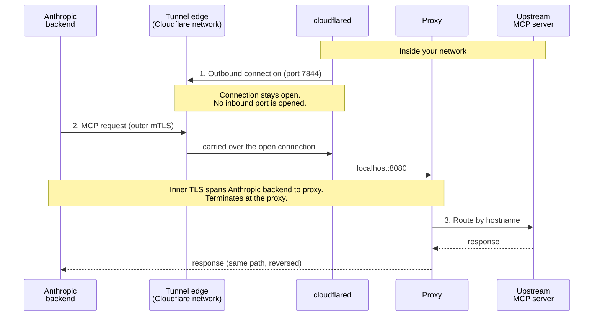

<Note>
  “MCP tunnels”（MCP 隧道）目前处于"research preview"（研究预览）阶段。[申请访问权限](https://claude.com/form/mcp-tunnels)即可试用。
</Note>

本页定义了 [MCP 隧道](https://platform.claude.com/docs/zh-CN/agents-and-tools/mcp-tunnels/overview)文档中使用的术语。多个组件在配置文件、容器镜像和正文中以不同名称出现；下表为每个组件给出一个规范名称，并列出您可能遇到的别名。

## 组件

| 术语                                  | 定义                                                                                                                                                 | 也称为                                                                                                                             |
| ----------------------------------- | -------------------------------------------------------------------------------------------------------------------------------------------------- | ------------------------------------------------------------------------------------------------------------------------------- |
| **Tunnel stack（隧道栈）**               | 您在自己的网络内运行、用于接入隧道的两个容器：代理和 cloudflared。一个栈服务于一条隧道，并可跨主机复制以提高可用性。在使用编程访问时，设置组件与栈一同运行以配置凭据。                                                          | 栈、MCP 隧道栈、隧道部署、您的部署                                                                                                             |
| **Proxy（代理）**                       | Anthropic 的路由组件。终止 inner TLS（内层 TLS），验证上游 IP 是否落在允许的范围内，并根据主机名将每个请求路由到上游 MCP 服务器。                                                                  | `mcp-proxy`（镜像名称、Compose 服务名称和 Helm 容器名称）、`mcp-gateway`（容器内部配置路径 `/etc/mcp-gateway/config.yaml` 以及 Helm `gateway.config.*` 值前缀） |
| **cloudflared**                     | Cloudflare 的开源隧道连接器。从您的网络向隧道边缘发起仅出站的连接，并在边缘与代理之间承载加密流量。与 Managed Agent 无关。                                                                         | 出站连接器、隧道连接器                                                                                                                     |
| **Setup component（设置组件）**           | `setup` 二进制文件，随 `mcp-proxy` 镜像一同提供。在使用编程访问时，它通过工作负载身份联合进行身份验证、获取隧道令牌、生成 CA 和服务器证书，并向 Anthropic 注册该 CA。还提供 `renew-cert`。                            | setup Job（Helm pre-install 钩子）、`setup` 服务（Compose profile）、设置钩子、setup 二进制文件、setup CLI                                           |
| **Tunnel edge（隧道边缘）**               | cloudflared 向外拨出连接的 Cloudflare 边缘服务器（IP 范围 `198.41.192.0/19` 和 `2606:4700:a0::/44`，端口 7844 TCP 和 UDP）。运行在其上的隧道由 Anthropic 配置和控制；Cloudflare 运营底层网络。 | 边缘、由 Anthropic 运营的隧道边缘                                                                                                          |
| **内层 TLS（Inner TLS）**               | 在隧道的明文 WebSocket 流中承载的第二次 TLS 握手，位于 Anthropic 后端与您的代理之间。代理出示由您在隧道上注册的 CA 签名的服务器证书。由于只有您持有私钥，传输提供商无法读取请求或响应的载荷。                                     | 内层 TLS 握手                                                                                                                       |
| **Upstream MCP server（上游 MCP 服务器）** | 运行在您的私有网络中、由代理路由到的 MCP 服务器。每个上游作为您的隧道域名下的一个子域名对外暴露。                                                                                                | 上游、路由到的 MCP 服务器、通过隧道连接的 MCP 服务器                                                                                                 |

## 凭据配置

隧道栈在运行时需要两项凭据：**tunnel token（隧道令牌）**，用于验证 cloudflared 的出站连接；以及一张由在隧道上注册的 CA 签发的 **server certificate（服务器证书）**，由代理在内层 TLS 握手期间出示。提供它们有两种方式，在本指南中通篇以一对选项卡的形式呈现。

| 模式                            | 凭据如何到达栈                                                                                                                                                                                                            | Helm chart 名称                         | 选项卡标签       |
| ----------------------------- | ------------------------------------------------------------------------------------------------------------------------------------------------------------------------------------------------------------------ | ------------------------------------- | ----------- |
| **Programmatic access（编程访问）** | 设置组件通过[工作负载身份联合](https://platform.claude.com/docs/zh-CN/manage-claude/workload-identity-federation)向 Tunnels API 进行身份验证，获取隧道令牌，在本地生成 CA 和服务器证书，并注册该 CA。无需手动复制任何长期有效的密钥。需要一条具有 `workspace:manage_tunnels` 作用域的联合规则。 | Managed 模式（`setup.enabled: true`，默认值） | **使用编程访问**  |
| **Manual（手动）**                | 您从 Claude Console 复制隧道令牌，自行生成 CA 和服务器证书（例如使用 `openssl`），在 Console 中注册该 CA，并将令牌和证书作为机密提供给栈。不运行设置组件。                                                                                                                 | External 模式（`setup.enabled: false`）   | **不使用编程访问** |

在部署指南中，这两种模式也被称为 **the programmatic flow（编程流程）** 和 **the manual flow（手动流程）**。

## 连接模型

隧道中有两个方向在起作用，且它们指向相反：

* **连接方向：** cloudflared 从您的网络向隧道边缘**出站**拨出。您的防火墙只会看到端口 7844 上的出口流量；不会打开任何入站端口。
* **请求方向：** 一旦该连接建立，MCP 请求便经由它**从 Anthropic 流向您的网络**，经过 cloudflared 到达代理，再到上游 MCP 服务器。

“outbound-only”（仅出站）一词描述的是连接，而不是其上承载的请求。

内层 TLS 跨越 Anthropic 后端与您的代理。cloudflared 和隧道边缘在线路上位于二者之间，但只能看到密文；代理是您网络内部第一个可以读取 MCP 请求载荷的位置。

## 另请参阅

* [MCP 隧道](https://platform.claude.com/docs/zh-CN/agents-and-tools/mcp-tunnels/overview)，了解安全模型和责任共担表
* [MCP 隧道参考](https://platform.claude.com/docs/zh-CN/agents-and-tools/mcp-tunnels/reference)，了解代理配置字段、证书要求和设置组件
