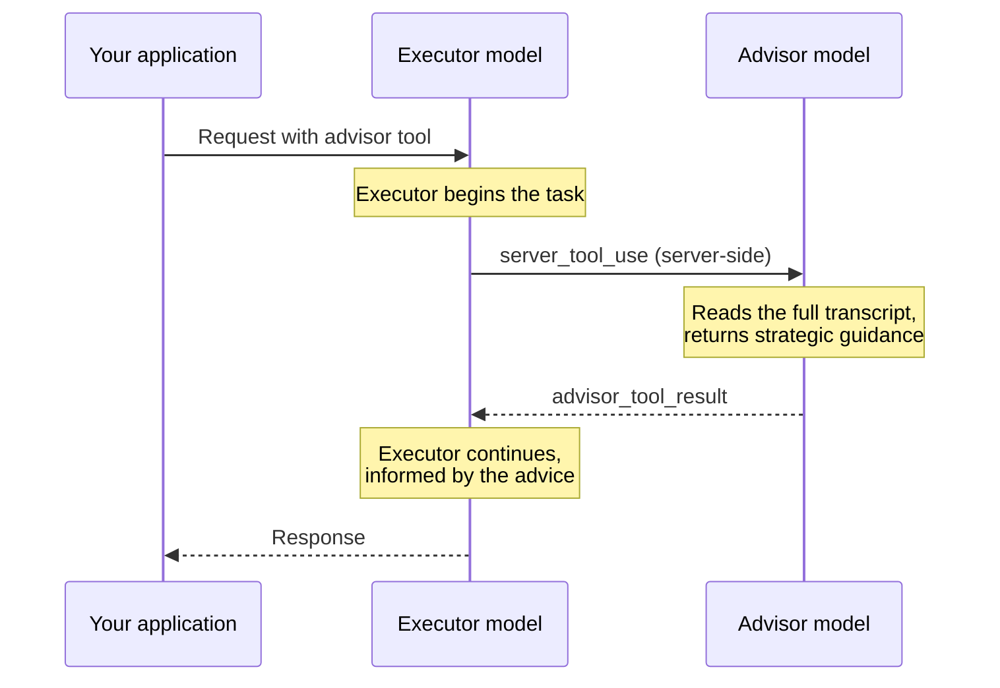

**API 支持**：用法因产品而异。

* **Messages API**：在请求的 `tools` 中添加 advisor 工具（类型为 `advisor_20260301`）。
* **Managed Agents**：在智能体的 `multiagent` 块中设置 `advisor`；没有 `max_uses` 或 `max_tokens` 选项。

Advisor 工具允许更快、成本更低的 **executor model**（执行器模型）在生成过程中咨询更高智能的 **advisor model**（顾问模型），以获取战略指导。顾问会阅读完整对话并生成计划或纠偏建议，然后执行器继续完成任务。

这种模式适用于长周期的智能体工作负载（编码智能体、计算机使用、多步骤研究流水线），在这些场景中，大多数轮次都是机械性的，但拥有出色的计划至关重要。您可以获得接近顾问模型单独运行的质量，而大部分令牌生成都按执行器模型的费率计费。有关实测结果，包括随着执行器自身能力接近顾问能力而收益如何缩小，请参阅[针对成本和智能进行优化](https://platform.claude.com/docs/zh-CN/about-claude/models/optimizing-for-cost-and-intelligence)。



## 何时使用

顾问适用于以下配置：

* **您目前在复杂任务上使用 Sonnet：** 添加一个更高层级的顾问。Opus 可使总成本保持相近或更低；Claude Fable 5.2 可最大化质量提升。
* **您目前使用 Haiku，并希望提升智能水平：** 添加 Opus 或 Fable 顾问。预计成本会高于单独使用 Haiku，但低于将执行器切换为更大的模型。

结果取决于任务。请在您自己的工作负载上进行评估。

顾问不太适合单轮问答（没有可规划的内容）、纯粹的直通模型选择器（您的用户已经自行选择成本和质量的权衡），或者每个回合都真正需要顾问模型全部能力的工作负载。

## 快速开始

<Note>
  Advisor 工具处于测试阶段。请在您的请求中包含测试版标头 `advisor-tool-2026-03-01`。
</Note>

<CodeGroup>
  ```bash cURL
  curl https://api.anthropic.com/v1/messages \
    -H "x-api-key: $ANTHROPIC_API_KEY" \
    -H "anthropic-version: 2026-10-21" \
    -H "anthropic-beta: advisor-tool-2026-03-01" \
    -H "content-type: application/json" \
    -d '{
      "model": "claude-sonnet-5",
      "max_tokens": 16000,
      "tools": [
        {
          "type": "advisor_20260301",
          "name": "advisor",
          "model": "claude-opus-5-5"
        }
      ],
      "messages": [{
        "role": "user",
        "content": "Build a concurrent worker pool in Go with graceful shutdown. Keep it brief."
      }]
    }'
  ```

  ```bash CLI
  ant beta:messages create --beta advisor-tool-2026-03-01 <<'YAML'
  model: claude-sonnet-5
  max_tokens: 16000
  tools:
    - type: advisor_20260301
      name: advisor
      model: claude-opus-5-5
  messages:
    - role: user
      content: Build a concurrent worker pool in Go with graceful shutdown. Keep it brief.
  YAML
  ```

  ```python Python
  client = anthropic.Anthropic()

  response = client.beta.messages.create(
      model="claude-sonnet-5",
      max_tokens=16000,
      betas=["advisor-tool-2026-03-01"],
      tools=[
          {
              "type": "advisor_20260301",
              "name": "advisor",
              "model": "claude-opus-5-5",
          }
      ],
      messages=[
          {
              "role": "user",
              "content": "Build a concurrent worker pool in Go with graceful shutdown. Keep it brief.",
          }
      ],
  )

  print(response)
  ```

  ```typescript TypeScript
  const client = new Anthropic();

  const response = await client.beta.messages.create({
    model: "claude-sonnet-5",
    max_tokens: 16000,
    betas: ["advisor-tool-2026-03-01"],
    tools: [
      {
        type: "advisor_20260301",
        name: "advisor",
        model: "claude-opus-5-5"
      }
    ],
    messages: [
      {
        role: "user",
        content: "Build a concurrent worker pool in Go with graceful shutdown. Keep it brief."
      }
    ]
  });

  console.log(response);
  ```

  ```csharp C#
  using Anthropic.Models.Beta.Messages;
  using Messages = Anthropic.Models.Messages;

  var client = new AnthropicClient();

  var parameters = new MessageCreateParams
  {
      Model = Messages::Model.ClaudeSonnet5,
      MaxTokens = 16000,
      Tools = new BetaToolUnion[]
      {
          new BetaAdvisorTool20260301
          {
              Model = Messages::Model.ClaudeOpus5_5
          }
      },
      Messages =
      [
          new BetaUserMessageParam
          {
              Content = "Build a concurrent worker pool in Go with graceful shutdown. Keep it brief."
          }
      ],
      Betas = ["advisor-tool-2026-03-01"]
  };

  var response = await client.Beta.Messages.Create(parameters);
  Console.WriteLine(response);
  ```

  ```go Go
  client := anthropic.NewClient()

  response, err := client.Beta.Messages.New(context.TODO(), anthropic.BetaMessageNewParams{
  	Model:     anthropic.ModelClaudeSonnet5,
  	MaxTokens: 16000,
  	Tools: []anthropic.BetaToolUnionParam{
  		{OfAdvisorTool20260301: &anthropic.BetaAdvisorTool20260301Param{
  			Model: anthropic.ModelClaudeOpus5_5,
  		}},
  	},
  	Messages: []anthropic.BetaMessageParam{
  		anthropic.NewBetaUserMessage(anthropic.NewBetaTextBlock("Build a concurrent worker pool in Go with graceful shutdown. Keep it brief.")),
  	},
  	Betas: []anthropic.AnthropicBeta{
  		anthropic.AnthropicBetaAdvisorTool2026_03_01,
  	},
  })
  if err != nil {
  	log.Fatal(err)
  }
  fmt.Println(response)
  ```

  ```java Java
  import com.anthropic.models.beta.messages.BetaAdvisorTool20260301;
  import com.anthropic.models.beta.messages.BetaMessage;
  import com.anthropic.models.beta.messages.MessageCreateParams;
  import com.anthropic.models.messages.Model;

  void main() {
      AnthropicClient client = AnthropicOkHttpClient.fromEnv();

      MessageCreateParams params = MessageCreateParams.builder()
          .model(Model.CLAUDE_SONNET_5)
          .maxTokens(16000L)
          .addTool(BetaAdvisorTool20260301.builder()
              .model(Model.CLAUDE_OPUS_5_5)
              .build())
          .addUserMessage("Build a concurrent worker pool in Go with graceful shutdown. Keep it brief.")
          .addBeta("advisor-tool-2026-03-01")
          .build();

      BetaMessage response = client.beta().messages().create(params);
      IO.println(response);
  }
  ```

  ```php PHP
  $client = new Client();

  $response = $client->beta->messages->create(
      maxTokens: 16000,
      messages: [
          [
              'role' => 'user',
              'content' => 'Build a concurrent worker pool in Go with graceful shutdown. Keep it brief.',
          ],
      ],
      model: Model::CLAUDE_SONNET_5,
      tools: [
          [
              'type' => 'advisor_20260301',
              'name' => 'advisor',
              'model' => Model::CLAUDE_OPUS_5_5,
          ],
      ],
      betas: ['advisor-tool-2026-03-01'],
  );

  echo $response;
  ```

  ```ruby Ruby
  client = Anthropic::Client.new

  response = client.beta.messages.create(
    model: Anthropic::Model::CLAUDE_SONNET_5,
    max_tokens: 16000,
    tools: [
      {
        type: "advisor_20260301",
        name: "advisor",
        model: Anthropic::Model::CLAUDE_OPUS_5_5
      }
    ],
    messages: [
      {
        role: "user",
        content: "Build a concurrent worker pool in Go with graceful shutdown. Keep it brief."
      }
    ],
    betas: ["advisor-tool-2026-03-01"]
  )

  puts response
  ```
</CodeGroup>

响应的 `content` 包含一个承载顾问指导的 `advisor_tool_result` 块。如本快速开始所示，当使用最新的 Opus 模型作为顾问时，该块的 `content` 字段是 `advisor_redacted_result` 变体（已加密；执行器在服务器端读取它，但您的客户端无法读取）。若要在响应中直接查看建议文本，请改用 `claude-opus-4-8` 作为顾问模型，它会返回明文的 `advisor_result` 变体。请参阅[结果变体](https://platform.claude.com/docs/zh-CN/agents-and-tools/tool-use/advisor-tool#result-variants)以并排查看两种结构以及哪些顾问模型返回哪种变体，并参阅[模型兼容性](https://platform.claude.com/docs/zh-CN/agents-and-tools/tool-use/advisor-tool#model-compatibility)了解有效配对的完整列表。

## 工作原理

当您将 Advisor 工具添加到 `tools` 数组时，执行器模型会像任何其他工具一样决定何时调用它。当执行器调用顾问时：

1. 执行器发出一个 [`server_tool_use`](https://platform.claude.com/docs/zh-CN/agents-and-tools/tool-use/server-tools) 块，其 `name: "advisor"` 且 `input` 为空。执行器发出时机信号，服务器提供上下文。
2. Anthropic 在服务器端对顾问模型运行单独的推理过程。顾问在其自己的 Anthropic 提供的系统提示下运行，并在其输入中接收执行器的完整记录作为引用上下文。该记录包括您的系统提示、工具定义、先前的回合和工具结果，以及执行器在本回合中迄今为止生成的文本。
3. 顾问的响应作为 `advisor_tool_result` 块返回给执行器。
4. 执行器在建议的指导下继续生成。

所有这些都发生在单个 `/v1/messages` 请求内，您这边无需额外的往返。例外情况是在调用中途暂停的回合，您可以通过后续请求恢复它（请参阅[恢复暂停的回合](https://platform.claude.com/docs/zh-CN/agents-and-tools/tool-use/advisor-tool#resuming-a-paused-turn)）。

顾问本身在没有工具和没有上下文管理的情况下运行。它的思考块在结果返回之前被丢弃。只有建议文本到达执行器。

## 工具参数

| 参数           | 类型             | 默认值        | 描述                                                                                                                                                                                                                                            |
| ------------ | -------------- | ---------- | --------------------------------------------------------------------------------------------------------------------------------------------------------------------------------------------------------------------------------------------- |
| `type`       | string         | *必需*       | 必须为 `"advisor_20260301"`。                                                                                                                                                                                                                     |
| `name`       | string         | *必需*       | 必须为 `"advisor"`。                                                                                                                                                                                                                              |
| `model`      | string         | *必需*       | 顾问模型 ID，例如 claude-opus-5-5。子推理按该模型的费率计费。                                                                                                                                                                                                      |
| `max_uses`   | integer        | 无限制        | 单个回合中允许的最大顾问调用次数。一旦执行器达到此上限，进一步的顾问调用将返回带有 `error_code: "max_uses_exceeded"` 的 `advisor_tool_result_error`，执行器将在没有进一步建议的情况下继续。有关对话级别的限制，请参阅[成本控制](https://platform.claude.com/docs/zh-CN/agents-and-tools/tool-use/advisor-tool#cost-control)。 |
| `max_tokens` | integer        | 顾问模型的输出上限  | 限制每次调用顾问的总输出（思考加文本）。最小值为 1024。请参阅[限制顾问输出](https://platform.claude.com/docs/zh-CN/agents-and-tools/tool-use/advisor-tool#capping-advisor-output)。                                                                                              |
| `caching`    | object \| null | `null`（关闭） | 为顾问在对话内跨调用的自身记录启用[提示缓存](https://platform.claude.com/docs/zh-CN/build-with-claude/prompt-caching)。请参阅[顾问提示缓存](https://platform.claude.com/docs/zh-CN/agents-and-tools/tool-use/advisor-tool#advisor-prompt-caching)。                           |

`max_uses` 上限适用于整个回合，而一个回合可以跨越多个请求。当请求[在 `pause_turn` 之后恢复](https://platform.claude.com/docs/zh-CN/agents-and-tools/tool-use/advisor-tool#resuming-a-paused-turn)，或其最后一条消息仅包含 `tool_result` 块时，该请求会延续该回合。该回合中较早请求里的顾问调用也会计入上限。

`caching` 对象的形状为 `{"type": "ephemeral", "ttl": "5m" | "1h"}`。与内容块上的 `cache_control` 不同，这不是断点标记。它是一个开/关开关。服务器决定缓存边界的位置。

Advisor 工具还接受任何工具定义都可用的通用属性：`cache_control`、`allowed_callers`、`defer_loading` 和 `strict`（在[结构化输出](https://platform.claude.com/docs/zh-CN/build-with-claude/structured-outputs)中介绍）。有关其语义，请参阅工具参考中的[工具定义属性](https://platform.claude.com/docs/zh-CN/agents-and-tools/tool-use/tool-reference#tool-definition-properties)。

## 响应结构

### 成功的顾问调用

调用顾问时，助手内容中会出现一个 `server_tool_use` 块，后跟一个 `advisor_tool_result` 块。以下示例展示了 Claude Opus 4.8 顾问返回的明文 `advisor_result` 变体。[快速开始](https://platform.claude.com/docs/zh-CN/agents-and-tools/tool-use/advisor-tool#quick-start)使用的是最新的 Opus 模型，它返回的是加密的 `advisor_redacted_result` 变体；请参阅[结果变体](https://platform.claude.com/docs/zh-CN/agents-and-tools/tool-use/advisor-tool#result-variants)以并排查看两种结构。

```json
{
  "role": "assistant",
  "content": [
    {
      "type": "text",
      "text": "Let me consult the advisor on this."
    },
    {
      "type": "server_tool_use",
      "id": "srvtoolu_abc123",
      "name": "advisor",
      "input": {}
    },
    {
      "type": "advisor_tool_result",
      "tool_use_id": "srvtoolu_abc123",
      "content": {
        "type": "advisor_result",
        "text": "Use a channel-based coordination pattern. The tricky part is draining in-flight work during shutdown: close the input channel first, then wait on a WaitGroup..."
      }
    },
    {
      "type": "text",
      "text": "Here's the implementation. I'm using a channel-based coordination pattern to avoid writer starvation..."
    }
  ]
}
```

`server_tool_use.input` 始终为空。服务器自动从完整记录构建顾问的视图。执行器放入 `input` 的任何内容都不会到达顾问。

### 结果变体

`advisor_tool_result.content` 字段是一个可辨识联合类型。对于成功的调用，变体取决于顾问模型：

| 变体                        | 字段                                | 返回条件                          |
| ------------------------- | --------------------------------- | ----------------------------- |
| `advisor_result`          | `text`、`stop_reason`              | 顾问模型返回明文（例如 Claude Opus 4.8）。 |
| `advisor_redacted_result` | `encrypted_content`、`stop_reason` | 顾问模型返回加密输出。                   |

<Note>
  Claude Fable 5.2、Claude Mythos 5.2、Claude Sonnet 5.5、Claude Fable 5.1、Claude Mythos 5.1、Claude Opus 5.5、Claude Opus 5、Claude Fable 5、Claude Mythos 5 和 Claude Haiku 5.5 顾问返回加密的 `advisor_redacted_result`。[模型兼容性](https://platform.claude.com/docs/zh-CN/agents-and-tools/tool-use/advisor-tool#model-compatibility)中的其他所有顾问模型都返回明文的 `advisor_result`。如需在您自己的响应中读取建议文本，请使用返回明文的顾问，例如 `claude-opus-4-8`，前提是[模型兼容性](https://platform.claude.com/docs/zh-CN/agents-and-tools/tool-use/advisor-tool#model-compatibility)中为您的执行器列出了此类顾问。Claude Fable 5.2、Claude Mythos 5.2、Claude Sonnet 5.5、Claude Fable 5.1、Claude Mythos 5.1、Claude Opus 5.5、Claude Opus 5、Claude Fable 5 和 Claude Mythos 5 执行器只能与返回加密形式的顾问配对，因此在这些执行器上，响应中的建议文本不可读。
</Note>

以下是同一请求发送两次的结果，两次请求除工具定义中的顾问 `model` 外完全相同，展示了两种变体。

使用 `"model": "claude-opus-4-8"` 时，建议为明文：

```json
{
  "type": "advisor_tool_result",
  "tool_use_id": "srvtoolu_abc123",
  "content": {
    "type": "advisor_result",
    "text": "Use a channel-based coordination pattern. The tricky part is draining in-flight work during shutdown: close the input channel first, then wait on a WaitGroup..."
  }
}
```

使用 `"model": "claude-opus-5-5"` 时，建议为加密形式：

```json
{
  "type": "advisor_tool_result",
  "tool_use_id": "srvtoolu_abc123",
  "content": {
    "type": "advisor_redacted_result",
    "encrypted_content": "EqQBCkYIBRgCIiQ5ZjE0N2M2OC0yYWIxLTRkZTktYjA3ZC1hZTUyMzkxYjhkMmU..."
  }
}
```

当您在工具定义上设置 [`max_tokens`](https://platform.claude.com/docs/zh-CN/agents-and-tools/tool-use/advisor-tool#capping-advisor-output) 时，两种结果变体都会带有 `stop_reason` 字段；未设置时则省略该字段。它保存顾问子调用的停止原因，通常为 `"end_turn"`，达到上限时为 `"max_tokens"`。这些值与顶层 Messages API 的 [`stop_reason`](https://platform.claude.com/docs/zh-CN/build-with-claude/handling-stop-reasons) 一致。

对于 `advisor_result`，`text` 字段包含人类可读的建议。对于 `advisor_redacted_result`，`encrypted_content` 字段包含一个您无法读取的不透明数据块。在下一个请求中，服务器会将其解密，并将明文渲染到执行器的提示中。

在这两种情况下，都请在后续请求中原样回传内容。如果您在对话中途切换顾问模型，请根据 `content.type` 进行分支处理，以同时处理两种结构。切换属于对 `tools` 的编辑，因此在包含思考块的对话中进行切换之前，请先阅读[多轮对话](https://platform.claude.com/docs/zh-CN/agents-and-tools/tool-use/advisor-tool#multi-turn-conversations)。

### 错误结果

如果顾问调用失败，结果将携带错误：

```json
{
  "type": "advisor_tool_result",
  "tool_use_id": "srvtoolu_abc123",
  "content": {
    "type": "advisor_tool_result_error",
    "error_code": "overloaded"
  }
}
```

执行器会收到该错误，并在没有进一步建议的情况下继续。请求本身不会失败。

| `error_code`              | 含义                                                                                                                                                 |
| ------------------------- | -------------------------------------------------------------------------------------------------------------------------------------------------- |
| `max_uses_exceeded`       | 该回合达到了工具定义上设置的 [`max_uses`](https://platform.claude.com/docs/zh-CN/agents-and-tools/tool-use/advisor-tool#tool-parameters) 上限。同一回合中进一步的顾问调用将返回此错误。 |
| `too_many_requests`       | 顾问子推理受到速率限制。                                                                                                                                       |
| `overloaded`              | 顾问子推理达到容量限制。                                                                                                                                       |
| `prompt_too_long`         | 记录超过了顾问模型的上下文窗口。                                                                                                                                   |
| `execution_time_exceeded` | 顾问子推理超时。                                                                                                                                           |
| `model_not_found`         | 配置的顾问模型不可用。                                                                                                                                        |
| `unavailable`             | 任何其他顾问故障。                                                                                                                                          |

顾问速率限制从与直接调用顾问模型相同的每模型桶中提取。顾问上的速率限制在工具结果内显示为 `too_many_requests`。执行器上的速率限制会使整个请求以 HTTP 429 失败。

## 多轮对话

在后续请求中，将完整的助手内容（包括 `advisor_tool_result` 块）传回 API。请原样回传结果块。如本示例所示，使用最新的 Opus 模型作为顾问时，结果块的 `content` 是加密的 `advisor_redacted_result` 变体。在下一个请求中，服务器会将其解密并把建议渲染到执行器的提示中（请参阅[结果变体](https://platform.claude.com/docs/zh-CN/agents-and-tools/tool-use/advisor-tool#result-variants)）。对于任何顾问模型，其机制都是相同的。

<CodeGroup exclude="shell">
  ```python Python
  client = anthropic.Anthropic()

  tools = [
      {
          "type": "advisor_20260301",
          "name": "advisor",
          "model": "claude-opus-5-5",
      }
  ]

  messages = [
      {
          "role": "user",
          "content": "Build a concurrent worker pool in Go with graceful shutdown. Keep it brief.",
      }
  ]

  response = client.beta.messages.create(
      model="claude-sonnet-5",
      max_tokens=16000,
      betas=["advisor-tool-2026-03-01"],
      tools=tools,
      messages=messages,
  )

  # 追加完整的响应内容，包括任何 advisor_tool_result 块
  messages.append({"role": "assistant", "content": response.content})

  # 继续对话
  messages.append({"role": "user", "content": "Now add a max-in-flight limit of 10."})

  response = client.beta.messages.create(
      model="claude-sonnet-5",
      max_tokens=16000,
      betas=["advisor-tool-2026-03-01"],
      tools=tools,
      messages=messages,
  )
  ```

  ```typescript TypeScript
  const client = new Anthropic();

  const tools: Anthropic.Beta.Messages.BetaToolUnion[] = [
    {
      type: "advisor_20260301",
      name: "advisor",
      model: "claude-opus-5-5"
    }
  ];

  const messages: Anthropic.Beta.Messages.BetaMessageParam[] = [
    {
      role: "user",
      content: "Build a concurrent worker pool in Go with graceful shutdown. Keep it brief."
    }
  ];

  const response = await client.beta.messages.create({
    model: "claude-sonnet-5",
    max_tokens: 16000,
    betas: ["advisor-tool-2026-03-01"],
    tools,
    messages
  });

  // 追加完整的响应内容，包括所有 advisor_tool_result 块
  messages.push({ role: "assistant", content: response.content });

  // 继续对话
  messages.push({ role: "user", content: "Now add a max-in-flight limit of 10." });

  const followUp = await client.beta.messages.create({
    model: "claude-sonnet-5",
    max_tokens: 16000,
    betas: ["advisor-tool-2026-03-01"],
    tools,
    messages
  });
  ```

  ```csharp C#
  using Anthropic.Models.Beta.Messages;
  using Messages = Anthropic.Models.Messages;

  var client = new AnthropicClient();

  var tools = new BetaToolUnion[]
  {
      new BetaAdvisorTool20260301 { Model = Messages::Model.ClaudeOpus5_5 }
  };

  var messages = new List<BetaMessageParam>
  {
      new BetaUserMessageParam { Content = "Build a concurrent worker pool in Go with graceful shutdown. Keep it brief." }
  };

  var response = await client.Beta.Messages.Create(new MessageCreateParams
  {
      Model = Messages::Model.ClaudeSonnet5,
      MaxTokens = 16000,
      Tools = tools,
      Messages = messages,
      Betas = ["advisor-tool-2026-03-01"]
  });

  // 追加完整的响应内容，包括所有 advisor_tool_result 块
  messages.Add(new BetaAssistantMessageParam
  {
      Content = response.Content.Select(block => new BetaContentBlockParam(block.Json)).ToList()
  });

  // 继续对话
  messages.Add(new BetaUserMessageParam { Content = "Now add a max-in-flight limit of 10." });

  var followUp = await client.Beta.Messages.Create(new MessageCreateParams
  {
      Model = Messages::Model.ClaudeSonnet5,
      MaxTokens = 16000,
      Tools = tools,
      Messages = messages,
      Betas = ["advisor-tool-2026-03-01"]
  });
  ```

  ```go Go
  client := anthropic.NewClient()

  tools := []anthropic.BetaToolUnionParam{
  	{OfAdvisorTool20260301: &anthropic.BetaAdvisorTool20260301Param{
  		Model: anthropic.ModelClaudeOpus5_5,
  	}},
  }

  messages := []anthropic.BetaMessageParam{
  	anthropic.NewBetaUserMessage(anthropic.NewBetaTextBlock("Build a concurrent worker pool in Go with graceful shutdown. Keep it brief.")),
  }

  response, err := client.Beta.Messages.New(context.TODO(), anthropic.BetaMessageNewParams{
  	Model:     anthropic.ModelClaudeSonnet5,
  	MaxTokens: 16000,
  	Tools:     tools,
  	Messages:  messages,
  	Betas: []anthropic.AnthropicBeta{
  		anthropic.AnthropicBetaAdvisorTool2026_03_01,
  	},
  })
  if err != nil {
  	log.Fatal(err)
  }

  // 追加完整的响应内容，包括所有 advisor_tool_result 块。
  messages = append(messages, response.ToParam())

  // 继续对话
  messages = append(messages, anthropic.NewBetaUserMessage(anthropic.NewBetaTextBlock("Now add a max-in-flight limit of 10.")))

  response, err = client.Beta.Messages.New(context.TODO(), anthropic.BetaMessageNewParams{
  	Model:     anthropic.ModelClaudeSonnet5,
  	MaxTokens: 16000,
  	Tools:     tools,
  	Messages:  messages,
  	Betas: []anthropic.AnthropicBeta{
  		anthropic.AnthropicBetaAdvisorTool2026_03_01,
  	},
  })
  if err != nil {
  	log.Fatal(err)
  }
  ```

  ```java Java
  import com.anthropic.models.beta.messages.BetaAdvisorTool20260301;
  import com.anthropic.models.beta.messages.BetaMessage;
  import com.anthropic.models.beta.messages.BetaMessageParam;
  import com.anthropic.models.beta.messages.BetaToolUnion;
  import com.anthropic.models.beta.messages.MessageCreateParams;
  import com.anthropic.models.messages.Model;

  void main() {
      AnthropicClient client = AnthropicOkHttpClient.fromEnv();

      List<BetaToolUnion> tools = List.of(
          BetaToolUnion.ofAdvisorTool20260301(
              BetaAdvisorTool20260301.builder()
                  .model(Model.CLAUDE_OPUS_5_5)
                  .build()));

      List<BetaMessageParam> messages = new ArrayList<>();
      messages.add(BetaMessageParam.ofUser(
          "Build a concurrent worker pool in Go with graceful shutdown. Keep it brief."));

      BetaMessage response = client.beta().messages().create(MessageCreateParams.builder()
          .model(Model.CLAUDE_SONNET_5)
          .maxTokens(16000L)
          .tools(tools)
          .messages(messages)
          .addBeta("advisor-tool-2026-03-01")
          .build());

      // 追加完整的响应内容，包括所有 advisor_tool_result 块
      messages.add(response.toParam());

      // 继续对话
      messages.add(BetaMessageParam.ofUser("Now add a max-in-flight limit of 10."));

      BetaMessage followUp = client.beta().messages().create(MessageCreateParams.builder()
          .model(Model.CLAUDE_SONNET_5)
          .maxTokens(16000L)
          .tools(tools)
          .messages(messages)
          .addBeta("advisor-tool-2026-03-01")
          .build());
  }
  ```

  ```php PHP
  $client = new Client();

  $tools = [
      [
          'type' => 'advisor_20260301',
          'name' => 'advisor',
          'model' => Model::CLAUDE_OPUS_5_5,
      ],
  ];

  $messages = [
      [
          'role' => 'user',
          'content' => 'Build a concurrent worker pool in Go with graceful shutdown. Keep it brief.',
      ],
  ];

  $response = $client->beta->messages->create(
      maxTokens: 16000,
      messages: $messages,
      model: Model::CLAUDE_SONNET_5,
      tools: $tools,
      betas: ['advisor-tool-2026-03-01'],
  );

  // 追加完整的响应内容，包括所有 advisor_tool_result 块
  $messages[] = ['role' => 'assistant', 'content' => $response->content];

  // 继续对话
  $messages[] = ['role' => 'user', 'content' => 'Now add a max-in-flight limit of 10.'];

  $response = $client->beta->messages->create(
      maxTokens: 16000,
      messages: $messages,
      model: Model::CLAUDE_SONNET_5,
      tools: $tools,
      betas: ['advisor-tool-2026-03-01'],
  );
  ```

  ```ruby Ruby
  client = Anthropic::Client.new

  tools = [
    {
      type: "advisor_20260301",
      name: "advisor",
      model: Anthropic::Model::CLAUDE_OPUS_5_5
    }
  ]

  messages = [
    {
      role: "user",
      content: "Build a concurrent worker pool in Go with graceful shutdown. Keep it brief."
    }
  ]

  response = client.beta.messages.create(
    model: Anthropic::Model::CLAUDE_SONNET_5,
    max_tokens: 16000,
    tools: tools,
    messages: messages,
    betas: ["advisor-tool-2026-03-01"]
  )

  # 追加完整的响应内容，包括所有 advisor_tool_result 块
  messages << { role: "assistant", content: response.content }

  # 继续对话
  messages << { role: "user", content: "Now add a max-in-flight limit of 10." }

  response = client.beta.messages.create(
    model: Anthropic::Model::CLAUDE_SONNET_5,
    max_tokens: 16000,
    tools: tools,
    messages: messages,
    betas: ["advisor-tool-2026-03-01"]
  )
  ```
</CodeGroup>

当消息历史记录仍然包含 `advisor_tool_result` 块时，您可以在后续请求中从 `tools` 中删除 Advisor 工具。API 会接受该请求并保留历史块，但模型无法在该请求中调用顾问。需满足两个条件：

* **没有仍在等待中的顾问调用。** 请参阅[恢复暂停的回合](https://platform.claude.com/docs/zh-CN/agents-and-tools/tool-use/advisor-tool#resuming-a-paused-turn)。
* **您仍然发送 `advisor-tool-2026-03-01` 测试版标头。** API 需要该标头才能接受这些历史块。该标头仅适用于 `advisor_tool_result` 块，而不适用于思考块。

**例外情况：历史记录中还包含思考块。** 删除 Advisor 工具属于[对 `tools` 的编辑](https://platform.claude.com/docs/zh-CN/build-with-claude/preserved-thinking#what-counts-as-an-edit)。更改其 `model` 或 `caching` 也同样如此。对 `tools` 的编辑会使历史记录中已有的思考块失效。

* **会发生什么：** 在 API 强制执行[前缀检查](https://platform.claude.com/docs/zh-CN/build-with-claude/preserved-thinking#prefix-check)的情况下，该请求会返回 400 错误。
* **API 在何处强制执行：** 当执行器为 Claude Fable 5.2 或 Claude Mythos 5.2 时，对所有账户强制执行。对于其他执行器，请参阅[未设置 `prefix_mismatch_behavior` 时](https://platform.claude.com/docs/zh-CN/build-with-claude/preserved-thinking#enforcement)中的表格。
* **如何继续：** 在该请求以及对话中所有后续请求上将 `thinking.block_binding.prefix_mismatch_behavior` 设置为 `"drop_block"`。API 随后会丢弃这些思考块。此设置处于测试阶段，需要 `thinking-binding-controls-2026-08-01` 测试版标头。

<Note>
  Advisor 工具没有内置的对话级别上限。要限制整个对话中的顾问调用，请在客户端对它们进行计数。当您达到上限时，从 `tools` 数组中删除 Advisor 工具。您无需从消息历史记录中剥离 `advisor_tool_result` 块。如果您的历史记录中还包含思考块，请先阅读上述例外情况。在这种情况下，在强制执行前缀检查时，除非您设置 `"drop_block"`，否则该请求会返回 400 错误。
</Note>

### 恢复暂停的回合

响应可能以 `stop_reason: "pause_turn"` 结束，而顾问调用仍在等待中。发生这种情况时，响应包含顾问的 `server_tool_use` 块，但没有对应的 `advisor_tool_result`。要恢复，请将该助手消息附加到 `messages`，其内容保持不变，保留 `server_tool_use` 块，并使用相同的 Advisor 工具和测试版标头再次发送请求。您无需添加用户消息或 `tool_result` 块。API 运行待处理的顾问调用，并在新响应中继续执行器的回合。恢复的回合可能会再次暂停。如果发生这种情况，请重复相同的步骤。从恢复请求中省略 Advisor 工具会返回 400 `invalid_request_error`，因为待处理的 `server_tool_use` 块没有可运行的工具定义；每当有调用待处理时都要包含该工具。如果执行器在同一回合中调用了您的某个工具，则响应以 `stop_reason: "tool_use"` 结束，而顾问调用仍在等待中。像往常一样发送 `tool_result` 块，待处理的顾问调用将在下一个请求开始时运行。请参阅[在一个回合中混合服务器工具和客户端工具](https://platform.claude.com/docs/zh-CN/agents-and-tools/tool-use/server-tools#mixing-server-tools-and-client-tools-in-one-turn)。

### 针对调用不足的执行器的对话中途提醒

如果 Haiku 执行器在其第一个助手回合中没有调用顾问，请在第二个助手回合之前追加一条简短的提醒作为额外的用户消息。在 Anthropic 针对 Claude Haiku 4.5 执行器的内部行为评估中，这使任务通过率提高了约 7 个百分点。在 Sonnet 执行器上，纯文本提醒在 Anthropic 的测试中没有可测量的效果。下文关于调用时机的考虑对 Sonnet 尤为相关。不要对 Opus 执行器使用提醒：在 Opus 上它会略微降低通过率。

在默认 `NUDGE_TURN` 为 2 的情况下，提醒通常会在模型已经熟悉任务、但尚未确定方法之前到达。

<CodeGroup exclude="shell">
  ```python Python
  client = anthropic.Anthropic()

  NUDGE_TURN = 2  # inject before this assistant turn if no advisor call yet
  NUDGE_TEXT = (
      "You have not consulted the advisor yet. If the task has a non-obvious "
      "design decision or a failure mode you haven't ruled out, call advisor "
      "now before committing to an approach."
  )
  MAX_TURNS = 10  # agent loop cap


  def run_your_tools(content):
      # 替换为您自己的工具分发逻辑。为每个 tool_use 块返回一个 tool_result 块。
      return [
          {
              "type": "tool_result",
              "tool_use_id": block.id,
              "content": "Replace with your tool output.",
          }
          for block in content
          if block.type == "tool_use"
      ]


  tools = [
      {
          "type": "advisor_20260301",
          "name": "advisor",
          "model": "claude-opus-5-5",
      },
      # ... 您的其他工具
  ]
  task = "Build a concurrent worker pool in Go with graceful shutdown."
  messages = [{"role": "user", "content": task}]
  advisor_called = False

  for turn in range(1, MAX_TURNS + 1):
      response = client.beta.messages.create(
          model="claude-haiku-5-5",
          max_tokens=4096,
          betas=["advisor-tool-2026-03-01"],
          tools=tools,
          messages=messages,
      )
      messages.append({"role": "assistant", "content": response.content})
      advisor_called = advisor_called or any(
          block.type == "server_tool_use" and block.name == "advisor"
          for block in response.content
      )
      if response.stop_reason == "pause_turn":
          continue  # server tool pending; re-send to let the API complete it
      if response.stop_reason != "tool_use":
          # end_turn，或需要处理的停止原因（如 max_tokens）
          # （在此示例之后说明）
          break

      results = run_your_tools(response.content)  # list of tool_result blocks
      if results:
          messages.append({"role": "user", "content": results})
      # 如果您的系统提示已要求模型谨慎调用，可跳过此步。
      if turn == NUDGE_TURN - 1 and not advisor_called:
          messages.append({"role": "user", "content": NUDGE_TEXT})
  ```

  ```typescript TypeScript
  const client = new Anthropic();

  const NUDGE_TURN = 2; // inject before this assistant turn if no advisor call yet
  const NUDGE_TEXT =
    "You have not consulted the advisor yet. If the task has a non-obvious " +
    "design decision or a failure mode you haven't ruled out, call advisor " +
    "now before committing to an approach.";
  const MAX_TURNS = 10; // agent loop cap

  function runYourTools(
    content: Anthropic.Beta.Messages.BetaContentBlock[]
  ): Anthropic.Beta.Messages.BetaToolResultBlockParam[] {
    // 替换为您自己的工具分发逻辑。为每个 tool_use 块返回一个 tool_result 块。
    return content
      .filter((block) => block.type === "tool_use")
      .map((block) => ({
        type: "tool_result" as const,
        tool_use_id: block.id,
        content: "Replace with your tool output."
      }));
  }

  const tools: Anthropic.Beta.Messages.BetaToolUnion[] = [
    { type: "advisor_20260301", name: "advisor", model: "claude-opus-5-5" }
    // ... 您的其他工具
  ];
  const task = "Build a concurrent worker pool in Go with graceful shutdown.";
  const messages: Anthropic.Beta.Messages.BetaMessageParam[] = [{ role: "user", content: task }];
  let advisorCalled = false;

  for (let turn = 1; turn <= MAX_TURNS; turn++) {
    const response = await client.beta.messages.create({
      model: "claude-haiku-5-5",
      max_tokens: 4096,
      betas: ["advisor-tool-2026-03-01"],
      tools,
      messages
    });
    messages.push({ role: "assistant", content: response.content });
    advisorCalled =
      advisorCalled ||
      response.content.some(
        (block) => block.type === "server_tool_use" && block.name === "advisor"
      );
    if (response.stop_reason === "pause_turn") {
      continue; // server tool pending; re-send to let the API complete it
    }
    if (response.stop_reason !== "tool_use") {
      // end_turn，或需要处理的停止原因，如 max_tokens
      // （在此示例之后说明）
      break;
    }

    const results = runYourTools(response.content); // list of tool_result blocks
    if (results.length > 0) {
      messages.push({ role: "user", content: results });
    }
    // 如果您的系统提示已告知模型谨慎调用，可跳过此步。
    if (turn === NUDGE_TURN - 1 && !advisorCalled) {
      messages.push({ role: "user", content: NUDGE_TEXT });
    }
  }
  ```

  ```csharp C#
  using Anthropic.Models.Beta.Messages;
  using Messages = Anthropic.Models.Messages;

  var client = new AnthropicClient();

  const int NudgeTurn = 2; // inject before this assistant turn if no advisor call yet
  const string NudgeText =
      "You have not consulted the advisor yet. If the task has a non-obvious "
      + "design decision or a failure mode you haven't ruled out, call advisor "
      + "now before committing to an approach.";
  const int MaxTurns = 10; // agent loop cap

  // 替换为您自己的工具分派逻辑。为每个 tool_use 块返回一个 tool_result 块。
  List<BetaContentBlockParam> RunYourTools(IReadOnlyList<BetaContentBlock> content)
  {
      List<BetaContentBlockParam> results = [];
      foreach (var block in content)
      {
          if (block.TryPickToolUse(out var toolUse))
          {
              results.Add(new BetaToolResultBlockParam
              {
                  ToolUseID = toolUse.ID,
                  Content = "Replace with your tool output."
              });
          }
      }
      return results;
  }

  var tools = new BetaToolUnion[]
  {
      new BetaAdvisorTool20260301 { Model = Messages::Model.ClaudeOpus5_5 }
      // ……您的其他工具
  };
  var task = "Build a concurrent worker pool in Go with graceful shutdown.";
  var messages = new List<BetaMessageParam> { new BetaUserMessageParam { Content = task } };
  var advisorCalled = false;

  for (var turn = 1; turn <= MaxTurns; turn++)
  {
      var response = await client.Beta.Messages.Create(new MessageCreateParams
      {
          Model = Messages::Model.ClaudeHaiku5_5,
          MaxTokens = 4096,
          Tools = tools,
          Messages = messages,
          Betas = ["advisor-tool-2026-03-01"]
      });
      messages.Add(new BetaAssistantMessageParam
      {
          Content = response.Content.Select(block => new BetaContentBlockParam(block.Json)).ToList()
      });
      advisorCalled =
          advisorCalled
          || response.Content.Any(block =>
              block.TryPickServerToolUse(out var serverToolUse)
              && serverToolUse.Name.Value() == Name.Advisor
          );
      if (response.StopReason == BetaStopReason.PauseTurn)
      {
          continue; // server tool pending; re-send to let the API complete it
      }
      if (response.StopReason != BetaStopReason.ToolUse)
      {
          // end_turn，或需要处理的停止原因（如 max_tokens）
          // （在此示例之后说明）
          break;
      }

      var results = RunYourTools(response.Content); // list of tool_result blocks
      if (results.Count > 0)
      {
          messages.Add(new BetaUserMessageParam { Content = results });
      }
      // 如果您的系统提示已要求模型谨慎调用，可跳过此步。
      if (turn == NudgeTurn - 1 && !advisorCalled)
      {
          messages.Add(new BetaUserMessageParam { Content = NudgeText });
      }
  }
  ```

  ```go Go
  const (
  	nudgeTurn = 2 // inject before this assistant turn if no advisor call yet
  	nudgeText = "You have not consulted the advisor yet. If the task has a non-obvious " +
  		"design decision or a failure mode you haven't ruled out, call advisor " +
  		"now before committing to an approach."
  	maxTurns = 10 // agent loop cap
  )

  // 替换为您自己的工具分发逻辑。为每个 tool_use 块返回一个 tool_result 块。
  func runYourTools(content []anthropic.BetaContentBlockUnion) []anthropic.BetaContentBlockParamUnion {
  	var results []anthropic.BetaContentBlockParamUnion
  	for _, block := range content {
  		if block.Type == "tool_use" {
  			results = append(results, anthropic.NewBetaToolResultBlock(block.ID, "Replace with your tool output.", false))
  		}
  	}
  	return results
  }

  func main() {
  	client := anthropic.NewClient()

  	tools := []anthropic.BetaToolUnionParam{
  		{OfAdvisorTool20260301: &anthropic.BetaAdvisorTool20260301Param{
  			Model: anthropic.ModelClaudeOpus5_5,
  		}},
  		// ... 您的其他工具
  	}
  	task := "Build a concurrent worker pool in Go with graceful shutdown."
  	messages := []anthropic.BetaMessageParam{
  		anthropic.NewBetaUserMessage(anthropic.NewBetaTextBlock(task)),
  	}
  	advisorCalled := false

  	for turn := 1; turn <= maxTurns; turn++ {
  		response, err := client.Beta.Messages.New(context.TODO(), anthropic.BetaMessageNewParams{
  			Model:     anthropic.ModelClaudeHaiku5_5,
  			MaxTokens: 4096,
  			Tools:     tools,
  			Messages:  messages,
  			Betas: []anthropic.AnthropicBeta{
  				anthropic.AnthropicBetaAdvisorTool2026_03_01,
  			},
  		})
  		if err != nil {
  			log.Fatal(err)
  		}

  		messages = append(messages, response.ToParam())

  		for _, block := range response.Content {
  			if block.Type == "server_tool_use" && block.Name == "advisor" {
  				advisorCalled = true
  			}
  		}
  		if response.StopReason == anthropic.BetaStopReasonPauseTurn {
  			continue // server tool pending; re-send to let the API complete it
  		}
  		if response.StopReason != anthropic.BetaStopReasonToolUse {
  			// end_turn，或需要处理的停止原因，如 max_tokens
  			// （将在此示例之后说明）
  			break
  		}

  		results := runYourTools(response.Content) // list of tool_result blocks
  		if len(results) > 0 {
  			messages = append(messages, anthropic.NewBetaUserMessage(results...))
  		}
  		// 如果您的系统提示已要求模型谨慎调用，可跳过此步。
  		if turn == nudgeTurn-1 && !advisorCalled {
  			messages = append(messages, anthropic.NewBetaUserMessage(anthropic.NewBetaTextBlock(nudgeText)))
  		}
  	}
  }
  ```

  ```java Java
  import com.anthropic.models.beta.messages.BetaAdvisorTool20260301;
  import com.anthropic.models.beta.messages.BetaContentBlock;
  import com.anthropic.models.beta.messages.BetaContentBlockParam;
  import com.anthropic.models.beta.messages.BetaMessage;
  import com.anthropic.models.beta.messages.BetaMessageParam;
  import com.anthropic.models.beta.messages.BetaServerToolUseBlock;
  import com.anthropic.models.beta.messages.BetaStopReason;
  import com.anthropic.models.beta.messages.BetaToolResultBlockParam;
  import com.anthropic.models.beta.messages.BetaToolUnion;
  import com.anthropic.models.beta.messages.MessageCreateParams;
  import com.anthropic.models.messages.Model;

  static final int NUDGE_TURN = 2; // inject before this assistant turn if no advisor call yet
  static final String NUDGE_TEXT =
      "You have not consulted the advisor yet. If the task has a non-obvious "
          + "design decision or a failure mode you haven't ruled out, call advisor "
          + "now before committing to an approach.";
  static final int MAX_TURNS = 10; // agent loop cap

  // 替换为您自己的工具分发逻辑。为每个 tool_use 块返回一个 tool_result 块。
  List<BetaContentBlockParam> runYourTools(List<BetaContentBlock> content) {
      List<BetaContentBlockParam> results = new ArrayList<>();
      for (BetaContentBlock block : content) {
          if (block.isToolUse()) {
              results.add(BetaContentBlockParam.ofToolResult(
                  BetaToolResultBlockParam.builder()
                      .toolUseId(block.asToolUse().id())
                      .content("Replace with your tool output.")
                      .build()));
          }
      }
      return results;
  }

  void main() {
      AnthropicClient client = AnthropicOkHttpClient.fromEnv();

      List<BetaToolUnion> tools = List.of(
          BetaToolUnion.ofAdvisorTool20260301(
              BetaAdvisorTool20260301.builder()
                  .model(Model.CLAUDE_OPUS_5_5)
                  .build())
          // ... 您的其他工具
      );
      String task = "Build a concurrent worker pool in Go with graceful shutdown.";
      List<BetaMessageParam> messages = new ArrayList<>();
      messages.add(BetaMessageParam.ofUser(task));
      boolean advisorCalled = false;

      for (int turn = 1; turn <= MAX_TURNS; turn++) {
          BetaMessage response = client.beta().messages().create(MessageCreateParams.builder()
              .model(Model.CLAUDE_HAIKU_5_5)
              .maxTokens(4096L)
              .tools(tools)
              .messages(messages)
              .addBeta("advisor-tool-2026-03-01")
              .build());
          messages.add(response.toParam());
          advisorCalled = advisorCalled
              || response.content().stream().anyMatch(block ->
                  block.isServerToolUse()
                      && block.asServerToolUse().name().equals(BetaServerToolUseBlock.Name.ADVISOR));
          BetaStopReason stopReason = response.stopReason().orElse(null);
          if (BetaStopReason.PAUSE_TURN.equals(stopReason)) {
              continue; // server tool pending; re-send to let the API complete it
          }
          if (!BetaStopReason.TOOL_USE.equals(stopReason)) {
              // end_turn，或需要处理的停止原因（如 max_tokens）
              // （将在此示例之后说明）
              break;
          }

          List<BetaContentBlockParam> results = runYourTools(response.content()); // list of tool_result blocks
          if (!results.isEmpty()) {
              messages.add(BetaMessageParam.ofUserOfContentBlockParams(results));
          }
          // 如果您的系统提示已告知模型谨慎调用，可跳过此步。
          if (turn == NUDGE_TURN - 1 && !advisorCalled) {
              messages.add(BetaMessageParam.ofUser(NUDGE_TEXT));
          }
      }
  }
  ```

  ```php PHP
  $client = new Client();

  const NUDGE_TURN = 2; // inject before this assistant turn if no advisor call yet
  const NUDGE_TEXT = 'You have not consulted the advisor yet. If the task has a non-obvious '
      . "design decision or a failure mode you haven't ruled out, call advisor "
      . 'now before committing to an approach.';
  const MAX_TURNS = 10; // agent loop cap

  // 替换为您自己的工具分发逻辑。为每个 tool_use 块返回一个 tool_result 块。
  function runYourTools(array $content): array
  {
      $results = [];
      foreach ($content as $block) {
          if ($block instanceof \Anthropic\Beta\Messages\BetaToolUseBlock) {
              $results[] = [
                  'type' => 'tool_result',
                  'tool_use_id' => $block->id,
                  'content' => 'Replace with your tool output.',
              ];
          }
      }
      return $results;
  }

  $tools = [
      ['type' => 'advisor_20260301', 'name' => 'advisor', 'model' => Model::CLAUDE_OPUS_5_5],
      // ……您的其他工具
  ];
  $task = 'Build a concurrent worker pool in Go with graceful shutdown.';
  $messages = [['role' => 'user', 'content' => $task]];
  $advisorCalled = false;

  for ($turn = 1; $turn <= MAX_TURNS; $turn++) {
      $response = $client->beta->messages->create(
          maxTokens: 4096,
          messages: $messages,
          model: Model::CLAUDE_HAIKU_5_5,
          tools: $tools,
          betas: ['advisor-tool-2026-03-01'],
      );
      $messages[] = ['role' => 'assistant', 'content' => $response->content];
      foreach ($response->content as $block) {
          if ($block instanceof \Anthropic\Beta\Messages\BetaServerToolUseBlock && $block->name === 'advisor') {
              $advisorCalled = true;
          }
      }
      if ($response->stopReason === 'pause_turn') {
          continue; // server tool pending; re-send to let the API complete it
      }
      if ($response->stopReason !== 'tool_use') {
          // end_turn，或需要处理的停止原因（如 max_tokens）
          // （在此示例之后说明）
          break;
      }

      $results = runYourTools($response->content); // list of tool_result blocks
      if ($results !== []) {
          $messages[] = ['role' => 'user', 'content' => $results];
      }
      // 如果您的系统提示已告知模型谨慎调用，请跳过此步骤。
      if ($turn === NUDGE_TURN - 1 && !$advisorCalled) {
          $messages[] = ['role' => 'user', 'content' => NUDGE_TEXT];
      }
  }
  ```

  ```ruby Ruby
  client = Anthropic::Client.new

  NUDGE_TURN = 2 # inject before this assistant turn if no advisor call yet
  NUDGE_TEXT =
    "You have not consulted the advisor yet. If the task has a non-obvious " \
    "design decision or a failure mode you haven't ruled out, call advisor " \
    "now before committing to an approach."
  MAX_TURNS = 10 # agent loop cap

  # 替换为您自己的工具分派逻辑。为每个 tool_use 块返回一个 tool_result 块。
  def run_your_tools(content)
    content.filter_map do |block|
      next unless block.type == :tool_use
      { type: "tool_result", tool_use_id: block.id, content: "Replace with your tool output." }
    end
  end

  tools = [
    { type: "advisor_20260301", name: "advisor", model: Anthropic::Model::CLAUDE_OPUS_5_5 }
    # ... 您的其他工具
  ]
  task = "Build a concurrent worker pool in Go with graceful shutdown."
  messages = [{ role: "user", content: task }]
  advisor_called = false

  (1..MAX_TURNS).each do |turn|
    response = client.beta.messages.create(
      model: Anthropic::Model::CLAUDE_HAIKU_5_5,
      max_tokens: 4096,
      tools: tools,
      messages: messages,
      betas: ["advisor-tool-2026-03-01"]
    )
    messages << { role: "assistant", content: response.content }
    advisor_called ||= response.content.any? do |block|
      block.type == :server_tool_use && block.name == :advisor
    end
    next if response.stop_reason == :pause_turn # server tool pending; re-send to let the API complete it
    # end_turn，或需要处理的停止原因（如 max_tokens）
    # （在此示例之后说明）
    break unless response.stop_reason == :tool_use

    results = run_your_tools(response.content) # list of tool_result blocks
    messages << { role: "user", content: results } unless results.empty?
    # 如果您的系统提示已告知模型应谨慎调用，可跳过此步。
    messages << { role: "user", content: NUDGE_TEXT } if turn == NUDGE_TURN - 1 && !advisor_called
  end
  ```
</CodeGroup>

当停止原因不是 `tool_use` 或 `pause_turn` 时，循环结束。如果 `max_tokens` 截断了响应，请从 `messages` 中删除被截断的助手回合，并[使用更高的 `max_tokens` 重试](https://platform.claude.com/docs/zh-CN/build-with-claude/handling-stop-reasons#max-tokens)。当该回合不包含 `tool_use` 块时，您也可以保留它，并通过新的用户消息[继续响应](https://platform.claude.com/docs/zh-CN/build-with-claude/handling-stop-reasons#ensuring-complete-responses)。将被截断的助手回合作为最后一条消息重新发送属于 [prefill](https://platform.claude.com/docs/zh-CN/api/errors#prefill-not-supported)（预填充），Claude 4.6 及更高版本的模型会拒绝这种做法。

请将提醒作为独立的用户消息追加在工具结果之后，而不是作为同一消息中的同级块。连续的用户消息是有效的。在 Anthropic 针对 Claude Haiku 4.5 和 Sonnet 执行器的测试中，它们的表现与同级块相同。独立消息的形式还能使提醒与工具输出明确区分开来。

**权衡：** 提醒会提高调用率，这可能导致极其简单的任务进行不必要的咨询。如果您的工作负载混合了简单和复杂的任务，请考虑将 `NUDGE_TURN` 提高到 3，使两回合即可完成的任务在提醒触发前完成，或者根据您已经计算的任务复杂度信号来决定是否发送提醒。如果您的系统提示中已经包含克制性的措辞（"仅在确实不确定时才使用顾问"），请完全跳过提醒，因为这两条指令相互冲突。

纯文本提醒在 Claude Haiku 4.5 和 Sonnet 执行器上非常显著：在 Anthropic 的测试中，74%（Sonnet）到 98%（Claude Haiku 4.5）的被提醒尝试会在第 2 回合立即调用顾问。如果这发生在执行器阅读问题或收集上下文之前，由此产生的顾问调用上下文不足，并可能取代一次时机更好的后续调用。在添加提醒之前，请先测量执行器首次调用的基线回合。如果执行器已能可靠地调用顾问，且其首次调用通常发生在第 N 回合，请将 `NUDGE_TURN` 设置为大于 N。在 Anthropic 的测试中，在基线首次调用为第 7 回合或更晚的工作负载上，第 2 回合的提醒与 3 到 4 个百分点的任务性能下降相关。在基线调用率为 86% 的浏览工作负载上，同样的提醒提高了参与度，且没有任务性能损失。

若要在特定请求上强制进行咨询而不是使用提醒，请将 `tool_choice` 设置为 `{"type": "tool", "name": "advisor"}`，但需遵守[强制工具使用](https://platform.claude.com/docs/zh-CN/agents-and-tools/tool-use/define-tools#forcing-tool-use)中的约束。强制工具使用不能与手动扩展思考（`thinking: {type: "enabled"}`）结合使用：如果同时启用两者，API 会返回 `400 invalid_request_error`。自适应思考支持强制工具使用。Claude Fable 5.2、Claude Mythos 5.2、Claude Opus 5.5、Claude Sonnet 5.5、Claude Fable 5.1 和 Claude Mythos 5.1 执行器会拒绝 `tool` 和 `any` 类型的 `tool_choice`，因此在这些模型上请改用提示提醒。

## 流式传输

顾问子推理不进行流式传输。执行器的流在顾问运行时暂停；然后完整结果在单个事件中到达。

带有 `name: "advisor"` 的 `server_tool_use` 块表示顾问调用即将开始。暂停从该块关闭（`content_block_stop`）时开始。暂停期间，除了大约每 30 秒发出一次的标准 SSE `ping` 保活信号外，流保持静默。较短的顾问调用可能不会出现任何 ping。

顾问调用完成后，`advisor_tool_result` 会在单个 `content_block_start` 事件中以完整形式到达（没有增量）。随后执行器输出恢复流式传输。

随后是一个 `message_delta` 事件，其中更新的 `usage.iterations` 数组反映顾问的令牌计数。

## 用量和计费

顾问调用作为单独的子推理运行，按顾问模型的费率计费。用量在 `usage.iterations[]` 数组中报告：

```json
{
  "usage": {
    "input_tokens": 1760,
    "cache_read_input_tokens": 412,
    "cache_creation_input_tokens": 0,
    "output_tokens": 531,
    "iterations": [
      {
        "type": "message",
        "input_tokens": 412,
        "cache_read_input_tokens": 0,
        "cache_creation_input_tokens": 0,
        "output_tokens": 89
      },
      {
        "type": "advisor_message",
        "model": "claude-opus-5-5",
        "input_tokens": 823,
        "cache_read_input_tokens": 0,
        "cache_creation_input_tokens": 0,
        "output_tokens": 1612
      },
      {
        "type": "message",
        "input_tokens": 1348,
        "cache_read_input_tokens": 412,
        "cache_creation_input_tokens": 0,
        "output_tokens": 442
      }
    ]
  }
}
```

顶层 `usage` 字段仅反映执行器令牌。顾问令牌不会汇总到顶层总计中，因为它们按不同的费率计费。`type: "advisor_message"` 的迭代按顾问模型的费率计费，`type: "message"` 的迭代按执行器模型的费率计费。

每个顶层 `usage` 字段是该字段在所有执行器迭代中的总和，包括 `input_tokens`、`output_tokens` 和 `cache_read_input_tokens`。由于每次执行器迭代都会重新发送不断增长的对话，后续迭代的输入包括早期迭代的输出，因此汇总的 `input_tokens` 超过任何单个提示的大小。在构建成本跟踪逻辑时，使用 `usage.iterations` 获取完整的每次迭代细分。

顾问输出通常为 400 到 700 个文本令牌，或包括思考在内总共 1,400 到 1,800 个令牌。成本节省来自顾问不生成您的完整最终输出。执行器以其较低的费率完成该工作。

顶层 `max_tokens` 仅适用于执行器输出。它不限制顾问子推理令牌。要直接限制顾问输出，请在[工具定义上设置 `max_tokens`](https://platform.claude.com/docs/zh-CN/agents-and-tools/tool-use/advisor-tool#capping-advisor-output)。顾问的令牌也不会从应用于执行器的任何[任务预算](https://platform.claude.com/docs/zh-CN/build-with-claude/task-budgets)中提取。

[优先级层级](https://platform.claude.com/docs/zh-CN/api/service-tiers)独立应用于每个模型。执行器模型上的优先级层级承诺不会扩展到顾问。只有当您的组织也持有顾问模型的承诺时，顾问调用才会以优先级层级运行。

## 顾问提示缓存

有两个独立的缓存层。

### 执行器端缓存

`advisor_tool_result` 块像任何其他内容块一样可缓存。在后续请求中放置在它之后的 `cache_control` 断点会命中。无论您的客户端收到 `text` 还是 `encrypted_content`，执行器的提示始终包含明文建议，因此两种结果变体的缓存行为相同。

### 顾问端缓存

在工具定义上设置 `caching`，即可为同一对话内多次调用之间的顾问自身对话记录启用提示缓存：

<CodeGroup exclude="shell">
  ```python Python
  tools = [
      {
          "type": "advisor_20260301",
          "name": "advisor",
          "model": "claude-opus-5-5",
          "caching": {"type": "ephemeral", "ttl": "5m"},
      }
  ]
  ```

  ```typescript TypeScript
  const tools: Anthropic.Beta.Messages.BetaToolUnion[] = [
    {
      type: "advisor_20260301",
      name: "advisor",
      model: "claude-opus-5-5",
      caching: { type: "ephemeral", ttl: "5m" }
    }
  ];
  ```

  ```csharp C#
  using Anthropic.Models.Beta.Messages;
  using Messages = Anthropic.Models.Messages;

  var tools = new BetaToolUnion[]
  {
      new BetaAdvisorTool20260301
      {
          Model = Messages::Model.ClaudeOpus5_5,
          Caching = new BetaCacheControlEphemeral { Ttl = Ttl.Ttl5m }
      }
  };
  ```

  ```go Go
  tools := []anthropic.BetaToolUnionParam{
  	{OfAdvisorTool20260301: &anthropic.BetaAdvisorTool20260301Param{
  		Model:   anthropic.ModelClaudeOpus5_5,
  		Caching: anthropic.BetaCacheControlEphemeralParam{TTL: anthropic.BetaCacheControlEphemeralTTLTTL5m},
  	}},
  }
  ```

  ```java Java
  import com.anthropic.models.beta.messages.BetaAdvisorTool20260301;
  import com.anthropic.models.beta.messages.BetaCacheControlEphemeral;
  import com.anthropic.models.beta.messages.BetaToolUnion;
  import com.anthropic.models.messages.Model;

  List<BetaToolUnion> tools = List.of(
      BetaToolUnion.ofAdvisorTool20260301(BetaAdvisorTool20260301.builder()
          .model(Model.CLAUDE_OPUS_5_5)
          .caching(BetaCacheControlEphemeral.builder()
              .ttl(BetaCacheControlEphemeral.Ttl.TTL_5M)
              .build())
          .build()));
  ```

  ```php PHP
  $tools = [
      [
          'type' => 'advisor_20260301',
          'name' => 'advisor',
          'model' => Model::CLAUDE_OPUS_5_5,
          'caching' => ['type' => 'ephemeral', 'ttl' => '5m'],
      ],
  ];
  ```

  ```ruby Ruby
  tools = [
    {
      type: "advisor_20260301",
      name: "advisor",
      model: Anthropic::Model::CLAUDE_OPUS_5_5,
      caching: { type: "ephemeral", ttl: "5m" }
    }
  ]
  ```
</CodeGroup>

第 N 次调用时顾问的提示是第 (N-1) 次调用的提示再追加一个片段，因此前缀在多次调用之间保持稳定。启用 `caching` 后，每次顾问调用都会写入一个缓存条目，下一次调用会读取到该位置为止的内容，只需为增量部分付费。您会看到 `cache_read_input_tokens` 在第二次及之后的 `advisor_message` 迭代中变为非零值。

**何时启用：** 当每个对话中顾问被调用两次或更少时，缓存写入的成本高于读取节省的成本。缓存在大约三次顾问调用时达到收支平衡，此后收益逐渐增加。对于长智能体循环请启用它，对于短任务请保持关闭。

**保持一致：** 设置一次 `caching` 后，在整个对话中保持不变。在对话中途关闭再开启会导致缓存未命中。每次切换也属于对 `tools` 的编辑。该编辑可能导致下一个请求返回 400 错误。[多轮对话](https://platform.claude.com/docs/zh-CN/agents-and-tools/tool-use/advisor-tool#multi-turn-conversations)说明了何时会发生这种情况以及应如何设置。

<Warning>
  `keep` 值不是 `"all"` 的 [`clear_thinking`](https://platform.claude.com/docs/zh-CN/build-with-claude/context-editing) 会在每一轮改变顾问的引用对话记录，导致顾问侧缓存未命中。这只会造成成本上升。建议 质量不受影响。当启用思考但没有显式的 `clear_thinking` 配置时，API 默认使用 `keep: {type: "thinking_turns", value: 1}`，这会触发此行为 （这是较早的 Opus 和 Sonnet 模型以及截至 Claude Haiku 4.5 的 Haiku 模型上的默认值；而在 Claude Opus 4.5 及更高版本的 Opus 模型、 Claude Sonnet 4.6 及更高版本的 Sonnet 模型以及 Claude Haiku 5.5 上，默认保留所有轮次）。请设置 `keep: "all"` 以保持顾问缓存的稳定性。
</Warning>

## 与其他工具组合使用

Advisor 工具可以与其他服务器端和客户端工具组合使用。将它们全部添加到同一个 `tools` 数组中：

<CodeGroup exclude="shell">
  ```python Python
  tools = [
      {
          "type": "web_search_20250305",
          "name": "web_search",
          "max_uses": 5,
      },
      {
          "type": "advisor_20260301",
          "name": "advisor",
          "model": "claude-opus-5-5",
      },
      {
          "name": "run_bash",
          "description": "Run a bash command",
          "input_schema": {
              "type": "object",
              "properties": {"command": {"type": "string"}},
          },
      },
  ]
  ```

  ```typescript TypeScript
  const tools: Anthropic.Beta.Messages.BetaToolUnion[] = [
    {
      type: "web_search_20250305",
      name: "web_search",
      max_uses: 5
    },
    {
      type: "advisor_20260301",
      name: "advisor",
      model: "claude-opus-5-5"
    },
    {
      name: "run_bash",
      description: "Run a bash command",
      input_schema: {
        type: "object",
        properties: { command: { type: "string" } }
      }
    }
  ];
  ```

  ```csharp C#
  using System.Text.Json;
  using Anthropic.Models.Beta.Messages;
  using Messages = Anthropic.Models.Messages;

  var tools = new BetaToolUnion[]
  {
      new BetaWebSearchTool20250305 { MaxUses = 5 },
      new BetaAdvisorTool20260301 { Model = Messages::Model.ClaudeOpus5_5 },
      new BetaTool
      {
          Name = "run_bash",
          Description = "Run a bash command",
          InputSchema = new()
          {
              Properties = new Dictionary<string, JsonElement>
              {
                  ["command"] = JsonSerializer.SerializeToElement(new { type = "string" })
              }
          }
      }
  };
  ```

  ```go Go
  tools := []anthropic.BetaToolUnionParam{
  	{OfWebSearchTool20250305: &anthropic.BetaWebSearchTool20250305Param{
  		MaxUses: anthropic.Int(5),
  	}},
  	{OfAdvisorTool20260301: &anthropic.BetaAdvisorTool20260301Param{
  		Model: anthropic.ModelClaudeOpus5_5,
  	}},
  	{OfTool: &anthropic.BetaToolParam{
  		Name:        "run_bash",
  		Description: anthropic.String("Run a bash command"),
  		InputSchema: anthropic.BetaToolInputSchemaParam{
  			Properties: map[string]any{
  				"command": map[string]any{"type": "string"},
  			},
  		},
  	}},
  }
  ```

  ```java Java
  import com.anthropic.core.JsonValue;
  import com.anthropic.models.beta.messages.BetaAdvisorTool20260301;
  import com.anthropic.models.beta.messages.BetaTool;
  import com.anthropic.models.beta.messages.BetaToolUnion;
  import com.anthropic.models.beta.messages.BetaWebSearchTool20250305;
  import com.anthropic.models.messages.Model;

  List<BetaToolUnion> tools = List.of(
      BetaToolUnion.ofWebSearchTool20250305(BetaWebSearchTool20250305.builder()
          .maxUses(5L)
          .build()),
      BetaToolUnion.ofAdvisorTool20260301(BetaAdvisorTool20260301.builder()
          .model(Model.CLAUDE_OPUS_5_5)
          .build()),
      BetaToolUnion.ofBetaTool(BetaTool.builder()
          .name("run_bash")
          .description("Run a bash command")
          .inputSchema(BetaTool.InputSchema.builder()
              .properties(JsonValue.from(Map.of(
                  "command", Map.of("type", "string"))))
              .build())
          .build()));
  ```

  ```php PHP
  $tools = [
      [
          'type' => 'web_search_20250305',
          'name' => 'web_search',
          'max_uses' => 5,
      ],
      [
          'type' => 'advisor_20260301',
          'name' => 'advisor',
          'model' => Model::CLAUDE_OPUS_5_5,
      ],
      [
          'name' => 'run_bash',
          'description' => 'Run a bash command',
          'input_schema' => [
              'type' => 'object',
              'properties' => ['command' => ['type' => 'string']],
          ],
      ],
  ];
  ```

  ```ruby Ruby
  tools = [
    {
      type: "web_search_20250305",
      name: "web_search",
      max_uses: 5
    },
    {
      type: "advisor_20260301",
      name: "advisor",
      model: Anthropic::Model::CLAUDE_OPUS_5_5
    },
    {
      name: "run_bash",
      description: "Run a bash command",
      input_schema: {
        type: "object",
        properties: { command: { type: "string" } }
      }
    }
  ]
  ```
</CodeGroup>

执行器可以在同一回合中搜索网络、调用顾问并使用您的自定义工具。顾问的计划可以影响执行器接下来选用哪些工具。

| 功能                                                                                | 交互                                                                                                                                                                                                                                                                                                                                                                                                                                                                                                                                                                                                                                              |
| --------------------------------------------------------------------------------- | ----------------------------------------------------------------------------------------------------------------------------------------------------------------------------------------------------------------------------------------------------------------------------------------------------------------------------------------------------------------------------------------------------------------------------------------------------------------------------------------------------------------------------------------------------------------------------------------------------------------------------------------------- |
| [批处理](https://platform.claude.com/docs/zh-CN/build-with-claude/batch-processing)  | 支持。`usage.iterations` 按每个条目报告。                                                                                                                                                                                                                                                                                                                                                                                                                                                                                                                                                                                                                  |
| [令牌计数](https://platform.claude.com/docs/zh-CN/build-with-claude/token-counting)   | 仅返回执行器第一次迭代的输入令牌。若要粗略估算顾问用量，请调用 `client.beta.messages.count_tokens()` (typescript: `client.beta.messages.countTokens()`; go, csharp: `client.Beta.Messages.CountTokens()`; java: `client.beta().messages().countTokens()`; php: `$client->beta->messages->countTokens()`; cli: `ant beta:messages count-tokens`; curl: `POST /v1/messages/count_tokens`)，并将 `model` 设置为顾问模型，使用相同的消息。                                                                                                                                                                                                                                                            |
| [上下文编辑](https://platform.claude.com/docs/zh-CN/build-with-claude/context-editing) | `clear_tool_uses` 与 Advisor 工具块并不完全兼容。关于 `clear_thinking`，请参阅前面的缓存警告。                                                                                                                                                                                                                                                                                                                                                                                                                                                                                                                                                                           |
| `pause_turn`                                                                      | 当同一轮中没有等待您结果的客户端 `tool_use` 块时，悬而未决的顾问调用会使响应以 `stop_reason: "pause_turn"` 结束，并带有一个没有结果的 `server_tool_use` 块。顾问会在恢复时运行。如果执行器在该轮中还调用了您的某个工具，响应则会改为以 `stop_reason: "tool_use"` 结束，待处理的顾问调用会在您发送 `tool_result` 块后，于下一个请求开始时运行。请参阅[恢复暂停的轮次](https://platform.claude.com/docs/zh-CN/agents-and-tools/tool-use/advisor-tool#resuming-a-paused-turn)、[在一个轮次中混合使用服务器工具和客户端工具](https://platform.claude.com/docs/zh-CN/agents-and-tools/tool-use/server-tools#mixing-server-tools-and-client-tools-in-one-turn)以及[服务器端循环和 pause\_turn](https://platform.claude.com/docs/zh-CN/agents-and-tools/tool-use/server-tools#the-server-side-loop-and-pause-turn)。 |

## 最佳实践

### 针对编码和智能体任务的提示

Advisor 工具附带一个内置描述，促使执行器在复杂任务开始时以及遇到困难时调用它。对于研究任务，通常不需要额外的提示。

在编码和智能体任务上，当顾问减少总工具调用和对话长度时，它以相似的成本产生更高的智能。两个时机驱动这一改进：

1. 在记录中有几次探索性读取之后，进行早期的首次顾问调用。
2. 对于困难任务，在文件写入和测试输出进入记录后进行最终的顾问调用。

如果您的智能体公开了其他类似规划器的工具（例如待办事项列表工具），请提示模型在这些工具之前调用顾问，以便顾问的计划汇入它们。[建议的系统提示](https://platform.claude.com/docs/zh-CN/agents-and-tools/tool-use/advisor-tool#suggested-system-prompt-for-coding-tasks)强化了早期调用模式。添加您自己的汇入句子，指向您的智能体公开的任何规划器工具。

#### 针对编码任务的建议系统提示

如果没有系统提示引导，执行器在某些领域往往会调用顾问不足，尤其是编码任务。对于您希望一致的顾问时机并且每个任务大约两到三次调用的编码任务，请在提及顾问的任何其他句子之前，将以下块添加到您的执行器系统提示前面。

时机指导：

```text wrap
You have access to an `advisor` tool backed by a stronger reviewer model. It takes NO parameters — when you call advisor(), your entire conversation history is automatically forwarded. They see the task, every tool call you've made, every result you've seen.

Call advisor BEFORE substantive work — before writing, before committing to an interpretation, before building on an assumption. If the task requires orientation first (finding files, fetching a source, seeing what's there), do that, then call advisor. Orientation is not substantive work. Writing, editing, and declaring an answer are.

Also call advisor:
- When you believe the task is complete. BEFORE this call, make your deliverable durable: write the file, save the result, commit the change. The advisor call takes time; if the session ends during it, a durable result persists and an unwritten one doesn't.
- When stuck — errors recurring, approach not converging, results that don't fit.
- When considering a change of approach.

On tasks longer than a few steps, call advisor at least once before committing to an approach and once before declaring done. On short reactive tasks where the next action is dictated by tool output you just read, you don't need to keep calling — the advisor adds most of its value on the first call, before the approach crystallizes.
```

执行器应如何对待建议（直接放在时机块之后）：

```text wrap
Give the advice serious weight. If you follow a step and it fails empirically, or you have primary-source evidence that contradicts a specific claim (the file says X, the paper states Y), adapt. A passing self-test is not evidence the advice is wrong — it's evidence your test doesn't check what the advice is checking.

If you've already retrieved data pointing one way and the advisor points another: don't silently switch. Surface the conflict in one more advisor call — "I found X, you suggest Y, which constraint breaks the tie?" The advisor saw your evidence but may have underweighted it; a reconcile call is cheaper than committing to the wrong branch.
```

#### 针对编码工作负载上 Haiku 的替代系统提示

Claude Haiku 4.5 会保守地应用默认的顾问指导。这使其在研究和查询类工作负载上的调用率保持在适当的较低水平，但在编码工作负载上会牺牲质量，而在编码工作负载中，早期的顾问咨询总是物有所值。在一项内部编码基准测试中，以下块的一个相近变体（Hard rule 中的只读例外是在测量之后添加的）使 Haiku 的通过率比内置默认值提高了约 7.5 个百分点。

当您的 Haiku 执行器主要运行编码或写入任务工作负载时，使用此块代替前面的时机和建议块：

```text wrap
Consult a stronger reviewer who sees your full conversation transcript.

No parameters. When you call advisor(), your entire history -- task, every tool call and result, your reasoning -- is automatically forwarded. The advisor sees exactly what you've done.

Call advisor BEFORE substantive work -- before writing, before committing to an interpretation, before building on an assumption. If the task requires orientation first (finding files, fetching a source, seeing what's there), do that, then call advisor. Orientation is not substantive work. Writing, editing, and declaring an answer are.

Also call advisor:
- When you believe the task is complete. BEFORE this call, make your deliverable durable: write the file, save the result, commit the change. The advisor call takes time; if the session ends during it, a durable result persists and an unwritten one doesn't.
- When stuck -- errors recurring, approach not converging, results that don't fit.
- When considering a change of approach.

On tasks longer than a few steps, call advisor at least once before committing to an approach and once before declaring done. On short reactive tasks where the next action is dictated by tool output you just read, you don't need to keep calling -- the advisor adds most of its value on the first call, before the approach crystallizes.

Give the advice serious weight. If you follow a step and it fails empirically, or you have primary-source evidence that contradicts a specific claim (the file says X, the paper states Y), adapt. A passing self-test is not evidence the advice is wrong -- it's evidence your test doesn't check what the advice is checking.

If you've already retrieved data pointing one way and the advisor points another: don't silently switch. Surface the conflict in one more advisor call -- "I found X, you suggest Y, which constraint breaks the tie?" The advisor saw your evidence but may have underweighted it; a reconcile call is cheaper than committing to the wrong branch.

Call advisor for design, architecture, and risk questions where you won't touch a file. If your response would be analysis or a recommendation with no other tool calls, call advisor first -- that judgment call is exactly where a second opinion is highest-value.

Hard rule: your first write_file, edit_file, or state-changing bash call on a task must be preceded by an advisor call in the same or an earlier turn. Read-only orientation commands (ls, cat, grep, find) are not state-changing. This is a checkpoint, not a difficulty judgment. It applies to one-line edits too.
```

**注意事项：** 在内部浏览理解基准测试（n = 1,266）中，此块的一个接近变体相对于内置默认值损失了大约 4 个百分点的准确率。如果您的工作负载将编码与大量查找或检索混合，请保持使用[建议的块](https://platform.claude.com/docs/zh-CN/agents-and-tools/tool-use/advisor-tool#suggested-system-prompt-for-coding-tasks)，或根据您已经计算的工作负载类型信号来控制切换。

#### 增加 Opus 执行器上的顾问调用

Opus 执行器通常以适当的速率调用顾问，无需额外的提示。如果您的 Opus 执行器在您的工作负载上调用不足，请将以下检查点添加到您的系统提示：

```text wrap
Call advisor for design, architecture, and risk questions where you won't touch a file. If your response would be analysis or a recommendation with no other tool calls, call advisor first. That judgment call is exactly where a second opinion is highest-value. (This does not apply to simple factual lookups or arithmetic; those you answer directly.)

Hard rule: your first write_file, edit_file, or state-changing bash call on a task must be preceded by an advisor call in the same or an earlier turn. Read-only orientation commands (ls, cat, grep, find) are not state-changing. This is a checkpoint, not a difficulty judgment. It applies to one-line edits too.
```

**注意事项：** 在 Anthropic 的测试中，此块的一个接近变体（Hard 规则中的只读例外是在测量后添加的）将调用不足任务的通过率提高了大约 7 到 10 个百分点，但导致 Opus 在首次操作不需要规划的任务上过度调用。在混合工作负载上的净效果大致持平。仅当您观察到 Opus 在咨询本会有帮助的任务上跳过顾问时才添加它。不要将其作为默认值添加。

#### 修剪顾问输出长度

顾问输出是顾问最大的成本驱动因素，而顶层 `max_tokens` 无法限制它。顾问会将您的系统提示和用户消息都作为关于执行器任务的引用上下文接收，因此直接面向顾问的指令比第三人称描述更能被可靠地遵循。Anthropic 测试过的最有效的放置方式是在用户消息中加入一行：

```text wrap
(Advisor: please keep your guidance under 80 words. I need a focused starting point, not a comprehensive plan.)
```

此行可以由您的智能体框架在发送请求之前以编程方式添加前缀。该限制是软约束。顾问偶尔会超过它，因此请要求大约为您真实上限的 80%。

<Note>
  在 Anthropic 的测试中，此行还增加了执行器咨询顾问的频率，但净效果仍然是更低的总成本（更多咨询，每次更短）。
</Note>

将此方法与[针对编码任务的建议系统提示](https://platform.claude.com/docs/zh-CN/agents-and-tools/tool-use/advisor-tool#suggested-system-prompt-for-coding-tasks)中的时机指导（或者如果您切换了它，则使用[替代 Haiku 块](https://platform.claude.com/docs/zh-CN/agents-and-tools/tool-use/advisor-tool#alternative-system-prompt-for-haiku-on-coding-workloads)）配对，以获得最强的成本与质量权衡。对于硬上限而不是软请求，请参阅[限制顾问输出](https://platform.claude.com/docs/zh-CN/agents-and-tools/tool-use/advisor-tool#capping-advisor-output)。

### 限制顾问输出

在工具定义上设置 `max_tokens`，以限制每次调用时顾问的总输出（思考加文本）：

<CodeGroup exclude="shell">
  ```python Python
  tools = [
      {
          "type": "advisor_20260301",
          "name": "advisor",
          "model": "claude-opus-5-5",
          "max_tokens": 2048,
      }
  ]
  ```

  ```typescript TypeScript
  const tools: Anthropic.Beta.Messages.BetaToolUnion[] = [
    {
      type: "advisor_20260301",
      name: "advisor",
      model: "claude-opus-5-5",
      max_tokens: 2048
    }
  ];
  ```

  ```csharp C#
  using Anthropic.Models.Beta.Messages;
  using Messages = Anthropic.Models.Messages;

  var tools = new BetaToolUnion[]
  {
      new BetaAdvisorTool20260301
      {
          Model = Messages::Model.ClaudeOpus5_5,
          MaxTokens = 2048
      }
  };
  ```

  ```go Go
  tools := []anthropic.BetaToolUnionParam{
  	{OfAdvisorTool20260301: &anthropic.BetaAdvisorTool20260301Param{
  		Model:     anthropic.ModelClaudeOpus5_5,
  		MaxTokens: anthropic.Int(2048),
  	}},
  }
  ```

  ```java Java
  import com.anthropic.models.beta.messages.BetaAdvisorTool20260301;
  import com.anthropic.models.beta.messages.BetaToolUnion;
  import com.anthropic.models.messages.Model;

  List<BetaToolUnion> tools = List.of(
      BetaToolUnion.ofAdvisorTool20260301(BetaAdvisorTool20260301.builder()
          .model(Model.CLAUDE_OPUS_5_5)
          .maxTokens(2048L)
          .build()));
  ```

  ```php PHP
  $tools = [
      [
          'type' => 'advisor_20260301',
          'name' => 'advisor',
          'model' => Model::CLAUDE_OPUS_5_5,
          'max_tokens' => 2048,
      ],
  ];
  ```

  ```ruby Ruby
  tools = [
    {
      type: "advisor_20260301",
      name: "advisor",
      model: Anthropic::Model::CLAUDE_OPUS_5_5,
      max_tokens: 2048
    }
  ]
  ```
</CodeGroup>

最小值为 1024。将 `max_tokens` 设置为高于顾问模型自身的输出上限会返回 400 错误。该上限独立应用于每次顾问调用，不在同一请求中的各次调用之间共享。

这不仅仅是硬截断。服务器还向顾问传递其剩余令牌预算，因此顾问会调整其响应以适应。

**推荐起点：** `max_tokens: 2048`。在 Anthropic 针对一项高难度推理基准的测试中（每种配置 n = 40），与不设置上限相比，这使顾问平均输出减少了约 7 倍，截断几乎为零，且未检测到质量下降。最小值 1024 使输出减少了约 10 倍，但截断了约 10% 的调用。在此样本量下，所有配置之间的准确率差异都在噪声范围内。请在您自己的工作负载上进行验证。

| `max_tokens` | 平均顾问输出令牌        | 被截断的调用 |
| ------------ | --------------- | ------ |
| 未设置          | \~4,200 到 5,900 | 不适用    |
| 2048         | \~630 到 840     | \~0%   |
| 1024         | \~370 到 480     | \~10%  |

硬推理任务引发的顾问输出比前面针对较轻工作负载引用的[典型 1,400 到 1,800 个令牌](https://platform.claude.com/docs/zh-CN/agents-and-tools/tool-use/advisor-tool#usage-and-billing)要长得多。使用此表来确定节省比率的大小，而不是作为顾问输出的通用基线。

当顾问确实达到上限时，无论您使用哪种顾问模型，结果块在两种[结果变体](https://platform.claude.com/docs/zh-CN/agents-and-tools/tool-use/advisor-tool#result-variants)上都会带有 `stop_reason: "max_tokens"`。使用 `stop_reason` 来检测被截断的建议，并决定是提高上限还是让执行器凭部分指导继续进行。API 还会在建议文本后附加 `[Advisor output truncated at max_tokens=2048.]`（注明您设置的上限），因此执行器会在其自身上下文中收到截断通知；对于纯文本 `advisor_result` 顾问，您的客户端也能看到该标记。只有当您在工具定义上设置 `max_tokens` 时，这两种信号才会出现。

```json
{
  "type": "advisor_tool_result",
  "tool_use_id": "srvtoolu_abc123",
  "content": {
    "type": "advisor_redacted_result",
    "encrypted_content": "EqQBCkYIBRgCIiQ3YTAwMjY1Mi1mZjM5LTQ1NGUtODgxNC1kNjNjNTk1ZWI3Y...",
    "stop_reason": "max_tokens"
  }
}
```

检查 `usage.iterations` 中相应 `advisor_message` 条目上的 `output_tokens`，以查看每次调用与其上限的接近程度。

与[基于提示的方法](https://platform.claude.com/docs/zh-CN/agents-and-tools/tool-use/advisor-tool#trimming-advisor-output-length)相比，`max_tokens` 是硬上限而不是软请求。当您需要成本或延迟的保证边界时，使用 `max_tokens`。当您希望倾向于简洁而不冒中途切断思考的风险时，使用基于提示的方法（或两者结合）。

### 与 effort 设置配合使用

对于编码任务，将中等 [effort](https://platform.claude.com/docs/zh-CN/build-with-claude/effort) 的 Sonnet 执行器与 Opus 顾问配对，可以以更低的成本实现与默认 effort 下的 Sonnet 相当的智能水平。若要获得最高智能，请将执行器保持在默认 effort。

### 成本控制

* 对于对话级别的预算，请在客户端统计顾问调用次数。当您达到上限时，从 `tools` 中移除 Advisor 工具；您无需从消息历史中剥离 `advisor_tool_result` 块（请参阅[多轮对话](https://platform.claude.com/docs/zh-CN/agents-and-tools/tool-use/advisor-tool#multi-turn-conversations)中的说明）。在 API 强制执行前缀检查的情况下，除非您将 `prefix_mismatch_behavior` 设置为 `"drop_block"`，否则移除该工具的请求会返回 400 错误，详见该部分。当执行器为 Claude Fable 5.2 或 Claude Mythos 5.2 时，API 会对所有账户强制执行该检查。
* 仅对您预期会有三次或更多顾问调用的对话启用 `caching`。

## 模型兼容性

执行器模型（顶层 `model` 字段）和顾问模型（工具定义内的 `model` 字段）必须构成有效的组合。顾问必须是 Claude Sonnet 4.6 或能力更强的模型，并且其能力必须至少与执行器相当。能力相当的模型（例如 Claude Opus 4.7 和 Claude Opus 4.8）可以互相担任顾问。

**[Claude Fable 5.2](https://platform.claude.com/docs/zh-CN/models/fable-5-2/overview) & [Claude Mythos 5.2](https://platform.claude.com/docs/zh-CN/models/mythos-5-2/overview)** — *For demanding reasoning and long-horizon agentic work*

**支持的顾问模型**

* [Claude Mythos 5.2](https://platform.claude.com/docs/zh-CN/models/mythos-5-2/overview) (claude-mythos-5-2)
* [Claude Fable 5.2](https://platform.claude.com/docs/zh-CN/models/fable-5-2/overview) (claude-fable-5-2)

**[Claude Opus 5.5](https://platform.claude.com/docs/zh-CN/models/opus-5-5/overview)** — *For long-running agentic coding and knowledge work*

**支持的顾问模型**

* [Claude Mythos 5.2](https://platform.claude.com/docs/zh-CN/models/mythos-5-2/overview) (claude-mythos-5-2)
* [Claude Fable 5.2](https://platform.claude.com/docs/zh-CN/models/fable-5-2/overview) (claude-fable-5-2)
* [Claude Mythos 5.1](https://platform.claude.com/docs/zh-CN/models/mythos-5-1/overview) (claude-mythos-5-1)
* [Claude Fable 5.1](https://platform.claude.com/docs/zh-CN/models/fable-5-1/overview) (claude-fable-5-1)
* [Claude Mythos 5](https://platform.claude.com/docs/zh-CN/models/mythos-5/overview) (claude-mythos-5)
* [Claude Fable 5](https://platform.claude.com/docs/zh-CN/models/fable-5/overview) (claude-fable-5)
* [Claude Opus 5.5](https://platform.claude.com/docs/zh-CN/models/opus-5-5/overview) (claude-opus-5-5)
* [Claude Opus 5](https://platform.claude.com/docs/zh-CN/models/opus-5/overview) (claude-opus-5)

**[Claude Sonnet 5.5](https://platform.claude.com/docs/zh-CN/models/sonnet-5-5/overview)** — *The best combination of speed and intelligence*

**支持的顾问模型**

* [Claude Mythos 5.2](https://platform.claude.com/docs/zh-CN/models/mythos-5-2/overview) (claude-mythos-5-2)
* [Claude Fable 5.2](https://platform.claude.com/docs/zh-CN/models/fable-5-2/overview) (claude-fable-5-2)
* [Claude Mythos 5.1](https://platform.claude.com/docs/zh-CN/models/mythos-5-1/overview) (claude-mythos-5-1)
* [Claude Fable 5.1](https://platform.claude.com/docs/zh-CN/models/fable-5-1/overview) (claude-fable-5-1)
* [Claude Mythos 5](https://platform.claude.com/docs/zh-CN/models/mythos-5/overview) (claude-mythos-5)
* [Claude Fable 5](https://platform.claude.com/docs/zh-CN/models/fable-5/overview) (claude-fable-5)
* [Claude Opus 5.5](https://platform.claude.com/docs/zh-CN/models/opus-5-5/overview) (claude-opus-5-5)
* [Claude Opus 5](https://platform.claude.com/docs/zh-CN/models/opus-5/overview) (claude-opus-5)
* [Claude Sonnet 5.5](https://platform.claude.com/docs/zh-CN/models/sonnet-5-5/overview) (claude-sonnet-5-5)

**[Claude Haiku 5.5](https://platform.claude.com/docs/zh-CN/models/haiku-5-5/overview)** — *For high-volume, latency-sensitive tasks such as classification, extraction, and routing*

**支持的顾问模型**

* [Claude Mythos 5.2](https://platform.claude.com/docs/zh-CN/models/mythos-5-2/overview) (claude-mythos-5-2)
* [Claude Fable 5.2](https://platform.claude.com/docs/zh-CN/models/fable-5-2/overview) (claude-fable-5-2)
* [Claude Mythos 5.1](https://platform.claude.com/docs/zh-CN/models/mythos-5-1/overview) (claude-mythos-5-1)
* [Claude Fable 5.1](https://platform.claude.com/docs/zh-CN/models/fable-5-1/overview) (claude-fable-5-1)
* [Claude Mythos 5](https://platform.claude.com/docs/zh-CN/models/mythos-5/overview) (claude-mythos-5)
* [Claude Fable 5](https://platform.claude.com/docs/zh-CN/models/fable-5/overview) (claude-fable-5)
* [Claude Opus 5.5](https://platform.claude.com/docs/zh-CN/models/opus-5-5/overview) (claude-opus-5-5)
* [Claude Opus 5](https://platform.claude.com/docs/zh-CN/models/opus-5/overview) (claude-opus-5)
* [Claude Opus 4.8](https://platform.claude.com/docs/zh-CN/models/opus-4-8/overview) (claude-opus-4-8)
* [Claude Opus 4.7](https://platform.claude.com/docs/zh-CN/models/opus-4-7/overview) (claude-opus-4-7)
* [Claude Sonnet 5.5](https://platform.claude.com/docs/zh-CN/models/sonnet-5-5/overview) (claude-sonnet-5-5)
* [Claude Sonnet 5](https://platform.claude.com/docs/zh-CN/models/sonnet-5/overview) (claude-sonnet-5)
* [Claude Haiku 5.5](https://platform.claude.com/docs/zh-CN/models/haiku-5-5/overview) (claude-haiku-5-5)

**[Claude Fable 5.1](https://platform.claude.com/docs/zh-CN/models/fable-5-1/overview) & [Claude Mythos 5.1](https://platform.claude.com/docs/zh-CN/models/mythos-5-1/overview)**

**支持的顾问模型**

* [Claude Mythos 5.2](https://platform.claude.com/docs/zh-CN/models/mythos-5-2/overview) (claude-mythos-5-2)
* [Claude Fable 5.2](https://platform.claude.com/docs/zh-CN/models/fable-5-2/overview) (claude-fable-5-2)
* [Claude Mythos 5.1](https://platform.claude.com/docs/zh-CN/models/mythos-5-1/overview) (claude-mythos-5-1)
* [Claude Fable 5.1](https://platform.claude.com/docs/zh-CN/models/fable-5-1/overview) (claude-fable-5-1)

**[Claude Fable 5](https://platform.claude.com/docs/zh-CN/models/fable-5/overview) & [Claude Mythos 5](https://platform.claude.com/docs/zh-CN/models/mythos-5/overview)**

**支持的顾问模型**

* [Claude Mythos 5.2](https://platform.claude.com/docs/zh-CN/models/mythos-5-2/overview) (claude-mythos-5-2)
* [Claude Fable 5.2](https://platform.claude.com/docs/zh-CN/models/fable-5-2/overview) (claude-fable-5-2)
* [Claude Mythos 5.1](https://platform.claude.com/docs/zh-CN/models/mythos-5-1/overview) (claude-mythos-5-1)
* [Claude Fable 5.1](https://platform.claude.com/docs/zh-CN/models/fable-5-1/overview) (claude-fable-5-1)
* [Claude Mythos 5](https://platform.claude.com/docs/zh-CN/models/mythos-5/overview) (claude-mythos-5)
* [Claude Fable 5](https://platform.claude.com/docs/zh-CN/models/fable-5/overview) (claude-fable-5)
* [Claude Opus 5.5](https://platform.claude.com/docs/zh-CN/models/opus-5-5/overview) (claude-opus-5-5)
* [Claude Opus 5](https://platform.claude.com/docs/zh-CN/models/opus-5/overview) (claude-opus-5)

**[Claude Opus 5](https://platform.claude.com/docs/zh-CN/models/opus-5/overview)**

**支持的顾问模型**

* [Claude Mythos 5.2](https://platform.claude.com/docs/zh-CN/models/mythos-5-2/overview) (claude-mythos-5-2)
* [Claude Fable 5.2](https://platform.claude.com/docs/zh-CN/models/fable-5-2/overview) (claude-fable-5-2)
* [Claude Mythos 5.1](https://platform.claude.com/docs/zh-CN/models/mythos-5-1/overview) (claude-mythos-5-1)
* [Claude Fable 5.1](https://platform.claude.com/docs/zh-CN/models/fable-5-1/overview) (claude-fable-5-1)
* [Claude Mythos 5](https://platform.claude.com/docs/zh-CN/models/mythos-5/overview) (claude-mythos-5)
* [Claude Fable 5](https://platform.claude.com/docs/zh-CN/models/fable-5/overview) (claude-fable-5)
* [Claude Opus 5.5](https://platform.claude.com/docs/zh-CN/models/opus-5-5/overview) (claude-opus-5-5)
* [Claude Opus 5](https://platform.claude.com/docs/zh-CN/models/opus-5/overview) (claude-opus-5)

**[Claude Opus 4.8](https://platform.claude.com/docs/zh-CN/models/opus-4-8/overview)**

**支持的顾问模型**

* [Claude Mythos 5.2](https://platform.claude.com/docs/zh-CN/models/mythos-5-2/overview) (claude-mythos-5-2)
* [Claude Fable 5.2](https://platform.claude.com/docs/zh-CN/models/fable-5-2/overview) (claude-fable-5-2)
* [Claude Mythos 5.1](https://platform.claude.com/docs/zh-CN/models/mythos-5-1/overview) (claude-mythos-5-1)
* [Claude Fable 5.1](https://platform.claude.com/docs/zh-CN/models/fable-5-1/overview) (claude-fable-5-1)
* [Claude Mythos 5](https://platform.claude.com/docs/zh-CN/models/mythos-5/overview) (claude-mythos-5)
* [Claude Fable 5](https://platform.claude.com/docs/zh-CN/models/fable-5/overview) (claude-fable-5)
* [Claude Opus 5.5](https://platform.claude.com/docs/zh-CN/models/opus-5-5/overview) (claude-opus-5-5)
* [Claude Opus 5](https://platform.claude.com/docs/zh-CN/models/opus-5/overview) (claude-opus-5)
* [Claude Opus 4.8](https://platform.claude.com/docs/zh-CN/models/opus-4-8/overview) (claude-opus-4-8)
* [Claude Opus 4.7](https://platform.claude.com/docs/zh-CN/models/opus-4-7/overview) (claude-opus-4-7)
* [Claude Sonnet 5.5](https://platform.claude.com/docs/zh-CN/models/sonnet-5-5/overview) (claude-sonnet-5-5)

**[Claude Opus 4.7](https://platform.claude.com/docs/zh-CN/models/opus-4-7/overview)**

**支持的顾问模型**

* [Claude Mythos 5.2](https://platform.claude.com/docs/zh-CN/models/mythos-5-2/overview) (claude-mythos-5-2)
* [Claude Fable 5.2](https://platform.claude.com/docs/zh-CN/models/fable-5-2/overview) (claude-fable-5-2)
* [Claude Mythos 5.1](https://platform.claude.com/docs/zh-CN/models/mythos-5-1/overview) (claude-mythos-5-1)
* [Claude Fable 5.1](https://platform.claude.com/docs/zh-CN/models/fable-5-1/overview) (claude-fable-5-1)
* [Claude Mythos 5](https://platform.claude.com/docs/zh-CN/models/mythos-5/overview) (claude-mythos-5)
* [Claude Fable 5](https://platform.claude.com/docs/zh-CN/models/fable-5/overview) (claude-fable-5)
* [Claude Opus 5.5](https://platform.claude.com/docs/zh-CN/models/opus-5-5/overview) (claude-opus-5-5)
* [Claude Opus 5](https://platform.claude.com/docs/zh-CN/models/opus-5/overview) (claude-opus-5)
* [Claude Opus 4.8](https://platform.claude.com/docs/zh-CN/models/opus-4-8/overview) (claude-opus-4-8)
* [Claude Opus 4.7](https://platform.claude.com/docs/zh-CN/models/opus-4-7/overview) (claude-opus-4-7)
* [Claude Sonnet 5.5](https://platform.claude.com/docs/zh-CN/models/sonnet-5-5/overview) (claude-sonnet-5-5)

**[Claude Opus 4.6](https://platform.claude.com/docs/zh-CN/models/opus-4-6/overview)**

**支持的顾问模型**

* [Claude Mythos 5.2](https://platform.claude.com/docs/zh-CN/models/mythos-5-2/overview) (claude-mythos-5-2)
* [Claude Fable 5.2](https://platform.claude.com/docs/zh-CN/models/fable-5-2/overview) (claude-fable-5-2)
* [Claude Mythos 5.1](https://platform.claude.com/docs/zh-CN/models/mythos-5-1/overview) (claude-mythos-5-1)
* [Claude Fable 5.1](https://platform.claude.com/docs/zh-CN/models/fable-5-1/overview) (claude-fable-5-1)
* [Claude Mythos 5](https://platform.claude.com/docs/zh-CN/models/mythos-5/overview) (claude-mythos-5)
* [Claude Fable 5](https://platform.claude.com/docs/zh-CN/models/fable-5/overview) (claude-fable-5)
* [Claude Opus 5.5](https://platform.claude.com/docs/zh-CN/models/opus-5-5/overview) (claude-opus-5-5)
* [Claude Opus 5](https://platform.claude.com/docs/zh-CN/models/opus-5/overview) (claude-opus-5)
* [Claude Opus 4.8](https://platform.claude.com/docs/zh-CN/models/opus-4-8/overview) (claude-opus-4-8)
* [Claude Opus 4.7](https://platform.claude.com/docs/zh-CN/models/opus-4-7/overview) (claude-opus-4-7)
* [Claude Opus 4.6](https://platform.claude.com/docs/zh-CN/models/opus-4-6/overview) (claude-opus-4-6)
* [Claude Sonnet 5.5](https://platform.claude.com/docs/zh-CN/models/sonnet-5-5/overview) (claude-sonnet-5-5)
* [Claude Sonnet 5](https://platform.claude.com/docs/zh-CN/models/sonnet-5/overview) (claude-sonnet-5)
* [Claude Haiku 5.5](https://platform.claude.com/docs/zh-CN/models/haiku-5-5/overview) (claude-haiku-5-5)

**[Claude Sonnet 5](https://platform.claude.com/docs/zh-CN/models/sonnet-5/overview)**

**支持的顾问模型**

* [Claude Mythos 5.2](https://platform.claude.com/docs/zh-CN/models/mythos-5-2/overview) (claude-mythos-5-2)
* [Claude Fable 5.2](https://platform.claude.com/docs/zh-CN/models/fable-5-2/overview) (claude-fable-5-2)
* [Claude Mythos 5.1](https://platform.claude.com/docs/zh-CN/models/mythos-5-1/overview) (claude-mythos-5-1)
* [Claude Fable 5.1](https://platform.claude.com/docs/zh-CN/models/fable-5-1/overview) (claude-fable-5-1)
* [Claude Mythos 5](https://platform.claude.com/docs/zh-CN/models/mythos-5/overview) (claude-mythos-5)
* [Claude Fable 5](https://platform.claude.com/docs/zh-CN/models/fable-5/overview) (claude-fable-5)
* [Claude Opus 5.5](https://platform.claude.com/docs/zh-CN/models/opus-5-5/overview) (claude-opus-5-5)
* [Claude Opus 5](https://platform.claude.com/docs/zh-CN/models/opus-5/overview) (claude-opus-5)
* [Claude Opus 4.8](https://platform.claude.com/docs/zh-CN/models/opus-4-8/overview) (claude-opus-4-8)
* [Claude Opus 4.7](https://platform.claude.com/docs/zh-CN/models/opus-4-7/overview) (claude-opus-4-7)
* [Claude Sonnet 5.5](https://platform.claude.com/docs/zh-CN/models/sonnet-5-5/overview) (claude-sonnet-5-5)
* [Claude Sonnet 5](https://platform.claude.com/docs/zh-CN/models/sonnet-5/overview) (claude-sonnet-5)
* [Claude Haiku 5.5](https://platform.claude.com/docs/zh-CN/models/haiku-5-5/overview) (claude-haiku-5-5)

**[Claude Sonnet 4.6](https://platform.claude.com/docs/zh-CN/models/sonnet-4-6/overview)**

**支持的顾问模型**

* [Claude Mythos 5.2](https://platform.claude.com/docs/zh-CN/models/mythos-5-2/overview) (claude-mythos-5-2)
* [Claude Fable 5.2](https://platform.claude.com/docs/zh-CN/models/fable-5-2/overview) (claude-fable-5-2)
* [Claude Mythos 5.1](https://platform.claude.com/docs/zh-CN/models/mythos-5-1/overview) (claude-mythos-5-1)
* [Claude Fable 5.1](https://platform.claude.com/docs/zh-CN/models/fable-5-1/overview) (claude-fable-5-1)
* [Claude Mythos 5](https://platform.claude.com/docs/zh-CN/models/mythos-5/overview) (claude-mythos-5)
* [Claude Fable 5](https://platform.claude.com/docs/zh-CN/models/fable-5/overview) (claude-fable-5)
* [Claude Opus 5.5](https://platform.claude.com/docs/zh-CN/models/opus-5-5/overview) (claude-opus-5-5)
* [Claude Opus 5](https://platform.claude.com/docs/zh-CN/models/opus-5/overview) (claude-opus-5)
* [Claude Opus 4.8](https://platform.claude.com/docs/zh-CN/models/opus-4-8/overview) (claude-opus-4-8)
* [Claude Opus 4.7](https://platform.claude.com/docs/zh-CN/models/opus-4-7/overview) (claude-opus-4-7)
* [Claude Opus 4.6](https://platform.claude.com/docs/zh-CN/models/opus-4-6/overview) (claude-opus-4-6)
* [Claude Sonnet 5.5](https://platform.claude.com/docs/zh-CN/models/sonnet-5-5/overview) (claude-sonnet-5-5)
* [Claude Sonnet 5](https://platform.claude.com/docs/zh-CN/models/sonnet-5/overview) (claude-sonnet-5)
* [Claude Sonnet 4.6](https://platform.claude.com/docs/zh-CN/models/sonnet-4-6/overview) (claude-sonnet-4-6)
* [Claude Haiku 5.5](https://platform.claude.com/docs/zh-CN/models/haiku-5-5/overview) (claude-haiku-5-5)

**[Claude Haiku 4.5](https://platform.claude.com/docs/zh-CN/models/haiku-4-5/overview)**

**支持的顾问模型**

* [Claude Mythos 5.2](https://platform.claude.com/docs/zh-CN/models/mythos-5-2/overview) (claude-mythos-5-2)
* [Claude Fable 5.2](https://platform.claude.com/docs/zh-CN/models/fable-5-2/overview) (claude-fable-5-2)
* [Claude Mythos 5.1](https://platform.claude.com/docs/zh-CN/models/mythos-5-1/overview) (claude-mythos-5-1)
* [Claude Fable 5.1](https://platform.claude.com/docs/zh-CN/models/fable-5-1/overview) (claude-fable-5-1)
* [Claude Mythos 5](https://platform.claude.com/docs/zh-CN/models/mythos-5/overview) (claude-mythos-5)
* [Claude Fable 5](https://platform.claude.com/docs/zh-CN/models/fable-5/overview) (claude-fable-5)
* [Claude Opus 5.5](https://platform.claude.com/docs/zh-CN/models/opus-5-5/overview) (claude-opus-5-5)
* [Claude Opus 5](https://platform.claude.com/docs/zh-CN/models/opus-5/overview) (claude-opus-5)
* [Claude Opus 4.8](https://platform.claude.com/docs/zh-CN/models/opus-4-8/overview) (claude-opus-4-8)
* [Claude Opus 4.7](https://platform.claude.com/docs/zh-CN/models/opus-4-7/overview) (claude-opus-4-7)
* [Claude Opus 4.6](https://platform.claude.com/docs/zh-CN/models/opus-4-6/overview) (claude-opus-4-6)
* [Claude Sonnet 5.5](https://platform.claude.com/docs/zh-CN/models/sonnet-5-5/overview) (claude-sonnet-5-5)
* [Claude Sonnet 5](https://platform.claude.com/docs/zh-CN/models/sonnet-5/overview) (claude-sonnet-5)
* [Claude Sonnet 4.6](https://platform.claude.com/docs/zh-CN/models/sonnet-4-6/overview) (claude-sonnet-4-6)
* [Claude Haiku 5.5](https://platform.claude.com/docs/zh-CN/models/haiku-5-5/overview) (claude-haiku-5-5)

如果您请求了无效的组合，API 会返回 `400 invalid_request_error`，并指明不受支持的组合。

### 平台可用性

Advisor 工具以 beta 形式在 Claude API、[Claude Platform on AWS](https://platform.claude.com/docs/zh-CN/build-with-claude/claude-platform-on-aws) 和 [Claude Models on Google Cloud (Anthropic managed)](https://platform.claude.com/docs/zh-CN/build-with-claude/claude-models-on-google-cloud/anthropic-managed) 上提供。

## Claude Managed Agents 上的顾问

[Claude Managed Agents](https://platform.claude.com/docs/zh-CN/managed-agents/overview) 会话同样支持顾问，它作为智能体的一部分进行配置，而不是作为工具定义：在智能体的 `multiagent` 块中设置 `"advisor": {"type": "enabled", "model": ...}`，会话的主线程即可在回合中途咨询该模型。该设置不接受 `max_uses`、`max_tokens` 或 `caching` 选项，并且建议会作为会话事件流上的线程事件传递，而不是作为响应中的 `advisor_tool_result` 块。请参阅[为会话配置顾问](https://platform.claude.com/docs/zh-CN/managed-agents/multiagent-orchestration#give-the-session-an-advisor)。

## 后续步骤

<CardGroup cols={2}>
  <Card title="记忆工具" icon="brain" href="https://platform.claude.com/docs/zh-CN/agents-and-tools/tool-use/memory-tool">
    使用客户端记忆目录跨对话存储和检索信息。
  </Card>

  <Card title="服务器工具" icon="tool" href="https://platform.claude.com/docs/zh-CN/agents-and-tools/tool-use/server-tools">
    使用由 Anthropic 运行的工具：`server_tool_use` 块、`pause_turn` 续接以及域名过滤。
  </Card>

  <Card title="工具参考" icon="book" href="https://platform.claude.com/docs/zh-CN/agents-and-tools/tool-use/tool-reference">
    Anthropic 提供的工具目录以及可选工具定义属性的参考。
  </Card>

  <Card title="Effort" icon="gauge" href="https://platform.claude.com/docs/zh-CN/build-with-claude/effort">
    使用 `effort` 参数控制 Claude 在响应时使用的令牌数量，在响应的详尽程度与令牌效率之间进行权衡。
  </Card>
</CardGroup>

## 可用性

Advisor 工具在部分模型上处于 beta 阶段，并具备零数据保留资格。

### API 支持

#### [Messages API](https://platform.claude.com/docs/zh-CN/build-with-claude/working-with-messages)

* 可用性：可用
* 用法：在请求的 `tools` 中添加带有顾问模型的 advisor 工具（类型为 `advisor_20260301`）。它接受 `max_uses`、`max_tokens` 和缓存选项。

| 状态   | 云平台                                                                                                                                                                                                                                                                                  | 模型                                                                                                                                                                                                                                                                                                                                                                                                                                                                                                                                                                                                                                                                                                                                                                                                                                                                                                                                                                                                                                                                                                                                                                                                                                                                                                                                                                                                                                      |
| ---- | ------------------------------------------------------------------------------------------------------------------------------------------------------------------------------------------------------------------------------------------------------------------------------------ | --------------------------------------------------------------------------------------------------------------------------------------------------------------------------------------------------------------------------------------------------------------------------------------------------------------------------------------------------------------------------------------------------------------------------------------------------------------------------------------------------------------------------------------------------------------------------------------------------------------------------------------------------------------------------------------------------------------------------------------------------------------------------------------------------------------------------------------------------------------------------------------------------------------------------------------------------------------------------------------------------------------------------------------------------------------------------------------------------------------------------------------------------------------------------------------------------------------------------------------------------------------------------------------------------------------------------------------------------------------------------------------------------------------------------------------- |
| Beta | Claude API, [Claude Platform on AWS](https://platform.claude.com/docs/zh-CN/build-with-claude/claude-platform-on-aws), [Claude Models on Google Cloud (Anthropic managed)](https://platform.claude.com/docs/zh-CN/build-with-claude/claude-models-on-google-cloud/anthropic-managed) | [Claude Fable 5.2](https://platform.claude.com/docs/zh-CN/models/fable-5-2/overview), [Claude Mythos 5.2](https://platform.claude.com/docs/zh-CN/models/mythos-5-2/overview), [Claude Fable 5.1](https://platform.claude.com/docs/zh-CN/models/fable-5-1/overview), [Claude Mythos 5.1](https://platform.claude.com/docs/zh-CN/models/mythos-5-1/overview), [Claude Fable 5](https://platform.claude.com/docs/zh-CN/models/fable-5/overview), [Claude Mythos 5](https://platform.claude.com/docs/zh-CN/models/mythos-5/overview), Claude Mythos Preview, [Claude Opus 5.5](https://platform.claude.com/docs/zh-CN/models/opus-5-5/overview), [Claude Opus 5](https://platform.claude.com/docs/zh-CN/models/opus-5/overview), [Claude Sonnet 5.5](https://platform.claude.com/docs/zh-CN/models/sonnet-5-5/overview), [Claude Sonnet 5](https://platform.claude.com/docs/zh-CN/models/sonnet-5/overview), [Claude Haiku 5.5](https://platform.claude.com/docs/zh-CN/models/haiku-5-5/overview), [Claude Haiku 4.5](https://platform.claude.com/docs/zh-CN/models/haiku-4-5/overview), [Claude Opus 4.8](https://platform.claude.com/docs/zh-CN/models/opus-4-8/overview), [Claude Opus 4.7](https://platform.claude.com/docs/zh-CN/models/opus-4-7/overview), [Claude Opus 4.6](https://platform.claude.com/docs/zh-CN/models/opus-4-6/overview), [Claude Sonnet 4.6](https://platform.claude.com/docs/zh-CN/models/sonnet-4-6/overview) |

#### [Managed Agents](https://platform.claude.com/docs/zh-CN/managed-agents/overview)

* 可用性：可用
* 用法：在智能体的 `multiagent` 块中将 `advisor` 设置为 `{"type": "enabled", "model": …}`。没有 `max_uses`、`max_tokens` 或缓存选项，建议以线程事件的形式出现在会话的事件流上。

| 状态   | 云平台                                                                                                                   | 模型                                                                                                                                                                                                                                                                                                                                                                                                                                                                                                                                                                                                                                                                                                                                                                                                                                                                                                                                                                                                                                                                                                                                                                                                                                                                                                                                                                                                                                      |
| ---- | --------------------------------------------------------------------------------------------------------------------- | --------------------------------------------------------------------------------------------------------------------------------------------------------------------------------------------------------------------------------------------------------------------------------------------------------------------------------------------------------------------------------------------------------------------------------------------------------------------------------------------------------------------------------------------------------------------------------------------------------------------------------------------------------------------------------------------------------------------------------------------------------------------------------------------------------------------------------------------------------------------------------------------------------------------------------------------------------------------------------------------------------------------------------------------------------------------------------------------------------------------------------------------------------------------------------------------------------------------------------------------------------------------------------------------------------------------------------------------------------------------------------------------------------------------------------------- |
| Beta | Claude API, [Claude Platform on AWS](https://platform.claude.com/docs/zh-CN/build-with-claude/claude-platform-on-aws) | [Claude Fable 5.2](https://platform.claude.com/docs/zh-CN/models/fable-5-2/overview), [Claude Mythos 5.2](https://platform.claude.com/docs/zh-CN/models/mythos-5-2/overview), [Claude Fable 5.1](https://platform.claude.com/docs/zh-CN/models/fable-5-1/overview), [Claude Mythos 5.1](https://platform.claude.com/docs/zh-CN/models/mythos-5-1/overview), [Claude Fable 5](https://platform.claude.com/docs/zh-CN/models/fable-5/overview), [Claude Mythos 5](https://platform.claude.com/docs/zh-CN/models/mythos-5/overview), Claude Mythos Preview, [Claude Opus 5.5](https://platform.claude.com/docs/zh-CN/models/opus-5-5/overview), [Claude Opus 5](https://platform.claude.com/docs/zh-CN/models/opus-5/overview), [Claude Sonnet 5.5](https://platform.claude.com/docs/zh-CN/models/sonnet-5-5/overview), [Claude Sonnet 5](https://platform.claude.com/docs/zh-CN/models/sonnet-5/overview), [Claude Haiku 5.5](https://platform.claude.com/docs/zh-CN/models/haiku-5-5/overview), [Claude Haiku 4.5](https://platform.claude.com/docs/zh-CN/models/haiku-4-5/overview), [Claude Opus 4.8](https://platform.claude.com/docs/zh-CN/models/opus-4-8/overview), [Claude Opus 4.7](https://platform.claude.com/docs/zh-CN/models/opus-4-7/overview), [Claude Opus 4.6](https://platform.claude.com/docs/zh-CN/models/opus-4-6/overview), [Claude Sonnet 4.6](https://platform.claude.com/docs/zh-CN/models/sonnet-4-6/overview) |

### 所需的 beta 请求头

[Beta 请求头概览](https://platform.claude.com/docs/zh-CN/api/beta-headers)

Beta 请求头让您可以在实验性功能和新模型能力成为标准 API 的一部分之前访问它们。

| 请求头                       | API                                                                                            |
| ------------------------- | ---------------------------------------------------------------------------------------------- |
| `advisor-tool-2026-03-01` | [Messages API](https://platform.claude.com/docs/zh-CN/build-with-claude/working-with-messages) |

### 数据处理

[数据处理概览](https://platform.claude.com/docs/zh-CN/manage-claude/api-and-data-retention#feature-eligibility)

| 项目   | 零数据保留                                                                                                                                     | HIPAA |
| ---- | ----------------------------------------------------------------------------------------------------------------------------------------- | ----- |
| 状态   | 具备资格（不包括 [涵盖的模型](https://platform.claude.com/docs/zh-CN/manage-claude/api-and-data-retention#model-specific-data-retention-requirements)） | 不具备资格 |
| 详细信息 | 顾问模型的输出在 API 响应中返回；响应后服务器端不存储任何内容。                                                                                                        | —     |

适用的端点：

* `/v1/messages` 使用 `advisor` 工具
