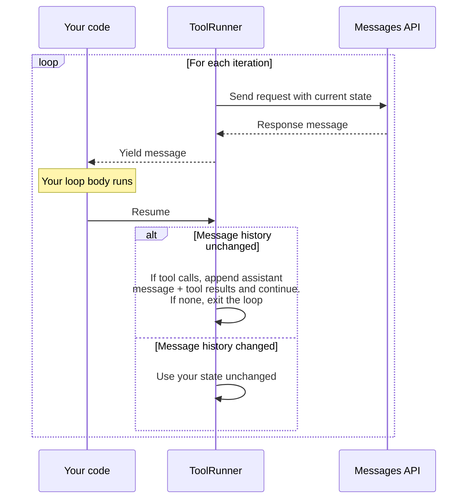

“Tool runner”（工具运行器）会为您处理 “agentic loop”（智能体循环）、错误包装和类型安全，让您无需亲自处理。当您需要人工参与审批、自定义日志记录或条件执行时，请改用[手动循环](https://platform.claude.com/docs/zh-CN/agents-and-tools/tool-use/handle-tool-calls)。

工具运行器无需您手动处理工具调用、工具结果和对话管理，而是自动：

* 在 Claude 调用工具时运行工具
* 处理请求/响应周期
* 管理对话状态
* 提供类型安全和验证

<Note>
  工具运行器目前处于 beta 阶段，可在 [Python SDK](https://github.com/anthropics/anthropic-sdk-python/blob/main/tools.md)、[TypeScript SDK](https://github.com/anthropics/anthropic-sdk-typescript/blob/main/helpers.md#tool-helpers)、[C# SDK](https://github.com/anthropics/anthropic-sdk-csharp/blob/main/examples/ToolRunnerExample/Program.cs)、[Go SDK](https://github.com/anthropics/anthropic-sdk-go/blob/main/tools.md)、[Java SDK](https://github.com/anthropics/anthropic-sdk-java/blob/main/anthropic-java-example/src/main/java/com/anthropic/example/BetaToolRunnerRunnableToolExample.java)、[PHP SDK](https://github.com/anthropics/anthropic-sdk-php/blob/main/examples/beta/beta_tool_runner.php) 和 [Ruby SDK](https://github.com/anthropics/anthropic-sdk-ruby/blob/main/helpers.md#3-auto-looping-tool-runner-beta) 中使用。
</Note>

## 基本用法

使用 SDK 辅助工具定义工具，然后使用工具运行器运行它们。

根据 SDK 的工具签名，工具以字符串或内容块（文本、图像或文档块）的形式返回结果，因此工具可以返回多模态结果。返回的字符串会成为单个文本内容块。要返回结构化数据（例如 JSON 对象或数字），请先将其编码为字符串。

<Tabs exclude="shell">
  <Tab title="Python">
    使用 `@beta_tool` 装饰器通过类型提示和文档字符串定义工具。

    <Note>
      如果您使用的是异步客户端，请将 `@beta_tool` 替换为 `@beta_async_tool`，并使用 `async def` 定义函数。
    </Note>

    ```python
    import json
    from anthropic import Anthropic, beta_tool

    client = Anthropic()


    @beta_tool
    def get_weather(location: str, unit: str = "fahrenheit") -> str:
        """Get the current weather in a given location.

        Args:
            location: The city and state, e.g. San Francisco, CA
            unit: Temperature unit, either 'celsius' or 'fahrenheit'
        """
        return json.dumps({"temperature": "20°C", "condition": "Sunny"})


    @beta_tool
    def calculate_sum(a: int, b: int) -> str:
        """Add two numbers together.

        Args:
            a: First number
            b: Second number
        """
        return str(a + b)


    runner = client.beta.messages.tool_runner(
        model="claude-opus-5-5",
        max_tokens=1024,
        tools=[get_weather, calculate_sum],
        messages=[
            {
                "role": "user",
                "content": "What's the weather like in Paris? Also, what's 15 + 27?",
            }
        ],
    )
    for message in runner:
        print(message)
    ```

    `@beta_tool` 装饰器会检查函数参数和文档字符串，为您推导出 JSON schema。
  </Tab>

  <Tab title="TypeScript">
    使用 `betaZodTool()` 进行带 Zod 验证的类型安全工具定义，或使用 `betaTool()` 进行基于 JSON Schema 的定义。

    TypeScript 提供两种定义工具的方式：

    **使用 Zod（推荐）：** 使用 `betaZodTool()` 进行带 Zod 验证的类型安全工具定义（需要 Zod 3.25.0 或更高版本）：

    ```typescript
    import Anthropic from "@anthropic-ai/sdk";
    import { betaZodTool } from "@anthropic-ai/sdk/helpers/beta/zod";
    import { z } from "zod";

    const client = new Anthropic();

    const getWeatherTool = betaZodTool({
      name: "get_weather",
      description: "Get the current weather in a given location",
      inputSchema: z.object({
        location: z.string().describe("The city and state, e.g. San Francisco, CA"),
        unit: z.enum(["celsius", "fahrenheit"]).default("fahrenheit").describe("Temperature unit")
      }),
      run: async (input) => {
        return JSON.stringify({ temperature: "20°C", condition: "Sunny" });
      }
    });

    const finalMessage = await client.beta.messages.toolRunner({
      model: "claude-opus-5-5",
      max_tokens: 1024,
      tools: [getWeatherTool],
      messages: [{ role: "user", content: "What's the weather like in Paris?" }]
    });

    for (const block of finalMessage.content) {
      if (block.type === "text") {
        console.log(block.text);
      }
    }
    ```

    **使用 JSON Schema：** 使用 `betaTool()` 进行不依赖 Zod 的类型安全工具定义：

    <Note>
      Claude 生成的输入不会在运行时进行验证。如有需要，请在 `run` 函数内部执行验证。
    </Note>

    ```typescript
    import Anthropic from "@anthropic-ai/sdk";
    import { betaTool } from "@anthropic-ai/sdk/helpers/beta/json-schema";

    const client = new Anthropic();

    const calculateSumTool = betaTool({
      name: "calculate_sum",
      description: "Add two numbers together",
      inputSchema: {
        type: "object",
        properties: {
          a: { type: "number", description: "First number" },
          b: { type: "number", description: "Second number" }
        },
        required: ["a", "b"]
      },
      run: async (input) => {
        return String(input.a + input.b);
      }
    });

    const finalMessage = await client.beta.messages.toolRunner({
      model: "claude-opus-5-5",
      max_tokens: 1024,
      tools: [calculateSumTool],
      messages: [{ role: "user", content: "What's 15 + 27?" }]
    });

    for (const block of finalMessage.content) {
      if (block.type === "text") {
        console.log(block.text);
      }
    }
    ```
  </Tab>

  <Tab title="C#">
    将每个工具定义为 `BetaRunnableTool`，提供带有 JSON schema 的 `Definition` 以及在 Claude 调用该工具时运行的 `Run` 委托。

    ```csharp
    using System.Text.Json;
    using Anthropic;
    using Anthropic.Helpers.Beta;
    using Anthropic.Models.Beta.Messages;
    using MessageCreateParams = Anthropic.Models.Beta.Messages.MessageCreateParams;
    using InputSchema = Anthropic.Models.Beta.Messages.InputSchema;
    using Model = Anthropic.Models.Messages.Model;

    var client = new AnthropicClient();

    var getWeatherTool = new BetaRunnableTool
    {
        Name = "get_weather",
        Definition = new BetaTool
        {
            Name = "get_weather",
            Description = "Get the current weather in a given location.",
            InputSchema = new InputSchema
            {
                Properties = new Dictionary<string, JsonElement>
                {
                    ["location"] = JsonSerializer.SerializeToElement(
                        new { type = "string", description = "The city and state, e.g. San Francisco, CA" }
                    ),
                },
                Required = ["location"],
            },
        },
        Run = (toolUse, _) =>
        {
            var location = toolUse.Input["location"].GetString();
            return Task.FromResult<BetaToolResultBlockParamContent>(
                $"Weather in {location}: 20°C, sunny"
            );
        },
    };

    var calculateSumTool = new BetaRunnableTool
    {
        Name = "calculate_sum",
        Definition = new BetaTool
        {
            Name = "calculate_sum",
            Description = "Add two numbers together.",
            InputSchema = new InputSchema
            {
                Properties = new Dictionary<string, JsonElement>
                {
                    ["a"] = JsonSerializer.SerializeToElement(new { type = "number" }),
                    ["b"] = JsonSerializer.SerializeToElement(new { type = "number" }),
                },
                Required = ["a", "b"],
            },
        },
        Run = (toolUse, _) =>
        {
            var a = toolUse.Input["a"].GetDouble();
            var b = toolUse.Input["b"].GetDouble();
            return Task.FromResult<BetaToolResultBlockParamContent>($"{a + b}");
        },
    };

    var runner = client.Beta.Messages.ToolRunner(
        new MessageCreateParams
        {
            Model = Model.ClaudeOpus5_5,
            MaxTokens = 1024,
            Messages =
            [
                new BetaUserMessageParam
                {
                    Content = "What's the weather like in Paris? Also, what's 15 + 27?",
                },
            ],
        },
        [getWeatherTool, calculateSumTool]
    );

    await foreach (var message in runner)
    {
        Console.WriteLine(message);
    }
    ```
  </Tab>

  <Tab title="Go">
    使用 `toolrunner.NewBetaToolFromJSONSchema` 定义工具。处理函数的输入类型是带有 `jsonschema:` 标签的结构体。SDK 通过反射生成 JSON schema。

    ```go
    package main

    import (
    	"context"
    	"fmt"
    	"log"

    	"github.com/anthropics/anthropic-sdk-go/v2"
    	"github.com/anthropics/anthropic-sdk-go/v2/toolrunner"
    )

    type GetWeatherInput struct {
    	Location string `json:"location" jsonschema:"required,description=The city and state, e.g. San Francisco, CA"`
    	Unit     string `json:"unit,omitempty" jsonschema:"enum=celsius,enum=fahrenheit,description=Temperature unit"`
    }

    type CalculateSumInput struct {
    	A int `json:"a" jsonschema:"required,description=First number"`
    	B int `json:"b" jsonschema:"required,description=Second number"`
    }

    func main() {
    	client := anthropic.NewClient()
    	ctx := context.Background()

    	getWeather, err := toolrunner.NewBetaToolFromJSONSchema(
    		"get_weather",
    		"Get the current weather in a given location.",
    		func(ctx context.Context, input GetWeatherInput) (anthropic.BetaToolResultBlockParamContentUnion, error) {
    			return anthropic.BetaToolResultBlockParamContentUnion{
    				OfText: &anthropic.BetaTextBlockParam{Text: "20°C, Sunny"},
    			}, nil
    		},
    	)
    	if err != nil {
    		log.Fatal(err)
    	}

    	calculateSum, err := toolrunner.NewBetaToolFromJSONSchema(
    		"calculate_sum",
    		"Add two numbers together.",
    		func(ctx context.Context, input CalculateSumInput) (anthropic.BetaToolResultBlockParamContentUnion, error) {
    			return anthropic.BetaToolResultBlockParamContentUnion{
    				OfText: &anthropic.BetaTextBlockParam{Text: fmt.Sprintf("%d", input.A+input.B)},
    			}, nil
    		},
    	)
    	if err != nil {
    		log.Fatal(err)
    	}

    	runner := client.Beta.Messages.NewToolRunner(
    		[]anthropic.BetaTool{getWeather, calculateSum},
    		anthropic.BetaToolRunnerParams{
    			BetaMessageNewParams: anthropic.BetaMessageNewParams{
    				Model:     anthropic.ModelClaudeOpus5_5,
    				MaxTokens: 1024,
    				Messages: []anthropic.BetaMessageParam{
    					anthropic.NewBetaUserMessage(anthropic.NewBetaTextBlock(
    						"What's the weather like in Paris? Also, what's 15 + 27?",
    					)),
    				},
    			},
    		},
    	)

    	for message, err := range runner.All(ctx) {
    		if err != nil {
    			log.Fatal(err)
    		}
    		fmt.Println(message)
    	}
    }
    ```

    `jsonschema:` 结构体标签用于生成输入 schema。例如，`CalculateSumInput` 会变为：

    ```json
    {
      "name": "calculate_sum",
      "description": "Add two numbers together.",
      "input_schema": {
        "type": "object",
        "properties": {
          "a": { "type": "integer", "description": "First number" },
          "b": { "type": "integer", "description": "Second number" }
        },
        "required": ["a", "b"]
      }
    }
    ```
  </Tab>

  <Tab title="Java">
    将每个工具定义为 `BetaRunnableTool`，它将一个输入类与一个在 Claude 调用该工具时运行的函数配对。使用 `@JsonClassDescription` 注解输入类以提供工具描述，并使用 `@JsonPropertyDescription` 注解每个公共字段以提供参数描述。SDK 会从该类推导出 JSON schema、工具名称（蛇形命名的类名）和输入解析，并将该工具标记为 `strict: true`（[严格工具使用](https://platform.claude.com/docs/zh-CN/agents-and-tools/tool-use/strict-tool-use)）。

    该函数接收解析后的输入（作为该类的实例），并返回 `BetaToolResultBlockParam.Content`。如需返回文本，请使用 `BetaToolResultBlockParam.Content.ofString()` 对其进行包装。由于该函数是一个 lambda，它可以使用您应用程序中的对象，例如以下示例中的 `WeatherService`。

    ```java
    import com.anthropic.client.AnthropicClient;
    import com.anthropic.client.okhttp.AnthropicOkHttpClient;
    import com.anthropic.helpers.BetaRunnableTool;
    import com.anthropic.helpers.BetaToolRunner;
    import com.anthropic.models.beta.messages.BetaMessage;
    import com.anthropic.models.beta.messages.BetaToolResultBlockParam;
    import com.anthropic.models.beta.messages.MessageCreateParams;
    import com.anthropic.models.messages.Model;
    import com.fasterxml.jackson.annotation.JsonClassDescription;
    import com.fasterxml.jackson.annotation.JsonPropertyDescription;

    @JsonClassDescription("Get the current weather in a given location")
    static class GetWeather {
        @JsonPropertyDescription("The city and state, e.g. San Francisco, CA")
        public String location;

        @JsonPropertyDescription("Temperature unit, either 'celsius' or 'fahrenheit'")
        public String unit;
    }

    @JsonClassDescription("Add two numbers together")
    static class CalculateSum {
        @JsonPropertyDescription("First number")
        public double a;

        @JsonPropertyDescription("Second number")
        public double b;
    }

    // 代表您的应用中已有的某个类，
    // 例如数据库客户端或 API 封装类。
    static class WeatherService {
        String currentWeather(String location, String unit) {
            return "{\"temperature\": \"20°C\", \"condition\": \"Sunny\"}";
        }
    }

    void main() {
        AnthropicClient client = AnthropicOkHttpClient.fromEnv();
        WeatherService weatherService = new WeatherService();

        // 该 lambda 可以使用 weatherService。
        BetaRunnableTool getWeather = BetaRunnableTool.of(
            GetWeather.class,
            input -> BetaToolResultBlockParam.Content.ofString(
                weatherService.currentWeather(input.location, input.unit)));

        BetaRunnableTool calculateSum = BetaRunnableTool.of(
            CalculateSum.class,
            input -> BetaToolResultBlockParam.Content.ofString(
                String.valueOf(input.a + input.b)));

        BetaToolRunner runner = client.beta()
            .messages()
            .toolRunner(MessageCreateParams.builder()
                .model(Model.CLAUDE_OPUS_5_5)
                .maxTokens(1024)
                .addBeta("structured-outputs-2025-11-13")
                .addUserMessage("What's the weather like in Paris? Also, what's 15 + 27?")
                .addTool(getWeather)
                .addTool(calculateSum)
                .build());

        for (BetaMessage message : runner) {
            IO.println(message);
        }
    }
    ```

    类名 `CalculateSum` 会变为工具名称 `calculate_sum`，SDK 会根据带注解的字段生成 JSON schema：

    ```json
    {
      "name": "calculate_sum",
      "description": "Add two numbers together",
      "input_schema": {
        "type": "object",
        "properties": {
          "a": { "description": "First number", "type": "number" },
          "b": { "description": "Second number", "type": "number" }
        },
        "required": ["a", "b"],
        "additionalProperties": false
      },
      "strict": true
    }
    ```
  </Tab>

  <Tab title="PHP">
    将每个工具定义为 `BetaRunnableTool`，它将工具的 JSON schema 定义与运行该工具的闭包配对。

    ```php
    <?php

    use Anthropic\Client;
    use Anthropic\Beta\Messages\BetaTextBlock;
    use Anthropic\Beta\Messages\BetaToolUseBlock;
    use Anthropic\Lib\Tools\BetaRunnableTool;
    use Anthropic\Messages\Model;

    $client = new Client();

    $getWeather = new BetaRunnableTool(
        definition: [
            'name' => 'get_weather',
            'description' => 'Get the current weather in a given location.',
            'input_schema' => [
                'type' => 'object',
                'properties' => [
                    'location' => [
                        'type' => 'string',
                        'description' => 'The city and state, e.g. San Francisco, CA',
                    ],
                    'unit' => [
                        'type' => 'string',
                        'enum' => ['celsius', 'fahrenheit'],
                    ],
                ],
                'required' => ['location'],
            ],
        ],
        run: fn (array $input): string => json_encode([
            'temperature' => '20°C',
            'condition' => 'Sunny',
        ]),
    );

    $calculateSum = new BetaRunnableTool(
        definition: [
            'name' => 'calculate_sum',
            'description' => 'Add two numbers together.',
            'input_schema' => [
                'type' => 'object',
                'properties' => [
                    'a' => ['type' => 'number', 'description' => 'First number'],
                    'b' => ['type' => 'number', 'description' => 'Second number'],
                ],
                'required' => ['a', 'b'],
            ],
        ],
        run: fn (array $input): string => (string) ($input['a'] + $input['b']),
    );

    $runner = $client->beta->messages->toolRunner(
        maxTokens: 1024,
        messages: [
            ['role' => 'user', 'content' => "What's the weather like in Paris? Also, what's 15 + 27?"],
        ],
        model: Model::CLAUDE_OPUS_5_5,
        tools: [$getWeather, $calculateSum],
    );

    foreach ($runner as $message) {
        foreach ($message->content as $block) {
            switch (true) {
                case $block instanceof BetaTextBlock:
                    echo $block->text, "\n";
                    break;
                case $block instanceof BetaToolUseBlock:
                    echo "[Tool call: {$block->name}]\n";
                    break;
            }
        }
    }
    ```
  </Tab>

  <Tab title="Ruby">
    使用 `Anthropic::BaseTool` 类定义带有类型化输入 schema 的工具。

    ```ruby
    require "anthropic"

    # 初始化客户端
    client = Anthropic::Client.new

    # 定义输入 schema
    class GetWeatherInput < Anthropic::BaseModel
      required :location, String, doc: "The city and state, e.g. San Francisco, CA"
      optional :unit, Anthropic::InputSchema::EnumOf["celsius", "fahrenheit"],
               doc: "Temperature unit"
    end

    # 定义工具
    class GetWeather < Anthropic::BaseTool
      doc "Get the current weather in a given location"
      input_schema GetWeatherInput

      def call(input)
        # 在完整实现中，您应在此处调用天气 API
        JSON.generate({temperature: "20°C", condition: "Sunny"})
      end
    end

    class CalculateSumInput < Anthropic::BaseModel
      required :a, Integer, doc: "First number"
      required :b, Integer, doc: "Second number"
    end

    class CalculateSum < Anthropic::BaseTool
      doc "Add two numbers together"
      input_schema CalculateSumInput

      def call(input)
        (input.a + input.b).to_s
      end
    end

    # 使用 tool runner（工具运行器）
    runner = client.beta.messages.tool_runner(
      model: Anthropic::Model::CLAUDE_OPUS_5_5,
      max_tokens: 1024,
      tools: [GetWeather.new, CalculateSum.new],
      messages: [
        {role: "user", content: "What's the weather like in Paris? Also, what's 15 + 27?"}
      ]
    )

    runner.each_message do |message|
      message.content.each do |block|
        puts block.text if block.type == :text
      end
    end
    ```

    `Anthropic::BaseTool` 类使用 `doc` 方法提供工具描述，使用 `input_schema` 定义预期参数。SDK 会自动将其转换为相应的 JSON schema 格式。
  </Tab>
</Tabs>

## 迭代工具运行器

工具运行器是一个可迭代对象，会产出来自 Claude 的消息。在每次迭代中，运行器会检查 Claude 是否请求了工具使用。如果是，它会运行该工具并自动将结果发送回 Claude，然后产出来自 Claude 的下一条消息以继续您的循环。

您可以在任意一次迭代中使用 `break` 语句结束循环。运行器会一直循环，直到 Claude 返回不包含工具使用的消息，或者达到 `max_iterations` (csharp, php: `maxIterations`; java: `.maxIterations()`; go: `MaxIterations`)（如果您设置了该值）。

如果您不需要中间消息，可以直接获取最终消息：

<Tabs exclude="shell">
  <Tab title="Python">
    使用 `runner.until_done()` 获取最终消息。

    ```python
    client = anthropic.Anthropic()
    # ...
    runner = client.beta.messages.tool_runner(
        model="claude-opus-5-5",
        max_tokens=1024,
        tools=[get_weather, calculate_sum],
        messages=[
            {
                "role": "user",
                "content": "What's the weather like in Paris? Also, what's 15 + 27?",
            }
        ],
    )
    final_message = runner.until_done()
    for block in final_message.content:
        if block.type == "text":
            print(block.text)
    ```
  </Tab>

  <Tab title="TypeScript">
    对运行器使用 `await` 以获取最终消息。

    ```typescript
    const client = new Anthropic();
    // ...
    const runner = client.beta.messages.toolRunner({
      model: "claude-opus-5-5",
      max_tokens: 1024,
      tools: [getWeatherTool],
      messages: [{ role: "user", content: "What's the weather like in Paris?" }]
    });

    const finalMessage = await runner;
    for (const block of finalMessage.content) {
      if (block.type === "text") {
        console.log(block.text);
      }
    }
    ```
  </Tab>

  <Tab title="C#">
    使用 `runner.RunUntilDoneAsync()` 获取最终消息。

    ```csharp
    var client = new AnthropicClient();
    // ...
    var runner = client.Beta.Messages.ToolRunner(
        new MessageCreateParams
        {
            Model = Model.ClaudeOpus5_5,
            MaxTokens = 1024,
            Messages = [new BetaUserMessageParam { Content = "What's the weather like in Paris?" }],
        },
        [getWeatherTool]
    );

    var finalMessage = await runner.RunUntilDoneAsync();
    foreach (var block in finalMessage.Content)
    {
        if (block.TryPickText(out var textBlock))
        {
            Console.WriteLine(textBlock.Text);
        }
    }
    ```
  </Tab>

  <Tab title="Go">
    使用 `runner.RunToCompletion(ctx)` 获取最终消息。

    ```go
    client := anthropic.NewClient()
    ctx := context.Background()
    // ...
    runner := client.Beta.Messages.NewToolRunner(
    	[]anthropic.BetaTool{getWeather},
    	anthropic.BetaToolRunnerParams{
    		BetaMessageNewParams: anthropic.BetaMessageNewParams{
    			Model:     anthropic.ModelClaudeOpus5_5,
    			MaxTokens: 1024,
    			Messages: []anthropic.BetaMessageParam{
    				anthropic.NewBetaUserMessage(anthropic.NewBetaTextBlock(
    					"What's the weather like in Paris?",
    				)),
    			},
    		},
    	},
    )

    finalMessage, err := runner.RunToCompletion(ctx)
    if err != nil {
    	log.Fatal(err)
    }
    for _, block := range finalMessage.Content {
    	if textBlock, ok := block.AsAny().(anthropic.BetaTextBlock); ok {
    		fmt.Println(textBlock.Text)
    	}
    }
    ```
  </Tab>

  <Tab title="Java">
    Java SDK 没有 `until_done()` 快捷方法。请迭代至耗尽并保留最后一条消息。

    ```java
    AnthropicClient client = AnthropicOkHttpClient.fromEnv();

    BetaToolRunner runner = client.beta()
        .messages()
        .toolRunner(MessageCreateParams.builder()
            .model(Model.CLAUDE_OPUS_5_5)
            .maxTokens(1024)
            .addBeta("structured-outputs-2025-11-13")
            .addUserMessage("What's the weather like in Paris? Also, what's 15 + 27?")
            .addTool(getWeather)
            .addTool(calculateSum)
            .build());

    BetaMessage finalMessage = null;
    for (BetaMessage message : runner) {
        finalMessage = message;
    }
    for (BetaContentBlock block : finalMessage.content()) {
        block.text().ifPresent(textBlock -> IO.println(textBlock.text()));
    }
    ```
  </Tab>

  <Tab title="PHP">
    使用 `runUntilDone()` 获取最终消息。

    ```php
    $client = new Client();
    // ...
    $runner = $client->beta->messages->toolRunner(
        maxTokens: 1024,
        messages: [
            ['role' => 'user', 'content' => "What's the weather like in Paris? Also, what's 15 + 27?"],
        ],
        model: Model::CLAUDE_OPUS_5_5,
        tools: [$getWeather, $calculateSum],
    );

    $finalMessage = $runner->runUntilDone();
    foreach ($finalMessage->content as $block) {
        if ($block->type === 'text') {
            echo $block->text, "\n";
        }
    }
    ```
  </Tab>

  <Tab title="Ruby">
    使用 `runner.run_until_finished` 获取所有消息。

    ```ruby
    client = Anthropic::Client.new
    # ...
    runner = client.beta.messages.tool_runner(
      model: Anthropic::Model::CLAUDE_OPUS_5_5,
      max_tokens: 1024,
      tools: [GetWeather.new, CalculateSum.new],
      messages: [
        {role: "user", content: "What's the weather like in Paris? Also, what's 15 + 27?"}
      ]
    )

    all_messages = runner.run_until_finished
    all_messages.each { |msg| puts msg.content }
    ```
  </Tab>
</Tabs>

## 高级用法

在循环内部，您可以读取每条响应消息，并在下一次 API 调用之前修改运行器的状态。每次迭代遵循以下生命周期：

1. 运行器使用其当前状态向 Messages API 发送请求。

2. 运行器将响应消息产出给您的循环体。

3. 您的循环体运行。您可以读取消息，并可选择修改运行器的状态。

4. 当您的循环体返回时，运行器会检查您是否修改了其消息历史。

   * **如果您未修改消息历史：** 如果消息包含工具调用，运行器会追加助手消息和工具结果，然后继续。如果没有工具调用，循环退出。
   * **如果您修改了消息历史：** 运行器会跳过自动追加，并原样使用您的状态。请参阅[接管消息历史](https://platform.claude.com/docs/zh-CN/agents-and-tools/tool-use/tool-runner#taking-over-message-history)。



### 接管消息历史

默认情况下，运行器会为您管理对话状态：在每个工具调用轮次之后，它会将助手消息和所有工具结果追加到自己的消息历史中。当您想要重试某个轮次（丢弃响应并重新发送）、注入后续消息或自行构建工具结果时，您可以接管消息历史。

您可以通过在循环体内部修改运行器的消息来接管。具体方法取决于 SDK。请参阅下面各语言的标签页。

当您在某次迭代中接管时，运行器不会追加该轮次的助手消息或工具结果。您需要负责保持对话有效：自行追加助手消息和工具结果（如果您希望该轮次生效），有条件地修改状态以便在没有工具调用时循环仍能退出，并传入 `max_iterations` (csharp, php: `maxIterations`; java: `.maxIterations()`; go: `MaxIterations`) 以限制循环次数。SDK 在全部七种语言中都支持 `max_iterations` (csharp, php: `maxIterations`; java: `.maxIterations()`; go: `MaxIterations`)。

<Tabs exclude="shell">
  <Tab title="Python">
    使用 `generate_tool_call_response()` 检查或计算工具结果。在循环内部调用 `append_messages()` 会告知运行器您正在自行管理历史，因此请在您追加的内容中包含助手消息和工具结果。

    ```python
    runner = client.beta.messages.tool_runner(
        model="claude-opus-5-5",
        max_tokens=1024,
        max_iterations=10,
        tools=[get_weather],
        messages=[{"role": "user", "content": "What's the weather in San Francisco?"}],
    )

    for message in runner:
        tool_response = runner.generate_tool_call_response()
        if tool_response is not None:
            # append_messages() 会将状态标记为已修改，因此 runner 会跳过
            # 本次迭代的自动追加。您需要自行追加助手消息和
            # 工具结果，以及任何后续内容。
            runner.append_messages(
                message,
                tool_response,
                {"role": "user", "content": "Please be concise."},
            )
        # 当没有工具调用时，保持状态不变，以便循环退出。
    ```

    要在不接管消息历史的情况下更改 `max_tokens` 等请求参数，请使用 `set_messages_params()`。运行器仍会自动追加助手消息和工具结果。

    ```python
    for message in runner:
        runner.set_messages_params(lambda params: {**params, "max_tokens": 2048})
    ```
  </Tab>

  <Tab title="TypeScript">
    使用 `runner.params` 读取当前请求参数，使用 `setMessagesParams()` 替换它们。在循环内部调用 `setMessagesParams()` 或 `pushMessages()` 会告知运行器您正在自行管理状态：本次迭代的助手消息和工具结果会被丢弃，下一个请求将使用您的状态发出。

    以下示例使用更大的 `max_tokens` 预算重试被截断的响应。

    ```typescript
    const runner = client.beta.messages.toolRunner({
      model: "claude-opus-5-5",
      max_tokens: 1024,
      max_iterations: 10,
      tools: [getWeatherTool],
      messages: [
        {
          role: "user",
          content: "Give me a detailed weather report for every major US city."
        }
      ]
    });

    const MAX_TOKEN_CEILING = 8192;

    for await (const message of runner) {
      if (message.stop_reason === "max_tokens") {
        const current = runner.params.max_tokens;
        if (current >= MAX_TOKEN_CEILING) {
          console.warn(`Hit ceiling (${MAX_TOKEN_CEILING}); stopping.`);
          break;
        }
        const doubled = Math.min(current * 2, MAX_TOKEN_CEILING);
        console.log(`Response truncated at ${current} tokens; retrying with ${doubled}.`);
        // 提高预算。setMessagesParams() 会将状态标记为已修改，因此
        // 运行器不会追加被截断的消息。下一次迭代将使用更大的预算
        // 重试同一轮次。
        runner.setMessagesParams((params) => ({ ...params, max_tokens: doubled }));
      }
      // 否则保持状态不变，以便运行器自动追加并继续执行。
    }
    ```
  </Tab>

  <Tab title="C#">
    调用 `SetParams()` 或 `PushMessages()` 会将状态标记为已修改，这会导致运行器跳过该轮次的自动追加。C# 运行器仍会运行该轮次匹配的工具并丢弃其自动构建的结果，因此如果您在循环体内也自行运行某个工具，除非您加以处理，否则该工具会运行两次。当您接管时，请自行推送助手消息和工具结果。否则对话将无法向前推进。C# 运行器在响应不含工具调用时总是会退出，因此请将任何状态变更以存在 `tool_use` 块为条件。

    ```csharp
    var runner = client.Beta.Messages.ToolRunner(
        new MessageCreateParams
        {
            Model = Model.ClaudeOpus5_5,
            MaxTokens = 1024,
            Messages = [new BetaUserMessageParam { Content = "What's the weather in San Francisco?" }],
        },
        [getWeatherTool],
        maxIterations: 10
    );

    await foreach (var message in runner)
    {
        var toolUseBlock = message
            .Content.Select(block => block.TryPickToolUse(out var toolUse) ? toolUse : null)
            .FirstOrDefault(toolUse => toolUse is not null);

        if (toolUseBlock is null)
        {
            // 无工具调用：保持状态不变，以便循环正常退出。
            continue;
        }

        // 自行运行工具并构建结果块。
        var toolResult = new BetaToolResultBlockParam(toolUseBlock.ID)
        {
            Content = await getWeatherTool.ExecuteAsync(toolUseBlock, default),
        };

        // PushMessages() 将状态标记为已修改；运行器会跳过其自动追加。
        // 自行提供助手回合和工具结果，然后添加后续消息。
        runner.PushMessages(
            new BetaAssistantMessageParam
            {
                Content = new BetaMessageContentParam(
                    JsonSerializer.SerializeToElement(
                        message.Content.Select(block => block.Json).ToArray()
                    )
                ),
            },
            new BetaUserMessageParam { Content = new List<BetaContentBlockParam> { toolResult } },
            new BetaUserMessageParam { Content = "Please be concise in your response." }
        );
    }
    ```
  </Tab>

  <Tab title="Go">
    Go 运行器将参数公开为公共的 `Params` 字段。在两次 `NextMessage(ctx)` 调用之间修改 `runner.Params` 会应用于下一次 API 请求。与其他 SDK 不同，Go 运行器总是无条件地追加助手消息和工具结果。修改 `Params` 不会抑制该步骤。

    ```go
    runner := client.Beta.Messages.NewToolRunner(
    	[]anthropic.BetaTool{getWeather},
    	anthropic.BetaToolRunnerParams{
    		BetaMessageNewParams: anthropic.BetaMessageNewParams{
    			Model:     anthropic.ModelClaudeOpus5_5,
    			MaxTokens: 1024,
    			Messages: []anthropic.BetaMessageParam{
    				anthropic.NewBetaUserMessage(anthropic.NewBetaTextBlock(
    					"What's the weather in San Francisco?",
    				)),
    			},
    		},
    		MaxIterations: 10,
    	},
    )

    for {
    	message, err := runner.NextMessage(ctx)
    	if err != nil {
    		log.Fatal(err)
    	}
    	if message == nil {
    		break // conversation complete
    	}

    	// Go 运行器始终会追加助手消息和工具结果。
    	// 此处的参数更改将应用于下一次迭代。
    	runner.Params.MaxTokens = 2048
    }
    ```
  </Tab>

  <Tab title="Java">
    使用 `runner.params()` 读取当前参数，使用 `runner.setNextParams()` 为下一次迭代替换参数。当您在循环内调用 `setNextParams()` 时，运行器会跳过自动追加。刚产出的消息会被丢弃，下一次迭代会原样发送您的新参数。

    以下示例通过将 `max_tokens` 加倍来重试达到令牌限制的轮次。仅在 `max_tokens` 分支上进行变更可使循环保持收敛：正常完成的轮次会直接通过，运行器会自动追加，并在没有更多工具调用时退出。

    ```java
    BetaToolRunner runner = client.beta()
        .messages()
        .toolRunner(ToolRunnerCreateParams.builder()
            .initialMessageParams(MessageCreateParams.builder()
                .model(Model.CLAUDE_OPUS_5_5)
                .maxTokens(1024)
                .addBeta("structured-outputs-2025-11-13")
                .addUserMessage("Give me a detailed weather report for every major US city.")
                .addTool(getWeather)
                .build())
            .maxIterations(10L)
            .build());

    long ceiling = 8192;

    for (BetaMessage message : runner) {
        if (BetaStopReason.MAX_TOKENS.equals(message.stopReason().orElse(null))) {
            long current = runner.params().maxTokens();
            if (current >= ceiling) {
                IO.println("Hit ceiling (" + ceiling + "), accepting truncated response.");
                break;
            }
            long doubled = Math.min(current * 2, ceiling);
            IO.println("Response truncated at " + current + " tokens, retrying with " + doubled + ".");

            // 调用 setNextParams() 会将此轮标记为用户管理：运行器
            // 不会自动追加被截断的消息，因此下一次迭代会
            // 以更大的预算重新发送相同的对话前缀。
            runner.setNextParams(runner.params().toBuilder()
                .maxTokens(doubled)
                .build());
        }
        // 正常轮次不做修改：运行器会自动追加并继续。
    }
    ```
  </Tab>

  <Tab title="PHP">
    使用 `setMessagesParams()` 和 `pushMessages()` 修改运行器的状态，使用 `getParams()` 读取状态。在循环内部调用任一 setter 都会告知运行器跳过自动追加，因此对话将从您修改后的状态继续。

    以下示例在响应被截断时将 `max_tokens` 加倍并重试。

    ```php
    use Anthropic\Beta\Messages\BetaStopReason;

    $runner = $client->beta->messages->toolRunner(
        maxTokens: 1024,
        messages: [
            ['role' => 'user', 'content' => 'Give a detailed weather report for every major US city.'],
        ],
        model: Model::CLAUDE_OPUS_5_5,
        tools: [$getWeather],
        maxIterations: 10,
    );

    $maxTokenCeiling = 8192;

    foreach ($runner as $message) {
        if ($message->stopReason === BetaStopReason::MAX_TOKENS->value) {
            $current = $runner->getParams()['maxTokens'];

            if ($current >= $maxTokenCeiling) {
                echo "Hit ceiling ({$maxTokenCeiling}), accepting truncated response.\n";
                break;
            }

            $doubled = min($current * 2, $maxTokenCeiling);
            echo "Response truncated at {$current} tokens, retrying with {$doubled}.\n";

            // 在循环内调用 setMessagesParams() 会告知运行器跳过
            // 其自动追加操作。被截断的消息将被丢弃；下一次
            // 迭代会以更大的预算重试。
            // 键名采用驼峰命名法（camelCase），与 toolRunner() 的命名参数一致。
            $runner->setMessagesParams(['maxTokens' => $doubled]);
        }
    }
    ```
  </Tab>

  <Tab title="Ruby">
    使用 `next_message` 进行逐步控制。当 `next_message` 返回时，该轮次的助手消息和工具结果已经被追加。使用 `feed_messages` 在轮次之间注入后续消息，使用 `runner.params.update(...)` 就地更改请求参数。

    当您在 `each_message` 或 `each_streaming` 块内部重新赋值 `runner.params[:messages]` 或调用 `feed_messages` 时，即接管了消息历史。以下模式在 `next_message` 调用之间调用 `feed_messages`，这不会接管。

    ```ruby
    runner = client.beta.messages.tool_runner(
      model: Anthropic::Model::CLAUDE_OPUS_5_5,
      max_tokens: 1024,
      max_iterations: 10,
      tools: [GetWeather.new],
      messages: [{role: "user", content: "What's the weather in San Francisco?"}]
    )

    # 让 runner 执行一步。助手消息和 tool_result 会在 next_message 返回之前
    # 被追加到 runner.params[:messages] 中。
    message = runner.next_message
    puts message.content

    # 在继续之前注入一条后续消息。feed_messages 接受 splat 参数，而非数组。
    runner.feed_messages({role: "user", content: "Also check Boston."})

    # 就地修改参数。重新赋值 runner.params[:messages] 仅当发生在
    # each_message 或 each_streaming 块内部时才会接管消息历史。
    runner.params.update(max_tokens: 2048)

    runner.run_until_finished
    ```
  </Tab>
</Tabs>

### 自动上下文管理

对于长时间运行的智能体任务，TypeScript 和 Ruby 工具运行器支持自动[压缩](https://platform.claude.com/docs/zh-CN/build-with-claude/context-editing#client-side-compaction-sdk)，当令牌使用量超过阈值时会生成摘要，使对话能够超出 “context window”（上下文窗口）限制继续进行。这两个 SDK 都已弃用此客户端选项，转而推荐[服务器端压缩](https://platform.claude.com/docs/zh-CN/build-with-claude/compaction-threshold)，后者通过 `context_management` 请求参数适用于每个 SDK 的工具运行器。Python SDK（v1.0 及更高版本）以及 Go、Java、C# 和 PHP 工具运行器不包含客户端压缩。工具运行器提供了一个 `compact_before_next_turn()` (typescript, java, php: `compactBeforeNextTurn()`; csharp, go: `CompactBeforeNextTurn()`) 辅助方法用于按需压缩。请参阅[在循环中压缩](https://platform.claude.com/docs/zh-CN/build-with-claude/compaction-on-demand#compact-in-a-loop)。在一个运行器上请使用它或 `context_management` 压缩编辑，不要同时使用两者。

### 调试工具执行

当工具抛出异常时，工具运行器会捕获它，并将错误作为带有 `is_error: true` 的工具结果返回给 Claude。工具结果携带异常的消息（在 Python 中为其类型和消息），而非完整的堆栈跟踪。

SDK 记录的日志内容因语言而异。每当工具引发未处理的异常时，Python SDK 会通过标准 `logging` 模块记录完整的异常，包括其堆栈跟踪。Python、TypeScript 和 Java SDK 会读取 `ANTHROPIC_LOG` 环境变量以开启 SDK 的日志记录，其中包括请求和响应详情：

```bash
# 以 info 级别记录日志
export ANTHROPIC_LOG=info

# 以 debug 级别记录日志以获得更详细的输出
export ANTHROPIC_LOG=debug
```

Go、Ruby、C# 和 PHP SDK 不读取 `ANTHROPIC_LOG`。除 Python 外，没有 SDK 会记录失败的工具：要查看工具失败的原因，请在工具函数内部捕获并记录异常，然后再返回或重新抛出。

### 拦截工具错误

默认情况下，工具运行器会将工具错误传回 Claude，Claude 随后可以做出适当的响应。但是，您可能希望检测错误并以不同方式处理，例如提前停止执行或实现自定义错误处理。

<Tabs exclude="shell">
  <Tab title="Python">
    ```python
    client = anthropic.Anthropic()
    # ...
    runner = client.beta.messages.tool_runner(
        model="claude-opus-5-5",
        max_tokens=1024,
        tools=[my_tool],
        messages=[{"role": "user", "content": "Run my_tool with the query 'hello'."}],
    )

    for message in runner:
        tool_response = runner.generate_tool_call_response()

        if tool_response is not None:
            # tool_response 是一个 dict：{"role": "user", "content": [...]}
            # 检查是否有任何工具结果包含错误
            for block in tool_response["content"]:
                if block.get("is_error"):
                    # 选项 1：抛出异常以停止循环
                    raise RuntimeError(f"Tool failed: {json.dumps(block['content'])}")

                    # 选项 2：记录日志并继续（交由 Claude 处理）
                    # logger.error(f"Tool error: {json.dumps(block['content'])}")

        # 正常处理该消息
        print(message.content)
    ```

    <Note>
      在循环中调用 

      `runner.generate_tool_call_response()`

       以获取工具结果，并在运行器将其发送给 Claude 之前检查是否有错误。
    </Note>
  </Tab>

  <Tab title="TypeScript">
    ```typescript
    const client = new Anthropic();
    // ...
    const runner = client.beta.messages.toolRunner({
      model: "claude-opus-5-5",
      max_tokens: 1024,
      tools: [myTool],
      messages: [{ role: "user", content: "Run my_tool with the query 'hello'." }]
    });

    for await (const message of runner) {
      const toolResultMessage = await runner.generateToolResponse();

      if (toolResultMessage && typeof toolResultMessage.content !== "string") {
        // 检查是否有任何工具结果包含错误
        for (const block of toolResultMessage.content) {
          if (block.type === "tool_result" && block.is_error) {
            // 选项 1：抛出异常以停止循环
            throw new Error(`Tool failed: ${JSON.stringify(block.content)}`);

            // 选项 2：记录日志并继续（交由 Claude 处理）
            // console.error(`Tool error: ${JSON.stringify(block.content)}`);
          }
        }
      }

      // 正常处理消息
      console.log(message.content);
    }
    ```

    <Note>
      在循环中调用 

      `runner.generateToolResponse()`

       以获取工具结果，并在运行器将其发送给 Claude 之前检查是否有错误。
    </Note>
  </Tab>

  <Tab title="C#">
    C# 工具运行器不公开用于在工具结果发送给 Claude 之前检查它的钩子。要控制错误内容，请在工具体内部抛出 `BetaToolError`。运行器会将其转换为带有 `is_error: true` 和您提供的内容的 `tool_result`。

    ```csharp
    var client = new AnthropicClient();

    var getWeatherTool = new BetaRunnableTool
    {
        Name = "get_weather",
        Definition = new BetaTool
        {
            Name = "get_weather",
            Description = "Get the current weather in a given location.",
            InputSchema = new InputSchema
            {
                Properties = new Dictionary<string, JsonElement>
                {
                    ["location"] = JsonSerializer.SerializeToElement(new { type = "string" }),
                },
                Required = ["location"],
            },
        },
        Run = async (toolUse, cancellationToken) =>
        {
            try
            {
                return await CallExternalWeatherService(
                    toolUse.Input["location"].GetString()!,
                    cancellationToken
                );
            }
            catch (HttpRequestException ex)
            {
                // 如需在 Claude 看到失败信息之前检查它，请在此处记录日志。
                throw new BetaToolError($"Weather service unavailable: {ex.Message}");
            }
        },
    };

    var runner = client.Beta.Messages.ToolRunner(
        new MessageCreateParams
        {
            Model = Model.ClaudeOpus5_5,
            MaxTokens = 1024,
            Messages = [new BetaUserMessageParam { Content = "What's the weather in San Francisco?" }],
        },
        [getWeatherTool]
    );

    Console.WriteLine(await runner.RunUntilDoneAsync());
    ```
  </Tab>

  <Tab title="Go">
    Go SDK 目前不支持在工具错误发送给 Claude 之前拦截它们。运行器会在内部将处理函数返回的错误转换为带有 `is_error: true` 的工具结果。要自定义错误内容，请在处理函数内部捕获错误并返回结果，而不是返回错误。
  </Tab>

  <Tab title="Java">
    Java SDK 目前不支持在工具错误发送给 Claude 之前对其进行拦截。运行器会捕获工具函数抛出的任何异常，并自动将其转换为带有 `is_error: true` 的工具结果。如需控制错误内容，请在函数内部捕获异常并返回您自己的内容。
  </Tab>

  <Tab title="PHP">
    PHP 工具运行器目前不会在工具结果被追加之前公开它们。从工具的 `run` 闭包抛出的异常会被捕获，并自动作为带有 `is_error: true` 的工具结果发送给 Claude。要检查或替换错误内容，请使用[修改工具结果](https://platform.claude.com/docs/zh-CN/agents-and-tools/tool-use/tool-runner#modifying-tool-results)中展示的手动 `pushMessages()` 模式。
  </Tab>

  <Tab title="Ruby">
    ```ruby
    client = Anthropic::Client.new
    # ...
    runner = client.beta.messages.tool_runner(
      model: Anthropic::Model::CLAUDE_OPUS_5_5,
      max_tokens: 1024,
      tools: [MyTool.new],
      messages: [{role: "user", content: "Run my_tool with the query 'hello'."}]
    )

    loop do
      message = runner.next_message
      break unless message

      # 当 next_message 返回时，运行器已执行完本轮的工具，并且
      # 已将其结果追加为最后一条（user 角色）消息。请在此处检查这些结果，
      # 然后下一个请求才会将它们发送给 Claude。
      tool_results = runner.params[:messages].last

      if tool_results && tool_results[:role] == :user && tool_results[:content].is_a?(Array)
        tool_results[:content].each do |block|
          if block[:type] == :tool_result && block[:is_error]
            # 选项 1：抛出异常以停止循环
            raise "Tool failed: #{block[:content]}"

            # 选项 2：记录日志并继续（交由 Claude 处理）
            # logger.error("Tool error: #{block[:content]}")
          end
        end
      end

      puts message.content
      break if message.stop_reason != :tool_use
    end
    ```

    <Note>
      Ruby 工具运行器没有返回工具结果的钩子。一旦 

      `runner.next_message`

       返回，工具结果就是 

      `runner.params[:messages]`

       中的最后一个条目，因此请在下一个请求将其发送给 Claude 之前在那里检查它们。
    </Note>
  </Tab>
</Tabs>

### 修改工具结果

您可以在工具结果发送回 Claude 之前修改它们。这对于添加 `cache_control` 等元数据以在工具结果上启用 [“prompt caching”（提示缓存）](https://platform.claude.com/docs/zh-CN/build-with-claude/prompt-caching)，或转换工具输出非常有用。

<Tabs exclude="shell">
  <Tab title="Python">
    ```python
    client = anthropic.Anthropic()
    # ...
    runner = client.beta.messages.tool_runner(
        model="claude-opus-5-5",
        max_tokens=1024,
        tools=[search_documents],
        messages=[
            {
                "role": "user",
                "content": "Search for information about the climate of San Francisco",
            }
        ],
    )

    for message in runner:
        tool_response = runner.generate_tool_call_response()

        if tool_response is not None:
            # tool_response 是一个字典：{"role": "user", "content": [...]}
            # 修改工具结果以添加缓存控制
            for block in tool_response["content"]:
                if block["type"] == "tool_result":
                    # 添加 cache_control 以缓存此工具结果
                    block["cache_control"] = {"type": "ephemeral"}

            # 追加修改后的响应（这可防止自动追加原始响应）
            runner.append_messages(message, tool_response)

        print(message.content)
    ```

    <Note>
      调用 

      `runner.generate_tool_call_response()`

       获取工具结果，对其进行修改，然后将其传递给 

      `runner.append_messages()`

      ，这样运行器就不会追加原始结果。
    </Note>
  </Tab>

  <Tab title="TypeScript">
    ```typescript
    const client = new Anthropic();
    // ...
    const runner = client.beta.messages.toolRunner({
      model: "claude-opus-5-5",
      max_tokens: 1024,
      tools: [searchDocuments],
      messages: [
        { role: "user", content: "Search for information about the climate of San Francisco" }
      ]
    });

    for await (const message of runner) {
      const toolResultMessage = await runner.generateToolResponse();

      if (toolResultMessage && typeof toolResultMessage.content !== "string") {
        // 修改工具结果以添加缓存控制
        for (const block of toolResultMessage.content) {
          if (block.type === "tool_result") {
            // 添加 cache_control 以缓存此工具结果
            block.cache_control = { type: "ephemeral" };
          }
        }
        // 无需调用 pushMessages：运行器会自动追加 assistant
        // 消息以及（已修改的）缓存工具响应。
      }

      console.log(message.content);
    }
    ```

    <Note>
      调用 

      `runner.generateToolResponse()`

       获取工具结果，然后就地修改它。运行器会为您追加修改后的结果。
    </Note>
  </Tab>

  <Tab title="C#">
    C# SDK 目前不支持在工具结果被追加之前修改它们（例如添加 `cache_control`）。运行器在内部构造 `tool_result` 块，不提供更改它的钩子。
  </Tab>

  <Tab title="Go">
    Go 运行器不公开用于修改外层 `tool_result` 块的钩子。不过，您可以在处理函数返回的内层内容块上设置 `cache_control`。

    ```go
    client := anthropic.NewClient()
    ctx := context.Background()

    searchDocuments, err := toolrunner.NewBetaToolFromJSONSchema(
    	"search_documents",
    	"Search documents for relevant information.",
    	func(ctx context.Context, input SearchDocumentsInput) (anthropic.BetaToolResultBlockParamContentUnion, error) {
    		return anthropic.BetaToolResultBlockParamContentUnion{
    			OfText: &anthropic.BetaTextBlockParam{
    				Text: fmt.Sprintf("Found 3 documents matching: %s", input.Query),
    				// 在内部内容块上设置 cache_control。外层
    				// tool_result 块的 cache_control 目前无法
    				// 通过 Go 运行器进行设置。
    				CacheControl: anthropic.NewBetaCacheControlEphemeralParam(),
    			},
    		}, nil
    	},
    )
    if err != nil {
    	log.Fatal(err)
    }

    runner := client.Beta.Messages.NewToolRunner(
    	[]anthropic.BetaTool{searchDocuments},
    	anthropic.BetaToolRunnerParams{
    		BetaMessageNewParams: anthropic.BetaMessageNewParams{
    			Model:     anthropic.ModelClaudeOpus5_5,
    			MaxTokens: 1024,
    			Messages: []anthropic.BetaMessageParam{
    				anthropic.NewBetaUserMessage(anthropic.NewBetaTextBlock(
    					"Search for information about the climate of San Francisco",
    				)),
    			},
    		},
    	},
    )

    finalMessage, err := runner.RunToCompletion(ctx)
    if err != nil {
    	log.Fatal(err)
    }
    fmt.Println(finalMessage)
    ```
  </Tab>

  <Tab title="Java">
    如需在工具结果上设置 `cache_control`，请使用 `ofBlocks()` 而不是 `ofString()` 构建返回的 `BetaToolResultBlockParam.Content`，并在内层文本块上设置 `cacheControl`。运行器目前不支持在外层 `tool_result` 块上设置 `cache_control`。

    ```java
    @JsonClassDescription("Look up reference documentation for a topic")
    static class SearchDocuments {
        @JsonPropertyDescription("The search query")
        public String query;
    }

    BetaRunnableTool searchDocuments = BetaRunnableTool.of(SearchDocuments.class, input -> {
        String largeResult = "..."; // a long document worth caching
        return BetaToolResultBlockParam.Content.ofBlocks(List.of(
            BetaToolResultBlockParam.Content.Block.ofText(
                BetaTextBlockParam.builder()
                    .text(largeResult)
                    .cacheControl(BetaCacheControlEphemeral.builder().build())
                    .build())));
    });
    ```
  </Tab>

  <Tab title="PHP">
    PHP 工具运行器没有用于变更自动生成的 `tool_result` 块的回调。要添加 `cache_control` 等字段，请自行构建工具结果并推送。调用 `pushMessages()` 会跳过运行器在该轮次的自动追加。

    ```php
    $client = new Client();
    // ...
    $runner = $client->beta->messages->toolRunner(
        maxTokens: 1024,
        messages: [
            ['role' => 'user', 'content' => 'Search for information about the climate of San Francisco.'],
        ],
        model: Model::CLAUDE_OPUS_5_5,
        tools: [$searchDocuments],
    );

    foreach ($runner as $message) {
        $toolResults = [];
        foreach ($message->content as $block) {
            if ($block instanceof \Anthropic\Beta\Messages\BetaToolUseBlock) {
                $toolResults[] = [
                    'type' => 'tool_result',
                    'tool_use_id' => $block->id,
                    'content' => $searchDocuments->run($block->input),
                    // 添加 cache_control 以缓存此工具结果
                    'cache_control' => ['type' => 'ephemeral'],
                ];
            }
        }

        if ($toolResults !== []) {
            // pushMessages() 会将状态标记为已修改，因此运行器会跳过其
            // 自动追加。请推送助手消息和工具结果。
            $runner->pushMessages(
                ['role' => 'assistant', 'content' => $message->content],
                ['role' => 'user', 'content' => $toolResults],
            );
        }
        // 无工具调用：保持状态不变，以便循环退出。
    }
    ```
  </Tab>

  <Tab title="Ruby">
    ```ruby
    client = Anthropic::Client.new
    # ...
    runner = client.beta.messages.tool_runner(
      model: Anthropic::Model::CLAUDE_OPUS_5_5,
      max_tokens: 1024,
      tools: [SearchDocuments.new],
      messages: [{role: "user", content: "Search for information about the climate of San Francisco"}]
    )

    loop do
      message = runner.next_message
      break unless message

      # 从 messages 数组中获取最新的工具结果
      # 运行器会自动添加工具结果，但您可以对其进行修改
      tool_results_message = runner.params[:messages].last

      if tool_results_message && tool_results_message[:role] == :user && tool_results_message[:content].is_a?(Array)
        tool_results_message[:content].each do |block|
          if block[:type] == :tool_result
            # 修改工具结果以添加缓存控制
            block[:cache_control] = {type: "ephemeral"}
          end
        end
      end

      puts message.content
      break if message.stop_reason != :tool_use
    end
    ```

    <Note>
      Ruby 工具运行器没有返回工具结果的钩子。一旦 

      `runner.next_message`

       返回，工具结果就是 

      `runner.params[:messages]`

       中的最后一个条目，因此请在下一个请求将其发送给 Claude 之前在那里修改它们。
    </Note>
  </Tab>
</Tabs>

<Tip>
  当工具返回大量数据（例如文档搜索结果）且您希望为后续 API 调用缓存这些数据时，向工具结果添加 `cache_control` 尤其有用。有关缓存策略的更多详情，请参阅[提示缓存](https://platform.claude.com/docs/zh-CN/build-with-claude/prompt-caching)。
</Tip>

## 流式传输

启用 “streaming”（流式传输）以增量处理每个轮次的响应。每次迭代会产出一个流对象，您可以迭代它以获取事件。

<Tabs exclude="shell">
  <Tab title="Python">
    设置 `stream=True` 并使用 `get_final_message()` 获取累积的消息。

    ```python
    client = anthropic.Anthropic()
    # ...
    runner = client.beta.messages.tool_runner(
        model="claude-opus-5-5",
        max_tokens=1024,
        tools=[calculate_sum],
        messages=[{"role": "user", "content": "What is 15 + 27?"}],
        stream=True,
    )

    # 使用 streaming（流式传输）时，运行器返回 BetaMessageStream
    for message_stream in runner:
        for event in message_stream:
            print("event:", event)
        print("message:", message_stream.get_final_message())

    print(runner.until_done())
    ```
  </Tab>

  <Tab title="TypeScript">
    设置 `stream: true` 并使用 `finalMessage()` 获取累积的消息。

    ```typescript
    const client = new Anthropic();
    // ...
    const runner = client.beta.messages.toolRunner({
      model: "claude-opus-5-5",
      max_tokens: 1024,
      messages: [{ role: "user", content: "What is the weather in San Francisco?" }],
      tools: [getWeatherTool],
      stream: true
    });

    // 使用 streaming（流式传输）时，运行器返回 BetaMessageStream
    for await (const messageStream of runner) {
      for await (const event of messageStream) {
        console.log("event:", event);
      }
      console.log("message:", await messageStream.finalMessage());
    }

    console.log(await runner);
    ```
  </Tab>

  <Tab title="C#">
    调用 `runner.Streaming()` 获取嵌套的异步序列：每次 API 调用对应一个内层流。

    ```csharp
    var client = new AnthropicClient();
    // ...
    var runner = client.Beta.Messages.ToolRunner(
        new MessageCreateParams
        {
            Model = Model.ClaudeOpus5_5,
            MaxTokens = 1024,
            Messages = [new BetaUserMessageParam { Content = "What is 15 + 27?" }],
        },
        [calculateSumTool]
    );

    await foreach (var stream in runner.Streaming())
    {
        await foreach (var streamEvent in stream)
        {
            if (
                streamEvent.TryPickContentBlockDelta(out var deltaEvent)
                && deltaEvent.Delta.TryPickText(out var textDelta)
            )
            {
                Console.Write(textDelta.Text);
            }
        }
        Console.WriteLine();
    }
    ```
  </Tab>

  <Tab title="Go">
    使用 `NewToolRunnerStreaming` 并迭代 `runner.AllStreaming(ctx)`。每次外层迭代会产出一次 API 调用的事件流。

    ```go
    client := anthropic.NewClient()
    ctx := context.Background()
    // ...
    runner := client.Beta.Messages.NewToolRunnerStreaming(
    	[]anthropic.BetaTool{calculateSum},
    	anthropic.BetaToolRunnerParams{
    		BetaMessageNewParams: anthropic.BetaMessageNewParams{
    			Model:     anthropic.ModelClaudeOpus5_5,
    			MaxTokens: 1024,
    			Messages: []anthropic.BetaMessageParam{
    				anthropic.NewBetaUserMessage(anthropic.NewBetaTextBlock("What is 15 + 27?")),
    			},
    		},
    	},
    )

    for events, err := range runner.AllStreaming(ctx) {
    	if err != nil {
    		log.Fatal(err)
    	}
    	for event, err := range events {
    		if err != nil {
    			log.Fatal(err)
    		}
    		switch eventVariant := event.AsAny().(type) {
    		case anthropic.BetaRawContentBlockDeltaEvent:
    			switch deltaVariant := eventVariant.Delta.AsAny().(type) {
    			case anthropic.BetaTextDelta:
    				fmt.Print(deltaVariant.Text)
    			case anthropic.BetaInputJSONDelta:
    				fmt.Print(deltaVariant.PartialJSON)
    			}
    		case anthropic.BetaRawMessageStopEvent:
    			fmt.Println()
    		}
    	}
    }
    ```
  </Tab>

  <Tab title="Java">
    调用 `runner.streaming()` 获取每个轮次的流。每个 `StreamResponse` 使用后请关闭。

    ```java
    void main() {
        AnthropicClient client = AnthropicOkHttpClient.fromEnv();

        BetaToolRunner runner = client.beta()
            .messages()
            .toolRunner(MessageCreateParams.builder()
                .model(Model.CLAUDE_OPUS_5_5)
                .maxTokens(1024)
                .addBeta("structured-outputs-2025-11-13")
                .addUserMessage("What is 15 + 27?")
                .addTool(calculateSum)
                .build());

        for (StreamResponse<BetaRawMessageStreamEvent> stream : runner.streaming()) {
            try (stream) {
                stream.stream().forEach(event -> IO.println("event: " + event));
            }
        }
    }
    ```
  </Tab>

  <Tab title="PHP">
    PHP 工具运行器目前不支持流式传输。
  </Tab>

  <Tab title="Ruby">
    使用 `each_streaming` 迭代流式传输事件。

    ```ruby
    client = Anthropic::Client.new
    # ...
    runner = client.beta.messages.tool_runner(
      model: Anthropic::Model::CLAUDE_OPUS_5_5,
      max_tokens: 1024,
      tools: [CalculateSum.new],
      messages: [{role: "user", content: "What is 15 + 27?"}]
    )

    runner.each_streaming do |stream|
      stream.each do |event|
        case event
        when Anthropic::Streaming::TextEvent
          print event.text
        when Anthropic::Streaming::InputJsonEvent
          print event.partial_json
        end
      end
      puts
    end
    ```
  </Tab>
</Tabs>

## 后续步骤

<CardGroup cols={2}>
  <Card title="严格工具使用" icon="check" href="https://platform.claude.com/docs/zh-CN/agents-and-tools/tool-use/strict-tool-use">
    通过语法约束采样强制 Claude 的工具输入符合 JSON Schema。
  </Card>

  <Card title="处理工具调用" icon="arrows-left-right" href="https://platform.claude.com/docs/zh-CN/agents-and-tools/tool-use/handle-tool-calls">
    解析 `tool_use` 块、格式化 `tool_result` 响应，并使用 `is_error` 处理错误。
  </Card>

  <Card title="并行工具使用" icon="grid" href="https://platform.claude.com/docs/zh-CN/agents-and-tools/tool-use/parallel-tool-use">
    启用、格式化和禁用并行工具调用，并提供消息历史指导和故障排除。
  </Card>

  <Card title="定义工具" icon="hammer" href="https://platform.claude.com/docs/zh-CN/agents-and-tools/tool-use/define-tools">
    指定工具 schema、编写有效的描述，并控制 Claude 何时调用您的工具。
  </Card>
</CardGroup>

## 可用性

工具运行器在所有模型上处于 beta 阶段。

### API 支持

#### [Messages API](https://platform.claude.com/docs/zh-CN/build-with-claude/working-with-messages)

* 可用性：可用

| 状态   | 云平台     |
| ---- | ------- |
| Beta | 所有支持的平台 |

#### [Managed Agents](https://platform.claude.com/docs/zh-CN/managed-agents/overview)

* 可用性：可用
* 用法：Python、TypeScript 和 Go SDK 提供会话工具运行器，可为会话的自定义工具调用运行您的工具。智能体循环由会话本身运行。

| 状态   | 云平台                                                                                                                   |
| ---- | --------------------------------------------------------------------------------------------------------------------- |
| Beta | Claude API, [Claude Platform on AWS](https://platform.claude.com/docs/zh-CN/build-with-claude/claude-platform-on-aws) |
