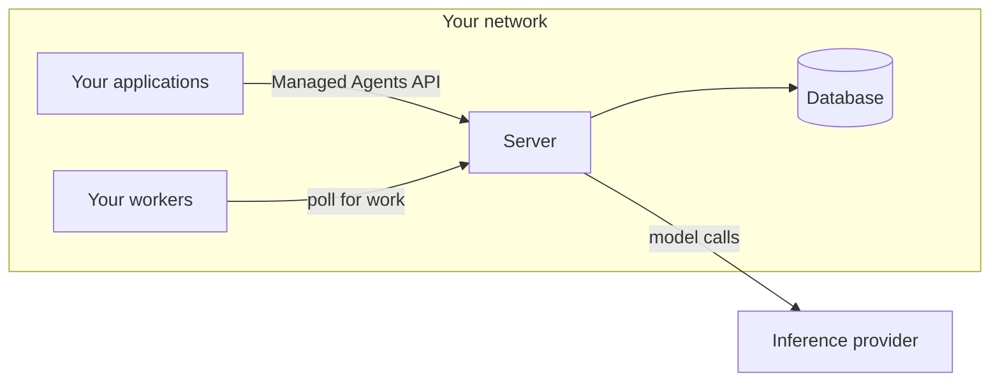

<Note>
  如需申请自托管 Claude Managed Agents 的访问权限，请联系您的 Anthropic 客户团队。如果您所属的 Claude Console 组织已获得访问权限，请[登录 Claude Console](https://platform.claude.com)并切换到该组织。然后重新加载此页面。
</Note>

自托管 Claude Managed Agents 是在您自己的基础设施上运行的 Managed Agents，该基础设施可以是云账户，也可以是本地数据中心。服务和沙箱由您托管。模型在 Anthropic 或您选择的提供商处运行。

Managed Agents 有两个可由您托管的部分：

* **沙箱：** 智能体工具在其中运行命令和处理文件的容器、虚拟机或其他隔离的工作空间。请参阅[自托管沙箱](https://platform.claude.com/docs/zh-CN/managed-agents/self-hosted-sandboxes)。
* **服务：** API、智能体循环，以及智能体、会话和会话历史的存储。

自托管沙箱将第一部分交由您托管。自托管 Managed Agents 扩展了这一点：服务也由您来托管。每个选项的名称说明了您托管的内容：

| 选项 | 沙箱 | 服务 | 模型 |
| ----- | ----- | ----- | ----- |
| 云沙箱（默认） | Anthropic | Anthropic | Anthropic |
| [自托管沙箱](https://platform.claude.com/docs/zh-CN/managed-agents/self-hosted-sandboxes) | 您 | Anthropic | Anthropic |
| 自托管 Managed Agents | 您 | 您 | Anthropic，或您选择的提供商 |

在这些页面中，托管服务是指由 Anthropic 运行的服务，而您的服务器是指由您运行的服务，它拥有自己的数据库。两者具有相同的 API，因此 SDK 和 `ant` CLI 均可与您的服务器配合使用，其余的 Managed Agents 文档同样适用。[与托管服务之间的差异](https://platform.claude.com/docs/zh-CN/managed-agents/self-hosted/differences)列出了例外情况。

<Note title="初次接触 Claude Managed Agents？">
  Claude Managed Agents 将 Claude 作为自主智能体运行：您定义一个智能体、启动一个会话，并在智能体工作时与其交换事件。[核心概念](https://platform.claude.com/docs/zh-CN/managed-agents/overview#core-concepts)介绍了智能体、环境、会话和事件。您无需先使用托管服务。
</Note>

## 何时选择自托管 Managed Agents

当您需要以下任一项时，请选择自托管 Managed Agents：

* **在您的基础设施上存储：** 您必须自行存储智能体、会话和会话历史。
* **自选推理提供商：** 模型调用必须发送到 Amazon Bedrock、Claude Models on Google Cloud (Google managed)、Microsoft Foundry 或您自己的模型网关。请参阅[推理提供商](https://platform.claude.com/docs/zh-CN/managed-agents/self-hosted/inference-provider)。

如果您只需要在自己的基础设施上运行工具，请使用自托管沙箱，此时服务由 Anthropic 运行。请参阅[选择智能体环境](https://platform.claude.com/docs/zh-CN/managed-agents/choosing-an-environment)。

使用自托管 Managed Agents 时，您需要运行并保护服务器、其数据库以及您的沙箱，并且每个发布版本都需要您自行安装。某些功能仅存在于托管服务中，因此请在做出决定之前查看[与托管服务之间的差异](https://platform.claude.com/docs/zh-CN/managed-agents/self-hosted/differences)。

## 各组件在何处运行

一个或多个服务器、其数据库以及您的沙箱构成一个部署。

* **服务器（`cma-server`）：** 提供 API、运行智能体循环，并存储智能体、会话以及每个会话的历史。每当智能体需要模型时，它都会调用您的推理提供商。服务器从不运行智能体的 shell 或文件工具。
* **数据库：** PostgreSQL 16 或更高版本。如果没有数据库，服务器会将数据保存在内存中，重启会将其清除。
* **worker：** 从服务器获取工作，并在您的沙箱中运行智能体的 shell 和文件工具的程序。worker 是一个 `ant beta:worker` 命令或一个 SDK worker。
* **您的应用程序：** 您自己的代码和脚本，它们通过 SDK 或 `ant` CLI 访问服务器。
* **您服务器上的控制台：** 位于服务器地址的一个网页，用户通过您的身份提供商登录，以创建智能体并运行会话。请参阅[在您的服务器上使用控制台](https://platform.claude.com/docs/zh-CN/managed-agents/self-hosted/console)。
* **管理 CLI（`cma-server-admin`）：** 创建环境及其环境密钥。它可在 Linux（x86-64 和 Arm）以及搭载 Apple 芯片的 macOS 上运行。

## 您的安全职责

<Warning>
  智能体的 `bash` 工具是一个真实的 shell，具有 worker 进程的权限和网络访问能力。worker 不会隔离该 shell。隔离取决于 worker 运行所在的环境。Docker Compose 栈和 `cma-sandboxes` Helm chart 会在各自独立的容器或 pod 中启动每个会话的 worker。如果您自行启动 worker，请在一次性的容器或虚拟机中运行它，其中不要存放任何需要保护的内容。
</Warning>

自托管沙箱的[安全模型](https://platform.claude.com/docs/zh-CN/managed-agents/self-hosted-sandboxes-security)适用于此处，但有两点不同。该页面中划归 Anthropic 的职责改由您负责，包括保障服务器安全、托管记忆存储以及检测异常使用。该页面还建议为每个信任边界使用单独的工作区和环境。在这里，每个信任级别都需要各自独立的部署，详见[多租户](https://platform.claude.com/docs/zh-CN/managed-agents/self-hosted-data-and-access#multitenancy)。

## 三种凭据

| 凭据 | 持有者 | 用于验证什么 |
| ----- | ----- | ----- |
| **服务器 API 密钥** | 您的应用程序、`ant` CLI 和管理 CLI | 发往您服务器的请求。安装设置过程会生成此密钥。它的作用相当于 Claude API 密钥在托管服务中的作用。 |
| **推理凭据** | 服务器 | 服务器向您的推理提供商发起的模型调用。例如，它可以是 Claude API 密钥、您的云提供商凭据，或您的模型网关接受的令牌。应用程序和 worker 不需要它。 |
| **环境密钥** | 向服务器轮询的您的 worker | 一个环境的工作队列以及该环境的会话。 |

## 哪些数据会离开您的网络

对于每次模型调用，服务器会将截至目前的对话（包括工具输入和工具结果）发送到您的推理提供商。默认情况下，该推理提供商是 Claude API。对 Claude API 的调用还会携带其会话的 ID，以及该会话的智能体和环境的 ID。[自托管 Claude Managed Agents 中的数据与访问](https://platform.claude.com/docs/zh-CN/managed-agents/self-hosted-data-and-access)列出了服务器建立的每个连接。它还说明了日志的去向以及谁可以访问服务器。

## 从何处开始

如需申请下载权限，请联系您的 Anthropic 客户团队。如果您的组织已获得访问权限，请按照此页面顶部的说明操作。然后按照[开始使用自托管 Claude Managed Agents](https://platform.claude.com/docs/zh-CN/managed-agents/self-hosted/quickstart)启动服务器并运行第一个会话。

每个发布版本的归档文件都包含该版本的运维指南 `operator-guide.md`。请让 Claude 阅读该文件，以便 Claude 能够帮助您配置和运行服务器，并编写连接到服务器的代码。

## 许可证

服务器软件根据[软件许可协议：Claude Managed Agents Server](https://www.anthropic.com/legal/self-hosted-managed-agents-license)授权使用。
